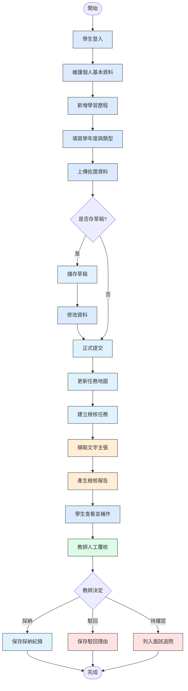
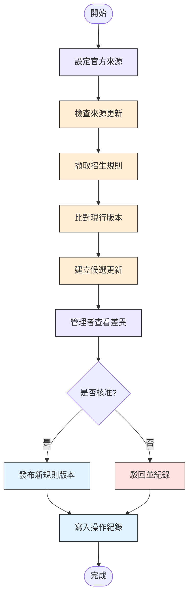
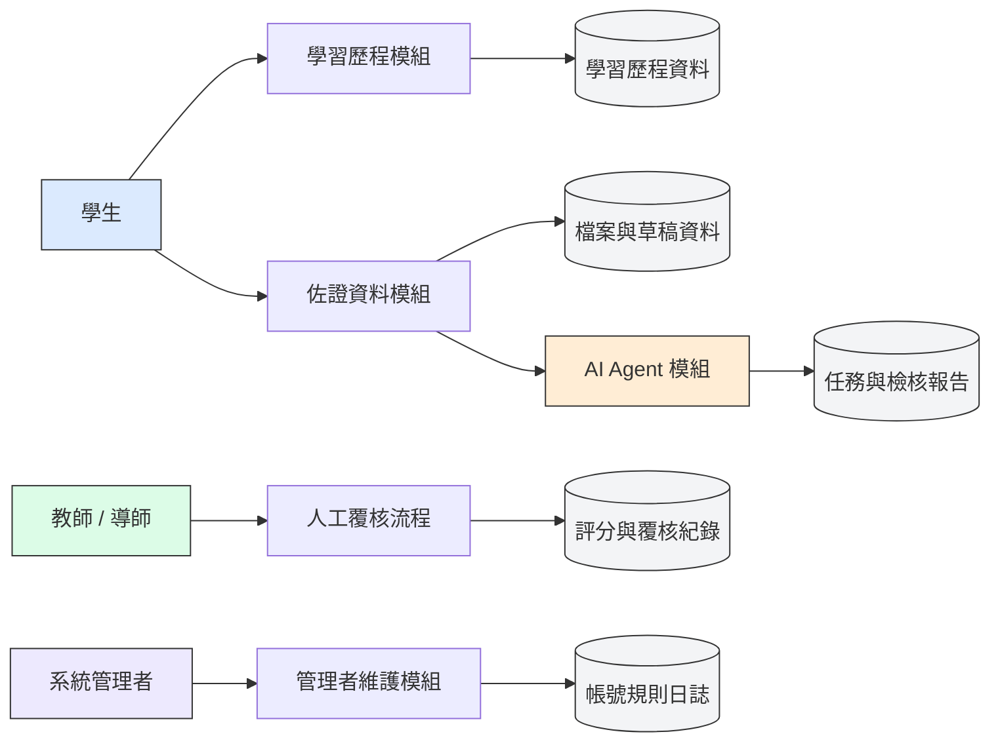
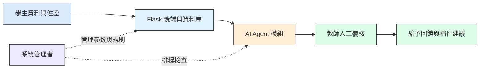

# 資管科智慧學習歷程系統－系統規格設計書（開發閱讀版）

> 來源：Google Docs「資管科智慧學習歷程系統－系統規格設計書（最終版）」
>
> 用途：給 Antigravity IDE、BMAD AI Agent 與開發成員直接閱讀。此版本整理為 Markdown 開發閱讀格式，重點保留需求、流程、架構、資料表與 AI Agent 規範。

## 專案基本資料

- 學校：康寧學校財團法人康寧大學
- 科別：資訊管理科
- 專題名稱：資管科智慧學習歷程系統
- 專題生：111534105 田心于、111534107 張馨羽、111534124 林承諺
- 指導老師：李栢松 老師
- 文件日期：中華民國 116 年 06 月

## 本版閱讀指引：正式規格與期中核心

本文件是本專題的正式系統規格設計書，描述「五專資管科學生從一年級到五年級，整合管理學習、證照、專題、實習、升學／就業成果」的完整產品願景與長期功能。因此，文件中的所有功能不代表在期中審查前都必須完成。

期中開發採取「保留完整願景、先驗收核心價值」的方式，優先實作成果證據與教師回饋流程：學生提交成果並選擇學習目標，系統保存當次目標要求快照，AI 產生初步證據比對，教師逐項覆核並做出正式結論，學生可依意見補件並建立新版本。V1、V2、AI 執行紀錄與教師意見均須保留，不能互相覆蓋。

本正式規格書與期中範圍的逐項對照，請參閱：[期中開發補充](../02_需求與設計/期中開發補充.md)。該文件只作為本階段的開發、展示與交付管理文件，不取代本正式規格書。

## 目錄

1. 緒論
    第一節 開發背景
    第二節 開發動機
    第三節 開發目的
    第四節 專題定位與歷屆差異
2. 開發環境
3. 系統規格書
    第零節 系統設計版本同步原則
    第一節 使用者需求
        一、 學生
        二、 教師／導師
        三、 管理員
    第二節 使用者案例圖
    第三節 使用者流程圖
        一、 系統首頁與使用者登入流程圖
        二、 學習歷程與證據檢核流程
        三、 招生資料更新流程
        四、 二技配分試算流程
    第四節 權限矩陣
4. 需求分析
    第一節 功能性需求
    第一之一節 MVP / Phase 2 / Future 功能切割
    第二節 系統架構圖與 DFD
        一、 DFD 資料流程圖
    第三節 非功能性需求
    第四節 AI Agent 設計與限制
    第五節 需求可行性與驗收原則
    第六節 系統頁面與路由規劃
5. 資料表結構
    第一節 資料庫設計原則
    第二節 ERD 資料庫關聯圖
    第三節 核心資料表
    第四節 資料字典摘要
6. 開發時程
7. 系統展示與功能說明
    第一節 展示情境
    第二節 報告用圖片版總體流程圖
8. 工作分配
9. 參考資料
10. 附錄一：歷屆專題差異比較
11. 附錄二：需求與功能檢核表
12. 附錄三：分年學習歷程任務地圖與資料介接原則
    第一節 分年任務
    第二節 任務完成原則
    第三節 資料介接原則
13. 附錄四：AI Agent 模組與測試資料規範
    第一節 Agent 定位
    第二節 主要任務
    第三節 成績單擷取流程
    第四節 後端模組規劃
    第五節 開發優先順序
14. 附錄五：系統長期使用的重要規則
15. 附錄六：網頁視覺與使用體驗設計原則
16. 附錄七：校務公開資料與專題規則整合

## 一、緒論

### 第一節 開發背景

五專學生在校期間會累積課程作品、專題成果、證照、競賽、實習經歷、成績資料及備審文件。這些資料常分散在個人電腦、雲端硬碟、GitHub、Canva 或紙本文件中，到了準備升學或備審資料時才重新搜尋與整理，容易耗時、漏件或產生文件內容不一致。

教師與導師在輔導或審閱學生資料時，也需要逐一開啟 PDF、作品連結、GitHub 儲存庫及證明文件，確認學生自傳中敘述的能力是否有證據支持。當資料格式不一致、連結失效或缺少佐證時，審閱工作會變得繁瑣。

因此，本專題規劃建置「資管科智慧學習歷程系統」，以「目標校系導航、關卡式養成、AI 備審小助手」作為主要特色，協助學生依照升學、實習或就業目標整理資料。

本系統中的 AI 不取代教師、評審或管理人員做最終判斷，而是協助完成重複、耗時的初步查找與整理工作，並保留資料來源、分析理由及人工確認機制。

### 第二節 開發動機

歷屆相關專題已完成備審素材管理、二技校系資訊、志願序、履歷製作、成績單辨識、修業科目表、畢業資格檢核、招生問答與實習媒合等功能。若本專題只做檔案上傳、校系查詢、AI 問答或履歷文字潤飾，會與歷屆內容過度相似。

本專題將 AI 定位為「AI 備審小助手」：學生先選擇目標校系或職涯方向，系統將需要準備的資料拆成任務，AI 協助整理已完成、缺少與建議補強項目，最後仍由學生與老師確認。

### 第三節 開發目的

1. 建立資管科學生學習歷程的結構化管理機制。
2. 提供學生管理基本資料、學習成果、備審 PDF、GitHub、Canva、證照、競賽、實習及佐證資料的功能。
3. 建立 AI 備審小助手，依目標校系或職涯方向整理已完成、未完成及建議補強資料。
4. 建立關卡式養成功能，將備審或履歷所需資料轉成任務卡。
5. 協助教師快速掌握學生學習歷程、作品、證照、專題成果與缺少項目。
6. 建立目標校系與職涯需求資料，由管理者整理並輸入系統。
7. 提供目標校系與職涯方向比較功能，但不預測錄取結果。
8. 符合資訊軟體開發組要求：關聯式資料庫、正規化、至少六張資料表、至少兩種非訪客角色、CRUD、統計、輸入防呆、檔案上傳、角色權限、系統架構、ERD、資料字典與需求檢核。

### 第四節 專題定位與歷屆差異

本系統不是單純備審檔案平台，也不是只會回答問題的聊天機器人。核心價值是：

- 目標校系導航
- 關卡式養成
- AI 備審小助手

歷屆專題主要著重資料保存、文件製作、志願填寫、修業科目管理、履歷潤飾或招生問答；本系統則把學生目標、學習成果、關卡進度與 AI 建議串在一起。

## 二、開發環境

- 作業系統：Windows 11
- 編輯工具：Antigravity IDE / Visual Studio Code
- 前端技術：HTML5、CSS3、JavaScript、Bootstrap 5
- 後端技術：Python 3.x、Flask
- 資料庫：MySQL 8.0
- AI 服務：Google Gemini API
- 第三方資料：GitHub REST API
- 文件處理：PDF 文字擷取套件，必要時搭配 OCR
- 視覺化：Chart.js
- 版本控制：Git、GitHub
- 開發資料：使用測試帳號與模擬資料，不直接串接學校正式資料庫

## 三、系統規格書

### 第零節 系統設計版本同步原則

本文件已依最新 Google Docs 內容與系統設計補強討論同步更新。後續開發時，若角色、流程、資料表、API 或 UI 畫面有新增或刪除，必須同步檢查下列位置：

1. 使用者案例與角色流程圖。
2. ERD 與資料字典。
3. `Users.role` 允許值與權限矩陣。
4. Flask 路由、API Specification 與測試案例。
5. UI Wireframe、首頁視覺方向與各角色工作頁。
6. `docs/02_需求與設計/system-design-action-plan.md` 與 `docs/04_圖表與介面/diagrams.md`。

目前系統角色統一為學生、教師/導師、科辦/行政、系統管理者與 AI Agent。專題審查的評審委員會由教師共同討論，不另建立 `reviewer` 登入角色；共同結論由科主任或科助登錄。AI Agent 屬於後端輔助模組，不是登入角色，也不得取代任何人工審核權限。

### 第一節 使用者需求

#### 學生

1. 管理個人基本資料。
2. 建立、查詢、修改與刪除個人學習歷程。
3. 依學年度、學期、課程及成果類型分類作品。
4. 上傳備審 PDF、證照、競賽、實習及其他證明文件。
5. 新增 GitHub、Canva 或其他作品連結。
6. 儲存草稿並於確認後正式提交。
7. 申請 AI Agent 進行備審一致性與證據完整性檢核。
8. 查看每項主張的證據、資料不足、內容不一致及待確認提示。
9. 依提示補充資料或修改文字後重新檢核。
10. 輸入二技配分試算所需成績與經歷，查看校系比較結果。
11. 查看教師回饋及補件建議。
12. 轉學生可查看校方抵免系統入口，並在本系統紀錄抵免申請狀態、需補交資料與教師確認結果。
13. 查看畢業門檻、證照、專題、重補修或補件提醒，作為學習歷程整理依據。

#### 教師／導師

1. 查看被授權或被分派學生的學習歷程及備審資料。
2. 查看 Agent 產生的學生摘要、主張—證據矩陣及資料缺漏。
3. 點擊回到原始文件、作品或來源。
4. 採納、駁回或標記 Agent 提示為待確認。
5. 留下備審修改、補件及面試準備建議。
6. 取得依缺件或風險狀態整理的優先查看名單。
7. 查看學生資料完成度與整體統計。
8. 針對所指導小組查看共用專題成果、個人分工、共同審查結論與補正證據；教師可提供輔導意見，但不在系統內建立個別評審分數。

#### 科辦／行政

1. 建立審查專案或學年度作業批次。
2. 協助分派教師或導師查看學生資料。
3. 登錄評審委員會共同討論後的每組結論、補正項目與結果彙整；不代替委員會個別給分。
4. 查看各班級或各作業批次的提交狀態。
5. 匯出基本統計與審查結果供行政作業使用。

#### 管理員

1. 新增、查詢、修改及停用帳號。
2. 維護課程、學年度、成果類型及權限。
3. 維護 Agent 允許使用的官方資料來源。
4. 維護學生測試帳號規則、畢業門檻、抵免入口、二技備審資料類型與校方公開來源連結。
5. 查看抵免申請狀態、重補修提醒、畢業門檻檢核與二技備審資料準備狀態。

#### 轉學生需求補充

轉學生進入系統後，應能先看到「轉學生抵免申請輔助」入口。第一版不直接串接校方正式抵免系統，也不讀取正式校務資料；系統僅提供康寧大學抵免系統連結與人工紀錄欄位，協助學生與教師掌握是否已完成申請、是否需補交資料、申請日期與教師確認狀態。

校方抵免系統入口：<https://ec.ukn.edu.tw/CT_web/login.aspx>

本系統應清楚標示：抵免結果仍以學校正式系統與教務單位審核為準，學習歷程系統僅做提醒、整理與佐證資料管理。
4. 啟動或排程招生資料檢查。
5. 查看 Agent 擷取結果、新舊差異與來源。
6. 核准或駁回候選更新，未經核准不得發布。
7. 維護招生年度、學校、科系、採計項目、權重及加分規則。
8. 查看系統操作、資料更新與人工覆核紀錄。
9. 查看及匯出統計報表。

### 第二節 使用者案例圖

- UC-01 使用者登入：系統驗證帳號及密碼，依角色顯示授權功能。
- UC-02 學生建立歷程：學生新增作品名稱、課程、期間、成果說明及附件。
- UC-03 學生提交備審：學生確認資料後正式提交，系統保留提交時間與版本。
- UC-04 啟動一致性檢核：學生或授權教師啟動 Agent，系統建立任務並記錄狀態。
- UC-05 建立主張—證據矩陣：Agent 拆解備審主張並尋找相符證據。
- UC-06 人工覆核：教師查看提示與來源，選擇採納、駁回或待確認。
- UC-07 招生資料監測：管理員啟動 Agent 檢查指定官方來源。
- UC-08 候選規則審核：管理員比較新舊內容，核准後建立新年度或新版本規則。
- UC-09 配分試算：學生選擇年度與校系，系統依已核准規則計算。
- UC-10 統計與匯出：授權使用者查看完成度、缺件、Agent 任務與招生資料更新統計。
- UC-11 批次分派與通知：科辦或管理員建立作業批次，分派教師並發送補件通知；專題共同審查結論由科主任或科助登錄。

### 第三節 使用者流程圖

#### 1. 系統首頁與使用者登入流程圖

#### 2. 學習歷程與證據檢核流程

#### 3. 招生資料更新流程

#### 4. 二技配分試算流程

學生輸入成績及經歷 → 選擇招生年度與校系 → 系統讀取已核准配分規則 → 計算原始分數、權重與加分 → 顯示計算過程及資料來源 → 比較多個校系 → 匯出參考結果

### 第四節 權限矩陣

| 角色 | 權限 |
| --- | --- |
| 學生 (`student`) | 管理本人歷程、附件、試算資料及查看本人報告 |
| 教師／導師 (`teacher`) | 查看被授權或被分派學生資料，提供輔導、留言、補件與完成度建議；共同審查時參與討論 |
| 科辦／行政 (`staff`) | 依行政授權登錄共同審查結論、整理補正項目與結果彙整，不建立個別評審分數 |
| 管理員 (`admin`) | 管理系統資料、帳號權限、招生規則、AI 任務、日誌與報表 |
| AI Agent | 依任務授權讀取必要資料，不能刪除、給分、退件或發布正式規則 |

### 管理員角色與開發者維護界線

本系統只保留一種管理員角色：`admin`。管理員可批次建立與停用假帳號、管理班級與入學年度、維護專題類型與成果要求模板、管理公開資料來源、查看 AI 任務與操作日誌，以及修改系統允許設定的文字與展示內容。

本系統不另設 `Administrator` 或「系統維護管理員」使用者。程式碼、套件、資料庫結構、環境變數、部署設定與作業系統維護，必須由開發者透過 IDE、Git、伺服器或本機部署環境處理，不開放網站執行任意程式碼或修改作業系統。

為支援老師現場查詢，後續可建立「開發者診斷／功能檢視器」，輸入系統路徑後顯示功能編號、Endpoint、模板、服務、資料表、角色與外部連接。此功能只讀取預先登錄的路由與功能對照，不直接顯示原始碼，也不允許透過網址修改程式。

```mermaid
flowchart TD
    classDef student fill:#DBEAFE,stroke:#333;
    classDef teacher fill:#DCFCE7,stroke:#333;
    classDef admin fill:#EDE9FE,stroke:#333;
    classDef staff fill:#FCE7F3,stroke:#333;
    classDef ai fill:#FFEDD5,stroke:#333;
    classDef alert fill:#FEE2E2,stroke:#333;

    Student[學生]:::student --> S1[管理本人資料]:::student
    Student --> S2[管理本人歷程與附件]:::student
    Student --> S3[查看本人 AI 報告]:::student
    Teacher[教師 / 導師]:::teacher --> T1[查看被分派學生]:::teacher
    Teacher --> T2[人工覆核 AI 建議]:::teacher
    Teacher --> T3[評分與留言回饋]:::teacher
    Staff[科辦 / 行政]:::staff --> F1[建立審查批次]:::staff
    Staff --> F2[分派教師與登錄共同結論]:::staff
    Staff --> F3[發送補件與批次通知]:::staff
    Admin[系統管理者]:::admin --> A1[帳號與角色管理]:::admin
    Admin --> A2[系統參數與開關]:::admin
    Admin --> A3[日誌與 AI 任務監控]:::admin
    Admin --> A4[招生規則發布審核]:::admin
    Agent[AI Agent]:::ai --> G1[讀取授權數據]:::ai
    Agent --> G2[產生草稿與檢核建議]:::ai
    Agent -.不得直接寫入正式資料.-> Block[必須經人工確認]:::alert
```

## 四、需求分析

### 第一節 功能性需求

- F-01 登入與登出
- F-02 帳號管理
- F-03 學生基本資料管理
- F-04 學習歷程 CRUD
- F-05 作品分類
- F-06 檔案上傳
- F-07 作品連結
- F-08 草稿與提交
- F-09 Agent 任務管理
- F-10 備審主張拆解
- F-11 證據擷取
- F-12 一致性檢核
- F-13 檢核狀態
- F-14 人工覆核
- F-15 補件與修改建議
- F-16 面試提問建議
- F-17 官方來源管理
- F-18 招生規則擷取
- F-19 新舊版本比較
- F-20 候選更新審核
- F-21 招生規則版本管理
- F-22 二技配分試算
- F-23 校系比較
- F-24 試算限制提示
- F-25 教師工作台
- F-26 統計 Dashboard
- F-27 報表匯出
- F-28 操作紀錄
- F-29 學生帳號假資料規則
- F-30 轉學生抵免申請輔助
- F-31 畢業門檻與證照檢核提醒
- F-32 二技備審資料包與加權提醒
- F-33 重補修與補件提醒
- F-34 專題評量對照與佐證整理

#### 帳號假資料規則

展示與開發階段不得使用真實身分證字號作為密碼。學生測試帳號可採用學號格式，密碼使用假資料或預設測試密碼，並在文件與系統畫面中註明「僅為測試資料」。

學號格式說明：

| 位置 | 範例 | 說明 |
| --- | --- | --- |
| 前三碼 | 111 | 入學年度 |
| 第四碼 | 5 | 五專部 |
| 第五至六碼 | 34 | 資訊管理科編號 |
| 第七碼 | 1 | 班級 |
| 第八至九碼 | 05 | 座號 |

範例帳號：`111534105`。範例密碼不得使用真實小寫身分證字號，建議開發階段使用 `test@111534105`、`student105` 或由系統產生一次性假密碼。

#### 校務與升學規則整合需求

| 功能 | 第一版做法 | 不做或未來擴充 |
| --- | --- | --- |
| 轉學生抵免 | 提供校方抵免系統連結，紀錄申請狀態、日期、備註與教師確認 | 不直接登入或讀取校方抵免系統 |
| 畢業門檻 | 依資管科畢業門檻 PDF 建立證照與補救措施提醒 | 不自動判定正式畢業資格 |
| 二技備審 | 依備審資料類型、加權與時程建立資料包提醒 | 不保證升學結果，不預測錄取 |
| 重補修 | 記錄學生需補修或補件狀態，提醒查核課程與學分 | 不取代教務選課與學分審核 |
| 專題評量 | 依專題學習目標與評量對照表整理佐證資料 | 不自動給專題成績 |

### 第一之一節 MVP / Phase 2 / Future 功能切割

為避免開發範圍過大，系統功能依完成優先度切分如下：

| 階段 | 必做功能 | 說明 |
| --- | --- | --- |
| MVP | 登入與角色權限 | 至少支援學生、教師/導師、科辦/行政、管理員的基本導頁與授權 |
| MVP | 學生學習歷程 CRUD | 學生可新增、查詢、修改、刪除與提交歷程 |
| MVP | 檔案與外部連結佐證 | 支援 PDF、圖片或外部連結欄位，包含 GitHub / Canva |
| MVP | 教師查看與回饋 | 教師可查看被分派學生、留下輔導回饋；專題共同結果由科辦／行政登錄 |
| MVP | 歷程狀態管理 | 支援草稿、提交、退回、通過、鎖定等狀態 |
| MVP | 管理者基本維護 | 帳號、角色、基本統計與結果查看 |
| MVP | 學生測試帳號規則 | 使用學號格式建立假帳號，密碼不得使用真實身分證字號 |
| MVP | 轉學生抵免入口 | 顯示校方抵免系統連結，並提供人工狀態紀錄 |
| MVP | 畢業門檻提醒 | 建立證照與補救措施檢核欄位，僅供提醒 |
| Phase 2 | 教師 Dashboard | 依缺件、最近更新、風險狀態整理優先名單 |
| Phase 2 | AI 一致性檢核 | 建立主張—證據矩陣，由教師人工覆核 |
| Phase 2 | GitHub API | 擷取專案摘要、提交紀錄或作品連結資訊 |
| Phase 2 | 分派與批次通知 | 科辦建立批次、分派教師、通知補件與登錄共同結論 |
| Phase 2 | 報表與操作日誌 | 匯出統計，保存重要異動與審核紀錄 |
| Phase 2 | 二技備審資料包 | 依校系加權顯示證照、成績、作品集、自傳與讀書計畫準備重點 |
| Phase 2 | 重補修/補件追蹤 | 提醒學生確認課程、學分、缺件與補救措施 |
| Future | OCR 成績單擷取 | 先產生可編輯草稿，不直接寫入正式資料 |
| Future | 二技落點或配分強化 | 只做規則試算與比較，不預測錄取結果 |
| Future | WebAuthn 或進階登入 | 視導入需求再加入 |
| Future | 更完整 AI 推薦 | 僅做整理與建議，不取代人工判斷 |
| Future | 正式校務介接 | 若校方授權，才可使用 SSO、唯讀 API 或去識別化資料 |

### 第二節 系統架構圖與 DFD

#### DFD 資料流程圖

### 第三節 非功能性需求

- 安全性：密碼雜湊、角色權限、後端驗證、安全檔案名稱。
- 個資保護：送往外部 AI 前遮蔽不必要敏感資訊。
- 可追溯性：Agent 結果保留資料來源、擷取時間、資料版本、分析狀態與人工確認結果。
- 可靠性：AI 輸出需經 JSON Schema 驗證。
- 可用性：主要畫面支援桌機、筆電、平板，錯誤訊息需明確。
- 效能：較久 Agent 任務採背景處理並顯示狀態。
- 可維護性：前端、後端、資料庫與 AI 模組分層。
- 公平性：Agent 不依無關資料評定學生，教師可駁回建議。

### 第四節 AI Agent 設計與限制

Agent 必須能接收任務、選擇允許工具、讀取資料、交叉比對、產生結構化結果、保存紀錄並等待人工確認，不只是聊天機器人。

主要 Agent：

1. 招生規則更新 Agent
2. 備審一致性檢核 Agent
3. 教師摘要 Agent
4. 成績單擷取 Agent
5. 任務地圖建議 Agent

禁止事項：

- 不得自行退件。
- 不得直接給予成績。
- 不得宣稱學生說謊或造假。
- 不得在沒有資料集時宣稱預測錄取率。
- 不得未經人工確認發布招生規則。

### 第五節 需求可行性與驗收原則

第一版測試範圍應控制為三至五所主要二技學校，每校一至三個相關科系，保存至少兩個招生年度或規則版本，使用三至五份匿名測試備審資料。

核心驗收：

1. 是否完成指定任務完整流程。
2. 是否產生符合 Schema 的結構化資料。
3. 是否保存可開啟的原始來源。
4. 是否能辨識測試資料中的已知缺件或矛盾。
5. 管理員是否能核准或駁回候選更新。
6. 教師是否能採納或駁回 AI 提示。
7. AI 失敗時是否能顯示錯誤並保留人工處理方式。

### 第六節 系統頁面與路由規劃

#### 一、頁面規劃原則

本系統不為學生、教師／導師及管理員各做一個獨立登入頁，而是使用一個共用登入頁。登入成功後，後端依帳號角色導向不同工作區，並在每個 API 再次檢查權限。這樣可以避免登入邏輯重複，也能清楚展示 RBAC 角色權限設計。

頁面分成三個層次：

1. 公開區：任何人可查看的系統首頁、系統特色、使用說明與登入入口。
2. 角色工作區：登入後依學生、教師／導師、科辦／行政與管理員顯示不同選單與資料。
3. 維護與報表區：管理員維護帳號、規則、關卡、來源、操作日誌與統計資料。

視覺與互動另外分為兩層：公開首頁、學生首頁與五年歷程屬於 `Experience Layer`，允許文字豐富、受控不對稱、拼圖／節點／路徑與較強動畫；教師、科辦／行政、審查與維護頁屬於 `Work Layer`，以搜尋、篩選、表格、狀態、批次操作與低程度回饋動畫為主。完整色彩、文案、動畫時序與響應式規格集中於 `docs/UI_UX_設計與動畫規格_2026-09-21.md`。

#### 二、一個月版必做頁面（12 個）

| 編號 | 頁面名稱 | 建議路由 | 使用者 | 主要功能 | 報告展示重點 |
| --- | --- | --- | --- | --- | --- |
| P01 | 公開首頁 | `/` | 訪客 | 顯示「五年，會留下很多東西」主題、系統特色、五年路線與登入按鈕 | 展示散落資料如何整理成學習歷程 |
| P02 | 共用登入頁 | `/login` | 全部角色 | 輸入測試帳號密碼、顯示錯誤、依角色導頁 | 說明一個登入入口、多角色權限 |
| P03 | 學生首頁／儀表板 | `/student/dashboard` | 學生 | 顯示年級、五年路線、完成數、缺件數、下一步 | 展示學生看到自己的進度 |
| P04 | 學習成果列表 | `/student/portfolio` | 學生 | 查詢成果、依類型篩選、查看草稿與已提交狀態 | 展示作品集中管理 |
| P05 | 成果新增／編輯 | `/student/portfolio/new`、`/student/portfolio/:id/edit` | 學生 | 填寫標題、類型、說明、技術、檔案或 GitHub／Canva 連結 | 現場新增一筆假作品 |
| P06 | 目標與需求頁 | `/student/goals` | 學生 | 選擇二技升學、實習或就業目標，顯示對應需求 | 展示目標會影響後續任務 |
| P07 | 關卡與進度頁 | `/student/milestones` | 學生 | 顯示 6 個共通關卡、未開始／進行中／已完成狀態 | 展示「關卡式養成」特色 |
| P08 | AI 小助手建議頁 | `/student/ai-advice` | 學生 | 顯示已完成、還缺什麼、下一步三件事；資料不足時明確提示 | 展示 AI 輔助但不取代人工判斷 |
| P09 | 教師工作台 | `/teacher/dashboard` | 教師／導師 | 查看學生清單、完成度、缺件與最近更新 | 展示教師快速掌握學生狀態 |
| P10 | 學生詳情與回饋 | `/teacher/students/:id` | 教師／導師 | 查看學生歷程、證據、AI 摘要與輔導留言 | 現場切換教師帳號留言 |
| P11 | 管理員首頁 | `/admin/dashboard` | 管理員 | 顯示帳號數、成果數、待審資料、系統任務與錯誤提示 | 展示系統管理與維護能力 |
| P12 | 管理員資料維護 | `/admin/maintenance` | 管理員 | 維護帳號、目標、需求、關卡、來源與展示假資料 | 現場新增或修改一項需求 |

一個月版的實作重點是「頁面少而流程完整」。P03、P05、P07、P09、P10、P12 是建議一定要能操作的頁面；P01、P02、P08 是報告展示時的招牌畫面。若時間不足，P04 可與 P05 合併成同一頁的列表加表單，P11 可先使用簡化統計卡片。

#### 三、最終版擴充頁面（再增加 10 個）

| 編號 | 頁面名稱 | 建議路由 | 使用者 | 主要功能 |
| --- | --- | --- | --- | --- |
| P13 | 個人資料與密碼設定 | `/profile` | 全部角色 | 修改顯示名稱、測試密碼與通知偏好，不顯示真實身分證字號 |
| P14 | 畢業門檻檢核 | `/student/graduation-check` | 學生、教師 | 檢查證照、課程、專題、補件與補救措施提醒 |
| P15 | 轉學生抵免紀錄 | `/student/transfer-credit` | 學生、教師 | 開啟校方抵免系統連結，記錄申請狀態、備註與人工確認結果 |
| P16 | 二技備審資料包 | `/student/admission-package` | 學生、教師 | 整理成績單、自傳、讀書計畫、證照、競賽與專題佐證 |
| P17 | 二技配分試算 | `/student/admission-score` | 學生、教師 | 依已輸入規則試算項目與分數，標示資料來源與限制 |
| P18 | 教師學生清單與分派 | `/teacher/students` | 教師、科辦 | 搜尋、篩選、分派學生與批次通知補件 |
| P19 | 管理員帳號與角色 | `/admin/users` | 管理員 | 建立假帳號、停用帳號、設定角色與重設測試密碼 |
| P20 | 規則與來源版本管理 | `/admin/rules` | 管理員 | 管理招生規則、畢業門檻、重補修與資料來源版本 |
| P21 | AI 任務與操作日誌 | `/admin/agent-tasks`、`/admin/logs` | 管理員 | 查看任務狀態、失敗原因、人工核准紀錄與重要異動 |
| P22 | 統計報表與匯出 | `/admin/statistics` | 管理員、教師 | 顯示完成度、缺件、審核與使用統計，匯出報告資料 |

#### 四、角色與頁面可見範圍

| 角色 | 登入後首頁 | 可操作範圍 | 不可操作範圍 |
| --- | --- | --- | --- |
| 學生 | `/student/dashboard` | 自己的成果、目標、關卡、AI 建議、抵免狀態與畢業提醒 | 其他學生資料、系統規則、角色權限、操作日誌 |
| 教師／導師 | `/teacher/dashboard` | 被分派學生的成果查看、輔導留言、覆核與統計 | 修改系統帳號權限、發布招生規則、查看未授權學生 |
| 科辦／行政 | `/teacher/dashboard` 或 `/admin/dashboard` | 依授權範圍查看學生、登錄共同結論與補件追蹤 | 修改核心系統設定與管理員權限 |
| 管理員 | `/admin/dashboard` | 帳號、角色、目標、需求、關卡、來源、日誌與統計維護 | 不直接替學生撰寫成果或代替教師做評量結論 |

#### 五、前後端模組對應

前端路由應依角色分區，後端 API 也要依功能模組拆分，避免只有畫面分開但後端沒有權限保護：

| 前端區域 | 後端模組 | 代表 API |
| --- | --- | --- |
| 共用登入 | `auth` | `POST /api/auth/login`、`POST /api/auth/logout` |
| 學生端 | `student`、`portfolio`、`goals`、`milestones` | `GET /api/student/me`、`GET /api/portfolios`、`POST /api/portfolios` |
| 教師端 | `teacher`、`review` | `GET /api/teacher/students`、`POST /api/teacher/feedback` |
| 管理員端 | `admin`、`rules`、`logs` | `GET /api/admin/users`、`PUT /api/admin/rules/:id`、`GET /api/admin/logs` |
| AI 小助手 | `agent` | `POST /api/agent/advice`、`GET /api/agent/tasks/:id` |
| 報表與匯出 | `reports` | `GET /api/reports/progress`、`GET /api/reports/export` |

#### 六、現場報告建議操作順序

報告時不需要逐一展示全部 22 個頁面，建議使用 7 個畫面完成一條可理解的故事線：

1. 公開首頁：說明五年資料整理與下一站概念。
2. 共用登入頁：使用假學生帳號登入，說明角色導頁。
3. 學生首頁：查看路線、完成度與缺件。
4. 成果新增頁：新增一筆假專題或證照成果並附上連結。
5. 關卡／AI 建議頁：顯示缺件與下一步三件事。
6. 教師工作台與學生詳情：查看成果並留言或退回補件。
7. 管理員維護頁：修改一項需求或關卡，回到學生頁確認畫面同步變化。

這套頁面規劃可直接轉成 BMAD 的 UX、架構、前端與測試任務；開發日誌則以 P 編號記錄「完成頁面、使用者角色、API、測試結果與待修問題」。

## 五、資料表結構

### 第一節 資料庫設計原則

資料庫採 MySQL 8.0 關聯式資料庫，至少完成第一、第二及第三正規化。基本資料集中管理，其他資料表以主鍵與外來鍵關聯。重要狀態使用明確列舉值或參照表，避免同一狀態有多種寫法。

### 第二節 ERD 資料庫關聯圖

### 第三節 核心資料表

1. Users
2. Student_Profiles
3. Portfolios
4. Portfolio_Evidence
5. Portfolio_Claims
6. Agent_Tasks
7. AI_Audit_Reports
8. Claim_Evidence_Links
9. Official_Sources
10. Admission_Rule_Versions
11. Admission_Rule_Items
12. Simulation_Results
13. Human_Reviews
14. Teacher_Feedback
15. Audit_Logs
16. Project_Groups
17. Project_Members
18. Project_Stage_Submissions
19. Project_Review_Results
20. Project_Revision_Records

### 第四節 資料字典摘要

| 資料表 | 主要用途 |
| --- | --- |
| Users | 使用者帳號、角色與狀態 |
| Student_Profiles | 學生基本資料與升學試算必要資料 |
| Portfolios | 學習歷程主檔 |
| Portfolio_Evidence | 附件、作品連結與證據資料 |
| Portfolio_Claims | 從備審拆解出的可驗證主張 |
| Agent_Tasks | Agent 任務、進度與錯誤紀錄 |
| AI_Audit_Reports | 一致性檢核報告 |
| Claim_Evidence_Links | 主張與證據關聯 |
| Official_Sources | 官方招生資料來源 |
| Admission_Rule_Versions | 招生規則年度與版本 |
| Admission_Rule_Items | 採計項目、權重與加分條件 |
| Simulation_Results | 配分試算結果 |
| Human_Reviews | 教師或管理員人工覆核 |
| Teacher_Feedback | 教師補件、備審與面試建議 |
| Audit_Logs | 重要操作與資料異動紀錄 |
| Project_Groups | 專五小組共用專題成果主檔、類別、年度與指導老師 |
| Project_Members | 小組成員、個人分工與貢獻紀錄 |
| Project_Stage_Submissions | 期中審查、複評等階段成果與佐證 |
| Project_Review_Results | 教師共同討論後，由科辦／行政登錄的一筆共同結果與評語 |
| Project_Revision_Records | 補正項目、處置、完成證據與確認狀態 |

`Users.role` 建議允許值如下：

| role 值 | 對應角色 | 說明 |
| --- | --- | --- |
| `student` | 學生 | 預設學生帳號 |
| `teacher` | 教師／導師 | 輔導、查看與回饋學生資料；參與專題共同審查討論 |
| `staff` | 科辦／行政 | 批次、通知、共同結論登錄與結果彙整 |
| `admin` | 系統管理者 | 系統設定、帳號權限與日誌 |

目前程式已移除 `reviewer` 導頁與正式登入角色；由 `teacher` 參與共同審查討論，並由 `staff` 登錄共同結論，避免規格與程式角色不一致。

## 六、開發時程

1. 需求與設計：使用者訪談、歷屆比較、Use Case、權限矩陣、架構、ERD、資料字典。
2. 基礎系統 MVP：登入、角色權限、學生歷程 CRUD、檔案與連結、教師查看、管理員維護。
3. Agent 最小可行版本：任務狀態、PDF 文字擷取、主張拆解、GitHub 摘要、主張—證據矩陣。
4. 招生更新與配分試算：官方來源、規則版本、候選更新、人工核准、公式與比較。
5. 統計、測試與文件：權限、防呆、檔案安全、Agent 測試、錯誤處理、簡報與展示腳本。

## 七、系統展示與功能說明

### 第一節 展示情境

1. 學生建立課程專題歷程，上傳 PDF 並綁定 GitHub。
2. 學生提交備審文字並啟動一致性檢核。
3. Agent 拆解「負責 Flask 後端開發」等主張並找出證據。
4. 系統顯示證據支持、部分支持、資料不足、內容不一致與待人工確認。
5. 教師查看摘要、點回證據、採納或駁回提示。
6. 管理員啟動招生來源檢查，查看新舊規則差異。
7. 學生選擇校系，查看配分試算與來源。
8. 管理員查看歷程完成度、缺件、Agent 任務與規則更新統計。

### 第二節 報告用圖片版總體流程圖

## 八、工作分配

在專題報告書與評分規範中，團隊成員的分工權責如下：

- **111534105 田心于（專題隊長 / 系統分析 / 前端與文件）**：
  - 需求整理、歷屆專題差異比較分析。
  - 學生端前端介面開發、學習歷程分類與檔案上傳介面。
  - 專題系統規格設計書彙整、開發日誌維護與展示報告撰寫。
- **111534107 張馨羽（後端開發 / 資料庫工程師）**：
  - MySQL 資料庫正規化設計、ERD 圖建立與數據表建置。
  - Flask 後端 RESTful API 設計與路由開發。
  - 角色權限控制 (RBAC)、登入驗證、招生規則版本管理與配分計算模組。
- **111534124 林承諺（AI Agent 模組 / 系統測試工程師）**：
  - AI Agent 模組封裝 (Gemini API / JSON Schema 結構化輸出)。
  - GitHub REST API 介接與 PDF/OCR 文字擷取處理。
  - 備審主張—證據矩陣邏輯、單元測試 (pytest) 與系統整合測試。
- **全體組員共同負責**：
  - 系統架構討論、前後端整合除錯、Agent 驗收、使用者測試、簡報製作與上台展示。

> **獨立開發補充說明**：目前由田心于同學進行系統全端實作與測試，開發過程結合 Antigravity IDE 與 BMAD AI Agent（Mary, Winston, Paige, Amelia 等）進行協同開發與日誌自動維護。

## 九、參考資料

- 康寧大學資訊管理科資訊軟體開發組專題規定
- 康寧大學資訊管理科近五年畢業專題成果報告
- Google Gemini API 官方文件
- GitHub REST API 官方文件
- Flask 官方文件
- MySQL 8.0 Reference Manual
- Bootstrap 5 官方文件
- Chart.js 官方文件
- 二技招生及技優甄審各校官方招生簡章與公開資料
- 康寧大學台北校區公開資訊：五專資訊管理科隸屬商業資訊學院，台北校區地址為臺北市內湖區康寧路三段75巷137號。
- 康寧大學資訊管理科入學專區：資管科成立於民國87年，招收國中畢業生，五專入學管道包含五專完全免試、五專優先免試與五專聯合免試。
- 康寧大學課程地圖：五專部列有資訊管理科課程地圖連結。
- 康寧大學招生中心五專與五專轉學考公開公告。
- 康寧大學抵免系統入口：<https://ec.ukn.edu.tw/CT_web/login.aspx>
- 113-康寧資管科畢業門檻 PDF。
- 116二技技優甄審_時程與備審加權_修訂版 PDF。
- 重補修選課原則簡報 PDF。
- 專題審查學習目標與評量對照表 PDF。

## 附錄一、歷屆專題差異比較

- 114 年「升學競賽全方位資源網」：備審素材分類、備審匯出、二技校系資訊、志願序及教師查看。
- 113 年「修業科目表管理系統」：修業科目表、替代課程、版本差異及畢業資格審查。
- 115 年「招生平台」：RAG 招生智能助手、招生資料管理、線上評分與來源連結。
- 115 年「智慧實習平台」：AI 履歷潤飾、成績單辨識、履歷審查及實習媒合。
- 114 年「軟丙軟乙學習平台」：術科自動批改、學習紀錄與教師統計。

本系統差異集中在三個 Agent 閉環：

1. 招生規則自動擷取、版本差異、候選更新與人工發布。
2. 備審主張拆解、跨來源證據比對與可追溯檢核矩陣。
3. 教師摘要、原始證據回查、人工採納或駁回及後續建議。

## 附錄二、需求與功能檢核表

| 需求 | 對應功能 | 驗收 |
| --- | --- | --- |
| R-01 學生作品容易散落 | F-04 至 F-08 | 學生能分類、保存、查詢並提交完整歷程 |
| R-02 教師需人工核對備審及作品 | F-09 至 F-16 | Agent 產生可追溯主張—證據矩陣，教師可人工覆核 |
| R-03 招生資料每年人工更新 | F-17 至 F-21 | Agent 建立候選更新，未核准資料不得發布 |
| R-04 學生難以比較校系配分 | F-22 至 F-24 | 系統顯示公式、來源及資料不足提示 |
| R-05 教師需快速掌握重點學生 | F-25 至 F-27 | 教師能查看缺件、待確認項目及統計 |
| R-06 重要操作必須可追溯 | F-28 | 發布、覆核及重要異動均有操作紀錄 |

## 附錄三、分年學習歷程任務地圖與資料介接原則

### 分年任務

- 專一：建立基地，完成基本資料、帳號、GitHub、第一份課程成果與心得。
- 專二：累積證據，每學期建立課程成果並完成分類欄位。
- 專三：技能成長，整理證照、競賽、社團、服務或實作經驗。
- 專四：實習準備與經驗整理；專題方向、組員與指導老師媒合從專五開始。
- 專五：備審整合，選取代表作品、完成自傳或履歷草稿、執行 AI 檢核。

### 任務完成原則

任務必須對應實際資料或證據，不得只以點擊按鈕作為完成條件。任務完成度用於協助整理與輔導，不直接等同學業成績或審查分數。

### 資料介接原則

專題開發不得索取、複製或直接連接學校核心資料庫。測試帳號可使用假資料，也可依學號格式建立示範帳號，例如 `111534105`、`111534107`、`111534124`；但密碼不得使用真實小寫身分證字號，應使用假密碼或一次性測試密碼。

若日後正式導入，應由校方資訊單位提供唯讀 API、SSO 或去識別化資料。

轉學生抵免系統採「外部連結＋人工紀錄」方式處理。本系統只放置校方抵免系統入口，並保存學生自行填寫的申請狀態、申請日期、抵免科目備註、需補交資料與教師確認狀態。系統不得擅自抓取抵免系統中的個資或審核結果。

畢業門檻、重補修、二技備審加權與專題評量資料，均以「提醒與佐證整理」為定位。正式畢業資格、抵免結果、補修學分、二技招生規定與專題成績，仍以學校、教務單位、招生簡章與指導老師/審查委員公告為準。

## 附錄四、AI Agent 模組與測試資料規範

### Agent 定位

AI Agent 是後端輔助模組，不是獨立聊天視窗，也不取代學生、科辦或審查委員權限。

### 主要任務

1. 成績單資料擷取。
2. 備審主張—證據檢核。
3. 任務地圖建議。
4. 招生資料更新。

### 成績單擷取流程

學生上傳成績單圖片或 PDF → 系統檢查身分、格式與大小 → 建立 Agent 任務 → AI 擷取課程、學分與成績 → 系統顯示可編輯草稿 → 學生確認或修正 → 寫入正式資料庫。

AI 擷取結果不得直接寫入正式成績資料。

### 後端模組規劃

- `routes/transcript.py`：成績單上傳、草稿確認及正式儲存。
- `routes/agent.py`：建立 Agent 任務、查詢任務狀態及取得報告。
- `services/ocr_service.py`：PDF 文字擷取或影像辨識處理。
- `services/gemini_client.py`：呼叫 Gemini API 並要求固定 JSON 輸出。
- `services/evidence_audit.py`：主張拆解與證據比對。
- `services/milestone_service.py`：依資料庫規則判斷任務地圖解鎖狀態。

### 開發優先順序

1. 學生歷程 CRUD、任務地圖、檔案／連結上傳、審查專案、分派、評分與鎖定。
2. 成績單擷取的上傳 → AI 草稿 → 學生確認 → 儲存。
3. 備審主張—證據矩陣、委員人工覆核與面試提問建議。
4. 招生規則自動更新與二技配分試算。

## 附錄五、系統長期使用的重要規則

1. **目標可以改**：學生在五年內可以更改升學、實習或就業方向。系統保留過去目標，成果不用重傳；改目標後只要重新比對目前還缺什麼。
2. **學校條件會變**：每筆校系或職涯條件都要記錄資料年度、來源網址和最後確認日期。正式規定仍以學校或公司公告為準。
3. **成果不只檔案**：學生可以上傳檔案，也可以貼 GitHub、影片、Canva 或作品網站連結。成果要填名稱、類型和日期，避免資料日後看不懂。
4. **完成不等於已確認**：學生上傳後是「已上傳」；老師看過後才可標示為「已確認」或「需要補充」。
5. **不同身分看不同資料**：學生只看自己的資料；老師看負責學生；管理者才可維護校系條件與帳號。
6. **轉科、休學或轉學也能使用**：系統保留歷年成果與成績紀錄，並依目前狀態重新整理；科目抵免與畢業資格仍由教務單位確認。
7. **保護個資與留下備份**：正式使用時要有資料保留規則，並讓學生可以匯出自己的作品清單或備審資料；開發展示階段只使用假帳號與測試資料。
8. **關卡是提醒，不是壓力**：畫面應顯示「下一步可以做什麼」，而不是用排名或責備方式讓學生焦慮。

以上是完整系統未來可以逐步加入的規則。本專題第一版不需要把每一項都做成自動功能，先完成選目標、上傳成果、顯示關卡、AI 小助手提醒缺漏，以及老師查看資料即可。

## 附錄六、網頁視覺與使用體驗設計原則

### 設計核心

本系統的網頁設計不以常見的科技藍 Dashboard、紫色 AI 漸層或大量統計卡片作為主要風格，而以「把五年，拼成下一站」作為整體設計概念。學生從專一到專五累積的課程、作品、證照、競賽、專題、實習、成績與反思，就像一塊一塊散落的資料。系統要做的不只是保存，而是協助學生留下、整理、連接、看見成長、發現缺漏，再依升學、實習或就業目標整理成下一站需要的資料。

整體視覺可使用三個主要元素：「拼圖」代表一件學習成果；「路徑與節點」代表專一到專五的成長與重要事件；「檔案／資料夾」代表成果被整理、分類與保存。畫面可以有資訊圖表與雜誌編排的藝術感，但每個圖形都應與功能有關，不為了好看加入過多裝飾。

### 整體視覺風格

網站以 Interactive Editorial Learning Journey（互動式資訊設計 x 五年成長旅程 x 個人數位檔案）為方向。視覺比例以約 70% 安靜、乾淨、成熟，20% 資訊視覺化與藝術編排，10% 小型互動驚喜為原則。

公開首頁與學生首頁可以有較強的藝術性；教師與行政後台以工作效率為主，使用清楚的表格、搜尋、篩選、狀態與編輯功能，但保留相同字體、色彩、線條與節點語言，使整套系統看起來仍屬於同一個網站。

### 公開首頁故事流程

公開首頁不先用大量文字介紹功能，而用捲動方式說明系統存在的原因：

1. 第一幕以「五年，會留下很多東西。」為主題，讓課程、作品、證照、GitHub、專題、競賽、實習等資料散落在畫面中。
2. 第二幕呈現散落資料被細線連接、分類與整理，表達「留下，只是第一步」。
3. 第三幕呈現資管科五年規劃，以路徑、節點或階段式資訊圖呈現專一到專五。
4. 第四幕在專五後分成二技升學、實習、就業三個方向，表達「五年不是終點，是開始選擇下一站的地方」。
5. 第五幕把五年累積資料整理成完整個人歷程，最後提供登入或開始整理入口。

### 學生端設計

學生登入後的首頁延續公開首頁的五年路徑，但內容改為學生自己的資料。專一時畫面可以較空，隨著學生逐年新增作品、證照、活動、競賽、專題與實習，節點逐漸增加，使同一套介面會跟著學生一起成長。

缺漏資料不只用紅色警告表示，也可以利用空白拼圖、未完成節點或空的資料位置呈現。學生補齊資料後，空白位置變成完成狀態，提供小幅動畫或文字回饋。此設計目的仍是提醒與整理，不直接代表成績或能力高低。

### 目標導航與 AI 小助手

學生選擇某個二技校系、實習或就業方向後，系統可將五年累積資料重新聚焦。與該目標有關的成績、作品、證照、專題或經歷顯示得較明顯，其他資料降低視覺強度，使學生看見現在真正需要補強的是哪些。

AI 不必用大型機器人圖示或獨立聊天首頁搶走注意力，可設計成「看看我的歷程還少了什麼」或「幫我整理下一步」等小入口。開啟後以側邊卡片或編輯註記方式顯示已經有什麼、還缺什麼、下一步可以先做什麼。AI 仍只提供建議，不直接修改正式資料，也不預測錄取結果。

### 教師與行政端設計

教師工作區以清楚、耐看和高效率為主。班級清單應支援搜尋、篩選、缺件狀態與最近更新時間。點入學生後，可先看到縮小版五年歷程圖，快速了解學生在哪些學年有成果、哪一段較缺資料，再查看正式成果與留言。

行政端同樣以表格、搜尋、分類與編輯為主，負責維護五年規劃、校系／職涯需求、關卡與來源資料。藝術性集中在公開首頁、學生首頁、五年歷程與成果展示；工作頁面優先讓老師與行政人員容易找到資料、容易修改、長時間使用不疲勞。

### 實作原則

網頁開發仍採「功能先完成，再逐步美化」。先完成資料庫、登入、成果管理、目標、關卡、AI 建議與教師／管理員功能，再建立共用的字體、色彩、按鈕、間距、線條與卡片規則，最後製作公開首頁和學生首頁的展示級互動。

動畫以 CSS 與 JavaScript 能穩定完成的捲動、淡入、位移、節點亮起與簡單拼圖回饋為主，不為追求效果而影響讀取速度、手機操作或功能可用性。

## 附錄七、校務公開資料與專題規則整合

### 第一節 康寧資管科公開資料定位

本系統以台北校區五專資訊管理科學生為主要使用對象。公開資料顯示，康寧大學台北校區設有五專資訊管理科，資管科屬於商業資訊學院；資管科入學專區說明資訊管理科成立於民國87年，招收國中畢業生，五專入學可參考五專完全免試、五專優先免試與五專聯合免試等管道。

系統文件與展示資料引用公開資料時，應保留來源名稱與查核日期。若招生、課程或聯絡資訊日後更新，系統中的資料必須由管理者人工確認後再更新，不得由 AI 自動覆蓋正式內容。

### 第二節 畢業門檻整合

依資管科畢業門檻資料，109學年度含以後入學之日間部五年制學生適用；轉學、復學及轉科學生比照所屬班級辦理。系統可將畢業門檻整理成提醒項目，例如專業證照、輸入證照、丙級或乙級證照、競賽成果、加選學分、輔導課程或資訊技術實作等。

系統僅協助學生整理「已取得證照、尚缺證照、可補救方式、佐證檔案」等資料，不自行判定正式畢業資格。正式畢業門檻審核仍以學校規定與審核委員會結果為準。

### 第三節 二技技優與備審資料整合

二技技優甄審資料顯示，備審資料常見類型包含歷年成績單、自傳、讀書計畫、證照、競賽成果、專題或作品集、其他有利資料。不同校系評分權重不同，因此系統可讓管理者維護校系、招生類別、備審資料項目與加權比例，學生端則依目標校系顯示準備順序。

第一版只做「資料包提醒」與「來源註記」，不保證錄取、不預測分發結果，也不將前一年度簡章直接視為下一年度正式規定。正式資料需以當年度招生簡章及各校系分則為準。

### 第四節 重補修與補件提醒

重補修或補件資料應被視為學生學習歷程中的風險提醒。系統可以記錄學生需確認的課程名稱、學分、開課狀態、是否影響畢業、是否已與科辦或導師確認。若 PDF 或簡報資料無法完整機器辨識，仍以人工整理後的正式規則為準。

本系統不取代選課系統、學分審核或教務判定，只提供整理、提醒與教師輔導紀錄。

### 第五節 專題評量對照

專題審查學習目標與評量對照表可作為專題成果資料整理依據。專題是小組共用的學習成果，不另發展場地、委員會或公告管理系統；每位組員只在個人學習歷程連結該成果並記錄分工、答詢與個人佐證。學生上傳專題成果時，系統可要求填寫專題名稱、組員分工、使用技術、成果檔案、GitHub 或作品連結、展示影片、測試紀錄與反思。共同審查結論由科主任或科助登錄，並可形成補正版本與完成證據。

AI Agent 可協助整理「學生聲稱的能力」與「實際佐證資料」是否一致，但不得自動給分，也不得取代專題審查委員判斷。
