# 資管科智慧學習歷程系統－系統規格設計書（開發閱讀版）

> 來源：Google Docs「資管科智慧學習歷程系統－系統規格設計書（最終版）」
>
> 用途：給 Antigravity IDE、BMAD AI Agent 與開發成員直接閱讀。此版本整理為 Markdown 開發閱讀格式，重點保留需求、流程、架構、資料表與 AI Agent 規範。

## 專案基本資料

- 學校：康寧學校財團法人康寧大學
- 科別：資訊管理科
- 專題名稱：資管科智慧學習歷程系統
- 專題生：111534105 田心于、111534107 張馨羽、111534124 林承諺
- 指導老師：李栢松 老師
- 文件日期：中華民國 115 年 09 月（開發閱讀版於 2026-10-06 依指導老師意見調整主線；2026-10-08 依錄音討論補上功能確認總表；2026-10-10 依六份定案設計規格改為 10-10 版，圖號重排）

## 本版閱讀指引：正式規格與期中核心

本文件是本專題的正式系統規格設計書，描述「五專資管科學生從一年級到五年級，整合管理學習、證照、專題、實習、升學／就業成果」的完整產品願景與長期功能。因此，文件中的所有功能不代表在期中審查前都必須完成。

### 2026-09-23 開發優先順序更新

依指導老師對「必須看見完成、可操作功能」的要求，本專題先驗收一條完整學生流程：**學生設定升學、就業或實習目標 → 建立五年學習地圖 → 上傳成績單、證照與作品 → 系統擷取並讓學生確認欄位 → 套用管理端維護的課程規劃／規則 → 顯示目標差距、學習摘要與補強清單 → 產出自傳草稿與學習／入學計畫草稿 → 下載 Word 或送入審查專案。**

### 2026-09-29 教師／科助端需求修正

行政表單發布、電子回傳、補件與科辦狀態追蹤列為 P1；原教師／科辦學習歷程覆核保留為支援功能，完整五年體驗列為 P2。不得把尚未接通的流程描述成已完成核心。需求根請參閱：[檔案分析與學習歷程產出需求基準](../02_需求與設計/AI_需求基準_檔案分析與學習歷程產出_2026-09-23.md)與[行政表單數位化與申請追蹤設計規格](../99_封存_歷史與待確認/02_舊版規格與規劃/AI_設計規格_行政表單數位化與申請追蹤_2026-09-29.md)。

### 2026-10-06 指導老師主線確認（目前最高優先）

與指導老師討論後確認：本系統的對象是學生，**先完成主線，再做擴充**。本節優先於上方 09-23 與 09-29 兩節；09-29 版列為 P1 的行政表單與科助端，改列為後續擴充。

主線流程：**學生登入 → 選擇想申請的二技校系 → 系統顯示該校系需要的備審資料與標準 → 學生自行登入學校系統下載成績單等資料 → 上傳六類學習資料（各年成績與學分、證照、活動、競賽、服務學習、幹部經歷）→ 學生確認 → 系統顯示還缺什麼 → 導師確認內容合理 → 產出完整備審資料，學生下載列印。**

- 不得以學生帳號登入或爬取學校系統，資料一律由學生自行下載後上傳。
- 角色：學生、教師（導師；專任教師待確認）、系統管理者（開發者本人）。科助任務當時尚待確認，已於 2026-10-08 確定為「替科上派的服務核准電子獎狀」，見「2026-10-10 功能確認總表」（10-10 起另加 TA 證明、社團證明與表單下載區）。
- 教師端先做「確認內容」，班級統計等功能在主線完成後再加。
- AI 可協助辨識上傳文件，但不是主線的必要條件。
- **系統亮點：二技招生資料 Agent。** 主線用到的「校系備審要求與加權」由 Agent 每年抓取官方公開資料、偵測新年度簡章並擷取加權，產生候選版本，經系統管理者核准後才給學生使用。Agent 是主線的資料來源，分三階段完成，見下一節。

詳細討論內容與待辦事項請參閱：[指導老師討論紀錄與主線收斂](../06_會議錄音與逐字稿/AI_會議紀錄_指導老師討論與主線收斂_2026-10-06.md)。

### 2026-10-10 功能確認總表（目前有效，以本節為準）

本節整理 2026-10-06 指導老師討論、2026-10-07 錄音討論（指導老師、科助）、2026-10-08～10-09 組內決定、AI 會議室審查，以及 **2026-10-10 定案的六份設計規格**，**取代上方各節中與本節衝突的描述**（例如 10-06 節的「AI 不是主線的必要條件」「科助任務待確認」、10-09 的「拿掉聊天框」）。使用者定的順序是：功能全部確定 → 流程圖確定 → 更新規格書 → 才開始開發。

10-10 定案的設計規格（都在 `docs/02_需求與設計/`）：

| 規格 | 重點 |
| --- | --- |
| [導師確認版本與段落註解](../02_需求與設計/AI_設計規格_導師確認版本與段落註解_2026-10-10.md) | 只能確認送審的那一版（伺服器端檢查）；確認畫面同時顯示送審版與最新版；導師改過自傳要學生重新送審；段落註解 |
| [資管科小助手 第 10.7 節](../02_需求與設計/AI_設計規格_資管科小助手_引導式Agent_2026-10-09.md) | 引導卡片＋說明區＋限定範圍的 AI 提問；上傳後 AI 在確認畫面旁註記；一～四年級選校不限、五年級最多 5 所 |
| [二技公告與 AI 推薦校系](../02_需求與設計/AI_設計規格_二技公告與AI推薦校系_2026-10-10.md) | AI 代理查資管相關二技科系、只存文字；管理員核對後公告；推薦＝規則算符合程度＋AI 寫理由 |
| [引導卡片與科辦、管理員功能清單](../02_需求與設計/AI_設計規格_引導卡片與科辦管理員功能清單_2026-10-10.md) | 功能寧可少，但不能缺；卡片一次最多 3 張；電子獎狀加 TA、社團證明；拿掉科辦「登錄送件審查結果」；管理員操作紀錄頁 |
| [學校資料匯入與官網資料來源](../02_需求與設計/AI_設計規格_學校資料匯入與官網資料來源_2026-10-10.md) | 成績貼上＋紙本 OCR；獎懲貼上；缺曠只存合計並保護隱私；官網與資圖中心照二技公告機制；資料來源維護；畢業學分檢查 |
| [學校官網資料盤點](../02_需求與設計/AI_檢查報告_學校官網資料盤點_2026-10-10.md) | 學校已有證照上傳、競賽報名、電子證書等系統 → 本系統定位是**整合做備審**；系統內重新分類學校資訊 |

#### 一、討論了什麼、決定了什麼

| 日期 | 來源 | 主題 | 決定 |
| --- | --- | --- | --- |
| 10-06 | 指導老師 | 系統主線 | 學生選校系 → 上傳六類資料 → 確認 → 缺件比對 → 導師確認 → 產出備審資料（Word）；先完成主線再擴充 |
| 10-06 | 指導老師 | 學校成績 | 學生自己從學校系統下載後上傳；不得用學生帳號登入或爬學校系統 |
| 10-07 | 指導老師 | 選校系 | 學生看不完那麼多簡章，由 AI Agent 依學生條件判斷、推薦適合的校系；學生可重選、可選多個 |
| 10-07 | 指導老師 | 上傳後的 AI 回饋 | AI 判斷格式；有錯時**不能只說「錯誤」**，要說明可能哪裡錯、建議怎麼修；存入前 AI 在旁註記發現的可疑點，**一定要本人確認** |
| 10-07 | 指導老師 | 證照、成績單 | 不需要經過導師；證照只要確認是真的證照即可，由 AI 判斷 |
| 10-07 | 科助（電話） | 備審資料 | 「導師看過就可以了」：**備審資料只由導師確認，科辦不看** |
| 10-07 | 科助（電話） | 科上派的服務 | 例如帶高中機器人社團。目前統一在學校電子證書平台開證明，證明上沒有時數，而且要等學生做備審時一次匯整給科助才開；科助希望系統能產出類似電子獎狀的格式 |
| 10-07 | 指導老師 | 招生資料 Agent | 沒有帳號不能爬學校系統；Agent 先查網路上資管相關二技校系與入學要求、列出條件，再與學生選的校系比對。設定的條件要下對，資料才不會亂 |
| 10-08 | 使用者提供學校系統截圖 | 現況 | 科上派的服務流程：科辦接到國中、高中社團的需求 → 找願意的指導老師 → 指導老師找學生組隊。完成後記在**獎懲記錄**，成為一筆嘉獎（例如「1141學期協助資管科麗山國中社團活動共1次」）。獎懲記錄是學校統整的正式紀錄，一行一筆是為了能印成 A4 正式文件，本身就是有效的證明，但每件服務沒有個別的獎狀；競賽得獎也記成嘉獎（例如「參加2025第36屆AERC…獲得佳作」）。學校**電子證書發證中心**另有服務學習與資訊盃比賽的證書，證書上有**驗證碼與 QR code** |
| 10-08 | 組內 | 資料來源 | 獎懲記錄、電子證書和成績單一樣，**由學生從學校系統下載後上傳**；AI 逐列讀出，並依事由分到六類（例如「協助…社團」→服務學習，「參加…獲得佳作」→競賽） |
| 10-08 | 組內 | 科辦角色 | 科辦只做一件事：**替科上派的服務開電子獎狀**（補充個別證明，不取代學校的獎懲記錄）。學生從自己的獎懲記錄中勾選科上派的服務並申請 → 科辦對照後按「核准」→ 系統產出電子獎狀。科辦不審備審資料，不用重打學校系統已有的資料（取代同日稍早「科辦用 Excel 上傳名單」的方案） |
| 10-08 | 組內 | 電子獎狀 | 參考學校電子證書的版面：**保留固定的獎狀外框**（校名、證明類別、發證單位、民國日期、驗證碼與 QR code 的位置固定），**內文可以編輯**（系統依申請自動帶入學生姓名、學號、學年度學期、服務內容、次數或時數，科辦核准前可修改）。驗證碼連到本系統自己的驗證頁 |
| 10-08 | 組內 | 競賽證明 | 參賽證明由主辦方開立（例如機器人競賽由 AREC 開），科辦不開，頂多給公假與嘉獎；所以競賽證明由學生自行上傳，不經科辦；每筆資料標示證明來源（學生上傳／競賽主辦方／學校獎懲記錄／學校電子證書／科辦電子獎狀） |
| 10-08 | 組內 | 競賽證明的 AI 判斷 | 各主辦方格式不同，AI 容易誤判，所以競賽證明**只整理欄位、標出可疑處，不判斷真偽**；只有證照（格式固定，有發證單位與證號）做真偽初判 |
| 10-08 | 組內 | 教師端 | 導師、專任教師、指導老師合併為同一個教師端（`teacher` 角色），不另設登入角色；用「與學生的關係」決定能看哪些學生（見第五點） |
| 10-08 | 組內 | 競賽報名 | 先不做；之後可能加入，設計上要留後路、不寫死（見第五點） |
| 10-08 | 組內 | AI 撰寫 | 自傳小幫手與備審資料可引用學生資料（含獎懲記錄、電子證書、科辦電子獎狀），並標示依據 |
| 10-08 | 組內 | 專案資料夾 | 只在 `D:\democase\ai` 開發；`ai-team`、`ai-personal` 暫停，功能穩定後再一次同步 |
| 10-08 | 科助採訪 | 公假與比賽報名 | 學生報名比賽、帶社團請公假都**自己上網申請**，不經科辦 |
| 10-08 | 科助採訪 | 科辦能補的證明 | 只能補科辦自己開的證明（例如 **TA 證明、社團證明**）；校外比賽證明由主辦方開，科辦不能補 |
| 10-08 | 科助採訪 | 社團現場 | 社團的對口是帶隊老師，科辦不管現場、不收照片 |
| 10-08 | 科助採訪 | 科辦痛點 | 機器人零件上完課要逐一重新檢查，學生沒有記錄缺了什麼，少了要科助自己賠 |
| 09-23 | 指導老師 | AI 的用法 | 老師示範：依序上傳科目 → AI 分類 → 上傳證照 → 證照分類 → 上傳專題 → 產出自傳與**未來學習計畫**；不是聊天問答 |
| 10-09 | 使用者 | 競賽報名 | **取消**（科助說學生自己處理，不經科辦） |
| 10-09 | 使用者 | 表單區 | 下載區保留；**收件暫停**（問卷與採訪都沒有出現這個需求） |
| 10-09 | 使用者 | 器材點收 | **只記錄為訪談發現，不開發**（不屬於學習歷程範圍） |
| 10-09 | 使用者 | 開發順序 | 先做學生主線 |
| 10-09 | 班導公告 | **時程** | **11/4 投影片給導師看、11 月中完成 70%、12 月初專題審核**；10-15 不是期限 |
| 10-09 | 使用者 | 資管科小助手 | 改成嵌在流程裡的引導式 Agent，**拿掉聊天框**（學長姐：做成可以問問題的 AI 出過問題）。**10-10 改為保留限定範圍的提問**，見下方 10-10 列；規格 `docs/02_需求與設計/AI_設計規格_資管科小助手_引導式Agent_2026-10-09.md` |
| 10-09 | AI 會議室審查＋使用者 | 確認與版本 | 學生確認 → 導師確認（可撤回、留紀錄）才算；確認接在 `PackageReview` 並存快照；自傳每次儲存一版、不刪除、不標「已過期」，AI 摘要標明依據第幾版；導師可直接改文字（像 Google 文件） |
| 10-09 | 使用者 | AI 金鑰 | 導師用學校金鑰；學生學校金鑰每人每天 5 次，用完改用自己的金鑰（先只支援 Gemini） |
| 10-10 | 使用者（AI 會議室審查後） | 導師確認版本 | 導師**只能確認學生送審的那一版**，伺服器端檢查；送審後學生或導師又存了新版就擋下，請學生重新送審。確認畫面同時顯示送審版與目前最新版（版本號、修改者、逐段差異）。導師改過自傳後，學生的自傳頁與首頁都會提醒 |
| 10-10 | 使用者 | 段落註解 | 像 Google 文件的「新增註解」：**和學生有關的老師都可以加**（顯示姓名與身分）、每段可多則、學生可以回覆、可按「已處理」收起；不能刪除；這次只做到段落 |
| 10-10 | 使用者 | 資管科小助手 | **不整個拿掉提問**：流程中的引導卡片是主角（首頁一次最多 3 張）＋「怎麼操作」說明區（網頁導覽、常見問題、找誰問，不用 AI）＋限定範圍的 AI 提問（只答操作、科上規定、個人進度，附出處，算進每天 5 次）。取代 10-09「拿掉聊天框」 |
| 10-10 | 使用者（依 10-07 指導老師錄音） | 上傳後的 AI 回饋 | AI 在學生確認畫面**旁邊註記**可能原因與修改建議，學生本人確認；不能只寫「錯誤」，也不用整片紅字 |
| 10-10 | 使用者 | 選校上限 | **一～四年級不限數量、隨時可換**；五年級做備審時同時最多 5 所（只算最新學年度），換學校時提醒「已經寫好的自傳要重寫」 |
| 10-10 | 使用者 | 二技公告與推薦校系 | AI 代理查**資管相關**二技科系，只存文字（資格、文件、時程、加權、申請連結、學校特色），每個來源只留最新一份簡章檔；管理員核對後公告給學生、老師（列出自己的四、五年級學生）、科辦。推薦＝**規則算符合程度＋AI 寫理由**；公告資料表做成通用，這次畫面只做二技公告 |
| 10-10 | 使用者 | 功能範圍原則 | **功能寧可少，但不能缺**：做了的功能都要完整可用、有測試、能展示；沒把握做完整的不放進範圍，並記錄原因（第六點） |
| 10-10 | 使用者 | 科辦 | 電子獎狀**加 TA 證明、社團證明**兩種類別；二技公告與寄送備審日期提醒；表單下載區；**拿掉「登錄送件審查結果」**；學生自己漏傳的獎狀科辦不處理 |
| 10-10 | 使用者 | 管理員 | 新增二技公告核對與發布、**操作紀錄查詢頁**、**資料來源維護**、核對資料分類；**專題類型與需求模板先隱藏**（程式與資料保留）；一般公告之後再做 |
| 10-10 | 使用者 | 入學學年度 | 由管理者匯入（「學號,入學學年度」），學生不能自己填；沒有入學學年度不能填資料、不能選目標 |
| 10-10 | 使用者 | 學校資料匯入 | 成績＝**網頁成績貼上**（僅供參考，網路成績只開放約一週）＋**紙本成績單 OCR**；獎懲多一種貼上表格；**缺曠記錄要收**（有些二技學校會看）；選課清單、個人課表不做；仍不登入、不爬學校系統 |
| 10-10 | 使用者 | 缺曠隱私 | **只存假別合計**、不存逐日明細；**只有學生本人與班導**看得到；**不送給 AI**；備審**預設不放**，學生勾選並看過提醒後全部假別合計都放 |
| 10-10 | 使用者 | 畢業學分檢查 | 依入學年度（學號前三碼）的資管科修業科目表，對照學生確認過的成績，列出還差的學分；僅供參考 |
| 10-10 | 使用者 | 官網資料與分類 | 資管科官網、資圖中心、教務處行事曆照二技公告機制（AI 代理抓文字 → 管理員核對 → 才給學生看）；在系統內**重新分類**（主題、適用年級、類型、有效期間、來源），學生像 Discord 一樣點分類瀏覽，引導卡片與小助手也從這裡取資料 |
| 10-10 | 使用者 | 考試與成績日期 | 學校首頁的 Google 行事曆已失效，改用**教務處行事曆 PDF** 的「成績上網登錄」期間；五年級用畢業班那一段 |
| 10-10 | 使用者 | 好維修 | 管理員「資料來源維護」：來源失效標紅、換網址、停用、手動輸入，都寫操作紀錄；這是正式系統的維修頁，不是把 AI 會議室搬進系統 |
| 10-10 | 官網盤點 | 專題定位 | 學校已有學生證照上傳、競賽活動報名、電子證書、服務學習、實習週記、畢業專題等系統；教務處舊的「學生學習歷程系統」（`portfolio.knjc.edu.tw`）已失效 → 本系統**不重做學校已有的系統**，定位是**整合這些資料做備審、對照二技校系、導師確認** |

#### 二、完整主線（10-10 版）

1. 學生登入；首頁顯示引導卡片（一次最多 3 張）與二技公告。
2. 認識二技：看各校特色與 AI 推薦校系（規則算符合程度＋AI 寫理由）；一～四年級想去的學校不限數量、隨時可換，五年級做備審時最多 5 所。
3. 系統列出該校系需要的備審資料項目與加權。
4. 學生自行從學校系統下載或複製成績、獎懲記錄、缺曠、電子證書等資料（本系統不登入、不爬學校系統）。
5. 學生上傳並選擇類別（成績與學分、證照、活動、競賽、服務學習、幹部經歷），或把成績、獎懲、缺曠整段貼上；獎懲記錄由 AI 逐列分類。
6. AI 辨識並判斷格式；證照另做真偽初判，競賽證明只整理欄位並標出可疑處。
7. 學生確認與修正：AI 在確認畫面旁註記可能原因與修改建議（不只寫「錯誤」）；本人確認後才存入。
8. 科上派的服務、TA、社團：學生申請電子獎狀 → 科辦核准 → 系統產出含驗證碼的電子獎狀並列入學生資料。
9. 系統比對校系要求，列出還缺什麼；畢業學分檢查列出還差的學分（僅供參考）。
10. 學生送審（系統存下快照）→ 老師查看送審版本，可加段落註解、修改自傳 → 導師**只能確認送審的那一版**；版本不同時要學生重新送審。
11. 導師確認後產出完整備審資料（Word）；自傳可由 AI 依確認過的資料協助撰寫。學生下載列印。

對應流程圖：圖 6（主線）、圖 7（學校資料匯入）、圖 8（導師確認）、圖 9（科辦核准電子獎狀）、圖 12（二技公告與 AI 推薦校系）。

#### 三、各功能與完成狀態

狀態說明：**已完成**＝`ai` 資料夾的 `main` 分支已有程式與測試；**部分完成**＝已有程式但要依 10-10 定案修改；**組員完成、待整合**＝組員已做出，但程式尚未併入 `ai`；**待開發**＝已確定要做；**後續擴充**＝主線完成前不做；**拿掉／不做**＝刻意不做，原因見第六點。完成狀態對照 2026-10-10 開發日誌。

| 角色 | 功能 | 狀態 | 說明 |
| --- | --- | --- | --- |
| 學生 | 選目標校系、查看準備度 | 部分完成 | `/student/targets`。目前不分年級同時最多 5 所（只算最新學年度），要改成一～四年級不限、五年級做備審才限 5 所，並加換校提醒 |
| 學生 | 認識二技：各校特色、AI 推薦校系 | 待開發 | 規則算符合程度＋AI 寫理由；額度用完仍顯示規則結果；一年級資料少時改成介紹各校特色 |
| 學生 | 二技公告、未讀標記 | 待開發 | 首頁與「公告」頁 |
| 學生 | 上傳六類資料、預覽、旋轉照片、10MB 上限 | 已完成 | |
| 學生 | 貼上網頁成績表格 | 待開發 | 解析學年、學期、選別、課號、課名、學分、成績；重複貼上不重複新增；標示「網頁成績（僅供參考）」 |
| 學生 | 紙本成績單 OCR | 組員完成、待整合 | `ai` 目前的文件辨識是 `fake`（回傳空草稿），學生需手動輸入 |
| 學生 | 上傳後 AI 在確認畫面旁註記可能原因與修改建議 | 待開發 | 不能只寫「錯誤」、不用整片紅字；確認頁目前只有原始檔對照 |
| 學生 | 上傳獎懲記錄截圖，AI 逐列讀出並分類到六類 | 已完成 | 懲處與已銷過的列不匯入。**AI 讀取尚未用真的金鑰實測**，沒有 AI 時改為手動填表 |
| 學生 | 貼上獎懲表格 | 待開發 | 解析後照原流程分類與確認 |
| 學生 | 貼上缺曠記錄 | 待開發 | 只存合計、只有本人與班導看得到、不給 AI、備審預設不放；接近請假上限時只在本人首頁提醒 |
| 學生 | 上傳學校電子證書，AI 讀出驗證碼並顯示驗證連結 | 待開發 | 系統是否可自動查詢待確認 |
| 學生 | 證照 AI 真偽初判 | 待開發 | 判斷範圍見第四點 |
| 學生 | 競賽證明 AI 整理欄位、標出可疑處 | 待開發 | 不判斷真偽 |
| 學生 | 每筆資料標示證明來源 | 已完成 | 學生、導師頁顯示標籤，自傳小幫手的事實會註明來源 |
| 學生 | 經歷要學生按「確認」才算；改過要重新確認 | 已完成 | 10-10 合併進 `main` |
| 學生 | 缺件比對、送審（存快照）、產出備審 Word | 已完成 | |
| 學生 | 畢業學分檢查 | 待開發 | 修業科目表 PDF（99～114 年度入學）已下載，要整理成結構化資料並人工核對 |
| 學生 | AI 自傳小幫手 | 已完成 | 只引用學生確認過的資料；學校金鑰每人每天 5 次，可改用自己的 Gemini 金鑰 |
| 學生 | 自傳版本紀錄（每次儲存一版、不能刪、可比較） | 已完成 | 10-10；取消目標後仍可唯讀查看 |
| 學生 | 「老師修改了你的自傳」提醒、回覆段落註解 | 待開發 | 自傳頁最上方＋首頁提醒；先不寄電子郵件 |
| 學生 | 申請電子獎狀（科上派的服務）、查看狀態並下載 | 已完成 | TA 證明、社團證明兩種類別待開發 |
| 學生 | 引導卡片 | 待開發 | 依年級＋時間點＋做了什麼出現；首頁一次最多 3 張；做完自動消失 |
| 學生 | 「怎麼操作」說明區 | 待開發 | 每頁網頁導覽、約 10 題常見問題、找誰問（學校分機），不用 AI |
| 學生、導師 | 資管科小助手 | 部分完成 | 現有小助手能查科上規定、個人進度、校系加權；要改成限定範圍的提問（只答操作、科上規定、個人進度，附出處，範圍外禮貌拒絕） |
| 學生 | 依分類瀏覽學校資訊 | 待開發 | 主題、適用年級、類型、有效期間、來源；過期自動收起 |
| 學生、老師 | 下載科辦表單 | 待開發 | 依開放對象顯示 |
| 導師 | 本班學生清單、學生詳情、看原始檔與佐證 | 已完成 | 只能看 `class_advisors` 指定班級 |
| 導師 | 確認送審快照或請學生修改；撤回要填原因；寫操作紀錄 | 已完成 | 10-10 合併進 `main` |
| 導師 | 直接修改自傳（存成新的一版、記錄編輯者） | 已完成 | |
| 導師 | 只能確認送審的那一版、確認畫面同時顯示送審版與最新版 | 待開發 | **第一個開發項目**；修正 AI 會議室審查找到的漏洞 |
| 老師 | 段落註解（多則、記錄是哪位老師、學生可回覆、已處理） | 待開發 | 新資料表 `autobiography_comments` |
| 老師 | 二技公告、看到自己的四、五年級學生並「提醒這些學生」 | 待開發 | |
| 班導 | 查看本班學生缺曠合計 | 待開發 | 只有班導；專任教師、指導老師看不到 |
| 導師 | 班級統計 | 後續擴充 | |
| 教師 | 專任教師、指導老師看到相關學生 | 後續擴充 | 同一個 `teacher` 角色，新增「關係」即可，不需新角色 |
| 科辦 | 電子獎狀申請清單、編輯內文後核准或退回、驗證頁 | 已完成 | `/staff/certificates`；驗證頁 `/verify` 姓名遮蔽。**QR code 尚未做**（要安裝套件，待使用者同意）；學校 logo 待確認 |
| 科辦 | TA 證明、社團證明 | 待開發 | 併進電子獎狀，沿用同一套申請與核准流程 |
| 科辦 | 二技公告、寄送備審日期提醒、截止前待核准的申請 | 待開發 | |
| 科辦 | 表單下載區（自訂分類、上架、改版、下架） | 待開發 | 規格 `AI_設計規格_科辦表單區_下載與收件_2026-10-08.md`；教務處學生用表單 14 種可當示範資料 |
| 科辦 | 登錄送件審查結果（`/staff/reviews/<id>/result`） | **拿掉** | 見第六點；已存在的資料不刪除 |
| 科辦 | 表單收件 | 暫停 | 2026-10-09 決定 |
| 科辦 | 用 Excel 一次上傳服務、公假、嘉獎名單 | 不做 | 學生上傳或貼上獎懲記錄後已不需要 |
| 科辦 | 開放競賽報名、處理公假與嘉獎申請 | 取消 | 學生自己上網申請，不經科辦 |
| 科辦 | 器材借用與點收紀錄 | 不開發 | 訪談發現，不屬於學習歷程範圍 |
| 管理者 | 帳號管理（停用帳號）、匯入入學學年度、班級與導師指派 | 已完成 | |
| 管理者 | 修改使用者密碼（只有管理員） | 待開發 | 例如學生換了身分證字號；使用者自己不能改密碼，沒有個人資料頁 |
| 管理者 | 校系資料（匯入、核准、改加權）、課程規則 | 已完成 | |
| 管理者 | 招生資料 Agent 第二、三階段 | 部分完成 | 已用真的 Gemini 實測；要改成每個來源只留最新一份簡章檔，並多擷取資格、文件、時程、申請連結、學校特色 |
| 管理者 | 二技公告核對與發布 | 待開發 | 核准時可勾選同時發布公告，公告內容系統先擬好 |
| 管理者 | 操作紀錄查詢頁 | 待開發 | 紀錄本來就存在 `audit_logs`；依使用者、動作、日期篩選 |
| 管理者 | 資料來源維護 | 待開發 | 來源失效標紅、換網址、停用、手動輸入 |
| 管理者 | 核對資料分類 | 待開發 | AI 先擬分類，管理員核對後才給學生看 |
| 管理者 | 專題類型與需求模板 | 先隱藏 | 選單不顯示，程式與資料保留 |
| 管理者 | 一般公告 | 後續擴充 | 公告資料表做成通用 |
| 系統 | MySQL 執行新的資料庫遷移 | 待執行 | 主線 5 張表與送審快照、每日 AI 用量共 4 份遷移只在 SQLite 測過；**先備份並問過使用者**才執行 |

#### 四、AI 功能的邊界

- AI 的結果都是**候選或提醒**，由學生本人、導師或管理者確認後才算數；AI 不直接發布、不直接核准。AI 代理查到的招生資料、官網資料與分類，都要管理員核對後才給學生看。
- **AI 只引用確認過的資料**：學生確認過的經歷、成績、證照，以及導師確認過的那一版送審快照。
- **缺曠資料不送給 AI**（不放進自傳、推薦校系、小助手的資料）。
- **小助手的提問限定範圍**：只回答系統怎麼操作、科上規定、個人進度，答案附出處；範圍外的問題禮貌拒絕。
- **推薦校系**由規則算出符合程度（可以說明、可以測試，每次結果一致），AI 只負責寫理由；額度用完仍顯示規則算出的結果。
- **上傳回饋**：AI 在確認畫面旁註記「可能原因＋建議怎麼改」，不能只寫「錯誤」。
- **只有證照做真偽初判；競賽證明不判斷真偽**，只整理欄位、標出可疑處，避免誤判主辦方的正式證明。
- **學校電子證書有驗證碼**：AI 讀出驗證碼，系統顯示學校的驗證網址，導師或學生點一下即可查驗。系統要不要自動去學校網站查詢，須先確認學校是否允許，未確認前不做。
- **其他證照「真偽」只能做到初判**：AI 能檢查發證單位、證號格式、日期與欄位是否合理，並說明判斷理由；無法保證真假。無法判斷時，請學生補上發證單位的查詢網址，或由導師看原始檔。
- **AI 額度**：導師用學校金鑰；學生學校金鑰每人每天 5 次，用完請學生貼自己的 Gemini 金鑰。免費方案 `gemini-2.5-flash` 每天只有 20 次，全班使用需要付費方案或學校帳號。

#### 五、設計原則：功能不能缺、留後路、不寫死

1. **功能寧可少，但不能缺**（10-10）：做了的功能都要完整可用、有測試、能展示；沒把握做完整的不放進範圍，並在第六點記錄原因。
2. **教師端用「關係」決定範圍，不新增角色**：導師、專任教師、指導老師都是 `teacher`。目前已有「導師 ↔ 班級」（`class_advisors`）；之後加「指導老師 ↔ 學生／競賽」「專任教師 ↔ 課程」時，只新增關係表，權限檢查集中在 `services/teacher_scope.py`。缺曠合計例外：只有班導看得到。
3. **每筆資料記錄來源**：學生上傳、網頁成績（參考）、紙本成績單、競賽主辦方、學校獎懲記錄、學校電子證書、科辦電子獎狀。之後新增來源只要多一個值。
4. **分類規則用設定，不寫死在程式裡**：獎懲事由的分類關鍵字、資管相關科系的關鍵字、學校資訊的分類，都放在可調整的設定，科上可自行調整。
5. **電子獎狀用範本**：外框是固定的範本檔，內文是可編輯欄位；TA 證明、社團證明各多一份範本。
6. **公告資料表做成通用**：這次畫面只做二技公告，之後的一般公告、老師給學生的提醒共用同一張表。
7. **資料來源要好維修**：學校網站常改版或失效，所有外部來源都登記在「資料來源維護」頁，失效時標紅、可換網址或手動輸入。
8. **不刪資料**：公告只能下架、註解只能標「已處理」、模板只隱藏、拿掉的功能保留舊資料，所有變更寫進 `audit_logs`。
9. **競賽報名之後接得上**：未來的報名資料完成比賽後，直接寫進同一份學生紀錄（來源標示「報名系統」），缺件比對、自傳與備審不用改。

#### 六、拿掉的功能與原因（報告用）

> 這一節是為了報告與日後查證：說明為什麼「看起來可以做」卻刻意不做，避免之後又被加回來、變成做一半的功能。處理方式：頁面與選單拿掉，**已經存在的資料不刪除**。

| 拿掉或不做的功能 | 原因 | 依據 |
| --- | --- | --- |
| 科辦「登錄送件審查結果」（舊流程：學生送件 → 教師意見 → 科辦登錄結果） | 備審資料**只由導師確認，科辦不看**；留著會讓科辦的角色前後矛盾，評審也會混淆「到底誰審備審」 | 2026-10-07 科助電話：「導師看過就可以了」 |
| 專題共同審查流程、專題類型與需求模板 | 早期「專五專題小組」設計留下的，主線沒用到；學校已有資管科「畢業專題管理系統」。模板先隱藏，程式與資料保留 | 2026-10-10 官網盤點、引導卡片與功能清單規格 |
| 行政表單收件（繳回、退件、補件追蹤） | 問卷與採訪都沒有出現這個需求；表單**下載區保留** | 2026-10-09 使用者決定 |
| 競賽報名、公假、嘉獎申請 | 學生自己上網申請，不經科辦；學校已有競賽活動報名系統 | 2026-10-08 科助採訪、10-09 使用者決定 |
| 科辦用 Excel 上傳服務、公假、嘉獎名單 | 學生上傳或貼上獎懲記錄後已不需要 | 2026-10-08、10-10 |
| 器材借用與點收 | 不屬於學習歷程範圍，只記錄為訪談發現 | 2026-10-08 科助採訪 |
| 學生資訊系統的選課清單、個人課表 | 備審用不到；學期結束後歷年成績裡就有 | 2026-10-10 學校資料匯入規格 |
| 個人資料頁、使用者自己改密碼 | 不占系統資源；帳號由管理員建立與停用，密碼只有管理員能改（例如學生換了身分證字號） | 2026-10-10 使用者決定 |
| 學生自己漏傳的獎狀、比賽證明由科辦補 | 科辦只補自己開得出來的證明（科上派的服務、TA、社團） | 2026-10-10 使用者決定 |

#### 七、這次更新了哪些文件（2026-10-10）

| 文件 | 更新內容 |
| --- | --- |
| 本規格書 | 本節；開發動機與專題定位（學校已有系統）；使用者需求、使用案例、流程圖章節、權限矩陣、功能性需求、頁面路由、資料表、驗收、附錄；**圖號從頭重排**（見下表） |
| `docs/04_圖表與介面/diagrams.md` | 圖表清單改成新圖號；新增圖 7、圖 13；ERD 拆成圖 18-1～18-3 |
| `docs/images/` | 新增 `D-21-school-data-import-flow`、`D-22-info-source-classify-flow`、`D-09-erd-part1～3`（由 `D-09-erd-build.py` 產生）；主線、DFD、系統架構、角色與責任、總體流程、使用案例圖補上新功能 |
| `docs/08_簡報/AI_流程圖彙整_2026-10-10.pptx` | 依新圖號重新產生 |

圖號對照（2026-10-10 重排；舊圖 7「專題共同審查」已移除）：

| 新圖號 | 圖 | 舊圖號 |
| --- | --- | --- |
| 圖 1～4 | 使用案例圖：學生、老師、科辦、系統管理者 | 圖 1、圖 2、圖 1-1、圖 3 |
| 圖 5 | 登入與角色導頁流程圖 | 圖 4 |
| 圖 6 | 學生主線流程圖 | 圖 5 |
| 圖 7 | 學校資料匯入流程圖（新增） | — |
| 圖 8 | 導師確認流程圖 | 圖 9 |
| 圖 9 | 科辦核准電子獎狀流程圖 | 圖 16 |
| 圖 10 | 科辦表單下載區流程圖 | 圖 6 |
| 圖 11 | 招生資料更新流程圖 | 圖 8 |
| 圖 12 | 二技招生公告與 AI 推薦校系流程圖 | 圖 17 |
| 圖 13 | 官網資料來源、資料分類與來源維護流程圖（新增） | — |
| 圖 14 | 系統管理者維護校系備審要求流程圖 | 圖 10 |
| 圖 15 | 角色與責任圖 | 圖 11 |
| 圖 16 | 系統架構圖 | 圖 12 |
| 圖 17 | DFD 資料流程圖 | 圖 13 |
| 圖 18-1～18-3 | ERD 資料庫關聯圖（依功能拆成三張） | 圖 14 |
| 圖 19 | 報告用總體流程圖 | 圖 15 |

#### 八、補充圖表（參考歷屆報告格式）

為補足 113、114、115 屆報告常見的功能架構圖、甘特圖與逐功能流程圖，本版新增圖 20～27 的 Mermaid 原始碼，放在 `docs/images/`，並在 `docs/04_圖表與介面/diagrams.md` 登錄。圖 22～27 分別涵蓋登入、學生資料上傳、校系推薦、備審送審、電子證明與管理員資料來源維護；目前先保留可重現的 `.mmd` 原始碼，PNG／SVG 需在 Mermaid CLI 可啟動瀏覽器的環境輸出。

依學長姐報告的圖表拆分方式，但只使用本專案既有規格、頁面、API、資料表與已完成資源，另補圖 28～41：四個角色的功能架構、角色／功能權限表、四角色細部流程、版本／歷史／下載流程，以及學生主工作台、資料確認、導師審查、管理員維護頁的展示架構。這批圖是文件與展示圖，不代表新增程式功能；學長姐專題的實習媒合、招生聊天室、WebAuthn、自動批改等領域功能不納入本專案。

#### 九、待確認事項（確認後才開發對應功能）

| 事項 | 問誰 | 影響 |
| --- | --- | --- |
| 證照真偽只做初判、無法判斷時請學生補查詢網址，是否可接受 | 指導老師 | 證照判斷 |
| 電子獎狀上可不可以放學校 logo、發證單位寫「資訊管理科」是否可以 | 科助 | 電子獎狀 |
| 科辦核准時，除了對照獎懲記錄，還需要學生附什麼佐證 | 科助 | 電子獎狀申請 |
| 系統可否自動到學校電子證書網站查驗驗證碼 | 指導老師、學校 | 電子證書查驗 |
| 組員的 OCR 程式放在哪裡、如何併入 `ai` | 組員 | 紙本成績單 OCR |
| 種子資料中「待確認」的項目對應 | 指導老師 | 缺件比對 |
| 微學分怎麼放進系統（學校沒有微學分系統，要寫紙本向教務處申請；學生上傳申請核准後的證明是否可以） | 指導老師、教務處 | 成績與學分、畢業學分檢查 |
| 修業科目表 PDF 整理成結構化資料後的人工核對（實習一年與半年的選修學分不同） | 組內 | 畢業學分檢查 |
| AI 額度：付費方案或學校帳號 | 指導老師 | 全班使用 |
| 電子獎狀的 QR code 要不要加安裝套件 | 使用者 | 電子獎狀 |

已在 10-08～10-10 回答、不再列為待確認：AI 推薦校系的依據（規則算符合程度＋AI 寫理由）、科辦是否開放競賽報名（取消）、科辦能補哪些證明（科上派的服務、TA、社團）。

**還要問科助的問題**（能拿到範例檔最好，請先遮掉個資）：

1. 電子獎狀可不可以放學校 logo？發證單位寫「資訊管理科」可以嗎？
2. 科辦核准電子獎狀時，除了獎懲記錄，還需要學生附什麼佐證（照片、指導老師確認）？
3. 科辦會由幾個人使用系統？每個人要有自己的帳號嗎？

#### 十、下一步

**時程：11/4 交專題報告簡報給導師、11 月中完成 70%、12 月初專題審核。** 二技技優（以 115 年度推估）：簡章約 11/20 公告、寄送備審 4/20–4/24。

1. 同步雲端正式版（複製一份再改，原文件不動）。
2. 開發依序進行，每一項開 git worktree 與新分支、先寫測試，完成後 Claude 與 GPT 各自驗收：
   1. **導師確認版本與段落註解**（規格已定案）。
   2. 二技公告＋AI 推薦校系＋選校上限改依年級。
   3. 引導卡片＋「怎麼操作」說明區＋小助手改成限定範圍的提問。
   4. 上傳後 AI 在確認畫面旁註記。
   5. 學校資料匯入：成績與獎懲貼上、缺曠合計、畢業學分檢查、紙本成績單 OCR 整合。
   6. 資料來源維護與資料分類。
   7. 科辦 TA 與社團證明、表單下載區；管理員操作紀錄頁；拿掉科辦「登錄送件審查結果」與隱藏專題模板。
3. 之後：證照真偽初判與競賽證明欄位整理、電子證書驗證碼；MySQL 遷移（先備份並問使用者）。

### 2026-10-06 系統亮點：二技招生資料 Agent 分階段計畫

歷屆專題的校系資料都靠人工輸入；本系統由 Agent 每年自動更新，這是本專題與歷屆最大的差異。為了不讓爬蟲卡住主線，分三階段完成，三個階段都寫入同一組資料表（`Admission_Rule_Versions`、`Admission_Rule_Items`），先手動建立的資料不會白做：

| 階段 | 內容 | 可展示成果 |
| --- | --- | --- |
| 第一階段 | 系統管理者把整理好的校系加權手動建入系統（種子資料），完成主線 | 選校系 → 缺件比對 → 產出備審資料 |
| 第二階段 | Agent 定期抓取官方來源（技專校院招生委員會公告、各校分則），比對內容是否變更 | 新年度簡章公告時自動通知管理者 |
| 第三階段 | Agent 擷取校系、招生類別、原始項目名稱與加權百分比，建立候選版本；管理者比對新舊差異並核准後發布 | 完整的每年自動更新 |

- 種子資料：[二技技優資管相關校系備審加權（115 學年度）](../02_需求與設計/AI_種子資料_二技技優資管相關校系備審加權_115.csv)，整理自 `school/Documents/116二技技優甄審_時程與備審加權_修訂版.pdf`，先收錄臺中科大資管系、臺中科大資訊應用菁英班、北商資管系、臺中科大資工系四個志願。
- 各校項目名稱不同（例如「個人特質與專業技能」「專業成果」），每個項目必須記錄「對應到本系統哪些資料類別」。種子資料中標為「待確認」的對應是依項目名稱推論，需看各校分則或請指導老師確認。
- 六類學習資料是學生**上傳的資料**；產出的完整備審資料則依下列**目錄**編排（參考同一份 PDF 的「備審資料建議目錄」），自傳、讀書計畫與專題作品集屬於備審資料的章節，不另列為學習資料類別：

  | 章節 | 內容 | 資料來源 |
  | --- | --- | --- |
  | 01 | 封面與目錄 | 系統產生 |
  | 02 | 報名資格證明 | 學生上傳 |
  | 03 | 歷年成績單與排名 | 成績與學分 |
  | 04 | 自傳 | 學生撰寫（AI 可協助草稿） |
  | 05 | 讀書計畫 | 學生撰寫（AI 可協助草稿） |
  | 06 | 證照證明 | 證照 |
  | 07 | 競賽成果 | 競賽 |
  | 08 | 專題／作品集 | 學生上傳 |
  | 09 | 社團與幹部經歷 | 活動、幹部經歷 |
  | 10 | 其他有利審查資料 | 服務學習等 |

  章節排序可依目標校系的加權調整，加權最高的項目排在前面。
- 資料使用 115 學年度內容；116 學年度正式簡章公告後，由 Agent（或管理者）建立新年度版本，舊年度資料保留不覆蓋。

本正式規格書與期中範圍的逐項對照，請參閱：[期中開發補充](../02_需求與設計/期中開發補充.md)。該文件只作為本階段的開發、展示與交付管理文件，不取代本正式規格書。

## 目錄

- 一、緒論
  - 第一節 開發背景
  - 第二節 開發動機
  - 第三節 開發目的
  - 第四節 專題定位與歷屆差異
- 二、開發環境
- 三、系統規格書
  - 第零節 系統設計版本同步原則
  - 第一節 使用者需求
    - 一、學生
    - 二、教師／導師
    - 三、科辦／行政（科助）
    - 四、管理員
    - 五、轉學生需求補充
  - 第二節 使用者案例圖（圖 1～4）
  - 第三節 使用者流程圖
    - 一、系統首頁與使用者登入流程圖（圖 5）
    - 二、學生主線：選校系、收資料到產出備審資料（圖 6）
    - 三、學校資料匯入流程（圖 7）
    - 四、導師確認流程（圖 8）
    - 五、科辦核准電子獎狀流程（圖 9）
    - 六、科辦表單下載區流程（圖 10）
    - 七、招生資料更新流程（圖 11）
    - 八、二技招生公告與 AI 推薦校系流程（圖 12）
    - 九、官網資料來源、資料分類與來源維護流程（圖 13）
    - 十、系統管理者維護校系備審要求流程（圖 14）
    - 十一、二技配分試算流程（後續擴充）
  - 第四節 權限矩陣（圖 15）
    - 管理員角色與開發者維護界線
- 四、需求分析
  - 第一節 功能性需求
  - 第一之一節 MVP / Phase 2 / Future 功能切割
  - 第二節 系統架構圖與 DFD（圖 16、圖 17）
  - 第三節 非功能性需求
  - 第四節 AI Agent 設計與限制
  - 第五節 需求可行性與驗收原則
  - 第六節 系統頁面與路由規劃
- 五、資料表結構
  - 第一節 資料庫設計原則
  - 第二節 ERD 資料庫關聯圖（圖 18-1～18-3）
  - 第三節 核心資料表
  - 第四節 資料字典摘要
- 六、開發時程
- 七、系統展示與功能說明
  - 第一節 展示情境
  - 第二節 報告用圖片版總體流程圖（圖 19）
- 八、工作分配
- 九、參考資料
- 附錄一、歷屆專題差異比較
- 附錄二、需求與功能檢核表
- 附錄三、分年學習歷程任務地圖與資料介接原則
- 附錄四、AI Agent 模組與測試資料規範
- 附錄五、系統長期使用的重要規則
- 附錄六、網頁視覺與使用體驗設計原則
- 附錄七、校務公開資料與專題規則整合

## 一、緒論

### 第一節 開發背景

五專學生在校期間會累積課程作品、專題成果、證照、競賽、實習經歷、成績資料及備審文件。這些資料常分散在個人電腦、雲端硬碟、GitHub、Canva 或紙本文件中，到了準備升學或備審資料時才重新搜尋與整理，容易耗時、漏件或產生文件內容不一致。

前期曾把教師端需求設定為逐份審閱學習歷程與 AI 報告，之後又一度把行政表單數位化列為第二主線。2026-10-06 與指導老師討論後確認：本系統的對象是學生，核心任務是協助學生把各年成績與學分、證照、活動、競賽、服務學習與幹部經歷收齊，並依目標校系整理成完整備審資料；行政表單與科助端功能屬後續擴充。

因此，本專題規劃建置「資管科智慧學習歷程系統」，以「選擇目標校系 → 收齊學習資料 → 比對還缺什麼 → 導師確認 → 產出完整備審資料」為主線，先完成主線流程，再逐步加入 AI 辨識、統計與其他擴充功能。

本系統中的 AI 不取代教師、評審或管理人員做最終判斷，而是協助完成重複、耗時的初步查找與整理工作，並保留資料來源、分析理由及人工確認機制。

### 第二節 開發動機

歷屆相關專題已完成備審素材管理、二技校系資訊、志願序、履歷製作、成績單辨識、修業科目表、畢業資格檢核、招生問答與實習媒合等功能。若本專題只做檔案上傳、校系查詢、AI 問答或履歷文字潤飾，會與歷屆內容過度相似。

本專題將 AI 定位為輔助工具：在學習歷程中協助整理已完成、缺少與建議補強項目；也可協助辨識學生上傳的文件。AI 不能核定學分、資格、通過或退件，正式結果仍由學生確認或授權人員登錄。

組長的親身經驗（2026-10-10）：學校各行政單位各做各的系統，成績、獎懲、證照、競賽、服務學習、實習與行事曆分散在不同網站，新生剛入學不知道去哪裡查；會主動問的學生拿得到資訊，茫然、狀況外的學生就容易被落下。佐證：教務處選單上的「學生學習歷程系統」連到舊網域 `portfolio.knjc.edu.tw`，已經打不開；學校首頁內嵌的行事曆也已失效；組長讀了五年才知道教務處有表單電子檔可以下載。本系統把這些資訊整合起來、依年級主動提醒，讓每個學生都拿得到。

### 第三節 開發目的

1. 建立資管科學生學習歷程的結構化管理機制。
2. 提供學生管理基本資料、學習成果、備審 PDF、GitHub、Canva、證照、競賽、實習及佐證資料的功能。
3. 建立 AI 備審小助手，依目標校系或職涯方向整理已完成、未完成及建議補強資料。
4. 建立關卡式養成功能，將備審或履歷所需資料轉成任務卡。
5. 協助教師快速掌握學生學習歷程、作品、證照、專題成果與缺少項目。
6. 建立目標校系與職涯需求資料，由管理者整理並輸入系統。
7. 提供目標校系與職涯方向比較功能，但不預測錄取結果。
8. 符合資訊軟體開發組要求：關聯式資料庫、正規化、至少六張資料表、至少兩種非訪客角色、CRUD、統計、輸入防呆、檔案上傳、角色權限、系統架構、ERD、資料字典與需求檢核。
9. 調查並建立各目標校系的備審資料項目與採計標準；學生勾選校系後比對缺漏，並產出可列印的完整備審資料。
10. （後續擴充）行政表單發布、電子回傳、補件與進度追蹤，待主線完成後再評估。

### 第四節 專題定位與歷屆差異

本系統不是單純備審檔案平台、一般作業傳繳系統或只會回答問題的聊天機器人。核心價值是：

- 目標校系導航
- 關卡式養成
- AI 備審小助手
- 完整備審資料產出

歷屆專題主要著重資料保存、一般作業傳繳、文件製作、志願填寫、修業科目管理、履歷潤飾或招生問答；本系統把學生的五年學習資料、目標校系的備審要求與缺漏比對串成一條流程，最後產出完整備審資料。只有上傳與下載檔案不構成本專題差異。

**和學校已有系統的差別**（2026-10-10 官網盤點）：學校已有學生證照上傳管理、競賽活動報名、電子證書發證平台、服務學習課程記錄、實習週記與資管科畢業專題管理系統。本系統**不重做**這些系統，而是讓學生把各處的資料整合進來、對照二技校系的要求、由導師確認並產出備審資料，再加上依年級主動出現的引導卡片與分類好的學校資訊。

## 二、開發環境

- 作業系統：Windows 11
- 編輯工具：Antigravity IDE / Visual Studio Code
- 前端技術：HTML5、CSS3、少量原生 JavaScript（程式未使用 Bootstrap）
- 後端技術：Python 3.x、Flask
- 資料庫：MySQL 8.0
- AI 服務：Google Gemini API
- 第三方資料：GitHub REST API
- 文件處理：PDF 文字擷取套件，必要時搭配 OCR
- 視覺化：Chart.js
- 版本控制：Git、GitHub
- 開發資料：使用測試帳號與模擬資料，不直接串接學校正式資料庫

## 三、系統規格書

### 第零節 系統設計版本同步原則

本文件已依最新 Google Docs 內容與系統設計補強討論同步更新。後續開發時，若角色、流程、資料表、API 或 UI 畫面有新增或刪除，必須同步檢查下列位置：

1. 使用者案例與角色流程圖。
2. ERD 與資料字典。
3. `Users.role` 允許值與權限矩陣。
4. Flask 路由、API Specification 與測試案例。
5. UI Wireframe、首頁視覺方向與各角色工作頁。
6. [系統設計更新行動計畫](../02_需求與設計/system-design-action-plan.md)與[系統流程圖與架構圖](../04_圖表與介面/diagrams.md)。

目前系統角色為學生、教師（導師、專任教師、指導老師共用教師端，以與學生的關係決定範圍）、科辦／行政（科助）、系統管理者與 AI Agent。系統管理者是開發者本人，與科助不同。導師負責備審資料確認；科辦／科助核准電子獎狀（科上派的服務、TA 證明、社團證明）並管理表單下載區，不審核備審資料。不另建立 `reviewer` 登入角色；專題審查不在本系統範圍（學校已有資管科畢業專題管理系統）。AI Agent 屬於後端輔助模組，可提供小助手介面，但不是登入角色，也不得取代任何人工審核權限。

### 第一節 使用者需求

#### 一、學生

1. 管理個人基本資料。
2. 建立、查詢、修改與刪除個人學習歷程。
3. 依學年度、學期、課程及成果類型分類作品。
4. 上傳備審 PDF、證照、競賽、實習及其他證明文件。
5. 新增 GitHub、Canva 或其他作品連結。
6. 儲存草稿並於確認後正式提交；經歷要本人按「確認」才算，改過內容要重新確認。
7. 申請 AI Agent 進行備審一致性與證據完整性檢核。
8. 查看每項主張的證據、資料不足、內容不一致及待確認提示。
9. 依提示補充資料或修改文字後重新檢核。
10. 輸入二技配分試算所需成績與經歷，查看校系比較結果（後續擴充）。
11. 查看教師回饋、段落註解及補件建議，並可回覆註解。
12. 轉學生可查看校方抵免系統入口，並在本系統紀錄抵免申請狀態、需補交資料與教師確認結果。
13. 查看畢業門檻、證照、專題、重補修或補件提醒，作為學習歷程整理依據。
14. 下載科辦開放給學生的表單（表單收件 2026-10-09 暫停）。
15. 認識二技：查看各校特色、要求、時程與 AI 推薦校系；一～四年級想去的學校不限數量、隨時可換，五年級做備審時同時最多 5 所。
16. 自行登入學校系統下載或複製成績、獎懲、缺曠等資料後交給本系統；本系統不使用學生帳號登入或爬取學校系統。
17. 依六類資料整理學習證據：各年成績與學分、證照、活動、競賽、服務學習、幹部經歷。
18. 資料齊全並經導師確認後，產出並下載可列印的完整備審資料。
19. 把網頁成績、獎懲、缺曠表格整段貼上匯入；缺曠只存合計，只有本人與班導看得到，備審預設不放。
20. 依入學年度的修業科目表做畢業學分檢查（僅供參考）。
21. 在首頁看到引導卡片（一次最多 3 張）、二技公告與老師的提醒；在「怎麼操作」說明區看網頁導覽與常見問題，必要時用限定範圍的 AI 提問。
22. 依主題、適用年級、類型瀏覽與搜尋系統整理好的學校資訊（比賽、證照、專題與實習時程、表單等）。
23. 申請電子獎狀：科上派的服務、TA 證明、社團證明。

#### 二、教師／導師

1. 導師查看本班學生的學習資料與備審資料準備狀態；確認學生**送審的那一版**，或請學生修改並留下建議。送審版與最新版不同時要學生重新送審。
2. 導師可以直接修改學生的自傳（存成新的一版、記錄編輯者），學生會收到提醒。
3. 和學生有關的老師（導師、專任教師、指導老師）可以在自傳段落加註解，每段可多則，學生看得到是哪位老師寫的。
4. 收到二技公告，看到自己有關的四、五年級學生的目標校系與完成度，並可「提醒這些學生」。
5. 班導可查看本班學生的缺曠合計（其他老師看不到）。
6. 下載科辦開放給老師的表單。
7. 導師查看班級統計表，例如本班學生預計申請的學校與科系、資料完成度與缺件情形（後續擴充）。
8. 導師、專任教師、指導老師合併為教師端（`teacher` 角色），用與學生的關係決定可查看範圍（2026-10-08 決定）；目前只實作導師與班級的關係，專任教師與指導老師的關係為後續擴充。

教師端功能較少是正常的；先完成學生主線，再依需要增加教師功能。專題共同審查不在本系統範圍（學校已有資管科「畢業專題管理系統」）。

#### 三、科辦／行政（科助）

依 2026-10-07 錄音討論、2026-10-08 科助採訪與 2026-10-10 定案，科辦**不查看或核准學生的備審資料**，只做科辦自己開得出來的證明、公告提醒與表單下載：

1. **電子獎狀**：查看學生的申請，對照學生上傳的獎懲記錄；編輯獎狀內文（外框固定，系統先帶入學生姓名、學號、學年度學期、服務內容、次數或時數，科辦可修改）；按「核准」產出含本系統驗證碼的電子獎狀（A4 可列印；QR code 待做），或退回並說明原因。證明類別有三種：**科上派的服務、TA 證明、社團證明**。電子獎狀補上適合放進備審的個別證明，**不取代學校的獎懲記錄**。
2. **二技公告**：收到二技公告與重要時程（特別是寄送備審日期），看到截止前還沒核准的電子獎狀申請。
3. **表單下載區**：自訂分類、上架表單並設定開放學生或老師、改版（舊版保留不能覆寫）、下架。收件功能暫停。
4. 不做：登錄送件審查結果、表單收件、競賽報名、公假、嘉獎申請、器材點收、Excel 名單上傳；學生自己漏傳的獎狀與比賽證明科辦不處理（原因見「2026-10-10 功能確認總表」第六點）。
5. 待確認：獎狀可否放學校 logo；核准時需要學生附什麼佐證；科辦幾個人用、每人是否各有帳號。

#### 四、管理員

1. 新增、查詢、修改及停用帳號；匯入學生的入學學年度（學生不能自己填）。
2. **修改密碼只有管理員能做**（例如學生換了身分證字號），學生、老師、科辦都不能自己改密碼，也沒有個人資料頁；修改寫進操作紀錄。
3. 指派班級導師；維護課程、學年度、成果類型及權限。
4. 維護 Agent 允許使用的資料來源：二技招生來源、資管科官網、資圖中心、教務處行事曆。
5. **資料來源維護**：來源失效、網址 404 或內容格式和上次差很多時標紅提醒；可換網址、停用來源或手動輸入（例如本學期考試週、成績上網登錄期間）。
6. 維護學生測試帳號規則、畢業門檻、修業科目表、抵免入口、二技備審資料類型與校方公開來源連結。
7. 啟動或排程招生資料檢查；查看 Agent 擷取結果、新舊差異與來源。
8. 核准或駁回候選更新，未經核准不得發布；核准時可同時發布二技公告（內容系統先擬好，管理員可修改）。
9. **核對資料分類**：AI 先替官網資料擬好主題、適用年級、類型與有效期間，管理員核對後才給學生看。
10. 維護招生年度、學校、科系、採計項目、權重及加分規則。
11. **操作紀錄查詢**：依使用者、動作、日期篩選系統操作、資料更新與人工覆核紀錄。
12. 查看及匯出統計報表（後續擴充）。
13. 專題類型與需求模板先隱藏（程式與資料保留）。

#### 五、轉學生需求補充

轉學生進入系統後，應能先看到「轉學生抵免申請輔助」入口。第一版不直接串接校方正式抵免系統，也不讀取正式校務資料；系統僅提供康寧大學抵免系統連結與人工紀錄欄位，協助學生與教師掌握是否已完成申請、是否需補交資料、申請日期與教師確認狀態。

校方抵免系統入口：<https://ec.ukn.edu.tw/CT_web/login.aspx>

本系統應清楚標示：抵免結果仍以學校正式系統與教務單位審核為準，學習歷程系統僅做提醒、整理與佐證資料管理。

### 第二節 使用者案例圖

- UC-01 使用者登入：系統驗證帳號及密碼，依角色顯示授權功能。
- UC-02 學生建立歷程：學生新增作品名稱、課程、期間、成果說明及附件。
- UC-03 學生送審：學生確認資料後送審，系統存下快照（事實清單、自傳版本、完成度）與送審時間。
- UC-04 啟動一致性檢核：學生或授權教師啟動 Agent，系統建立任務並記錄狀態。
- UC-05 建立主張—證據矩陣：Agent 拆解備審主張並尋找相符證據。
- UC-06 人工覆核：教師查看提示與來源，選擇採納、駁回或待確認。
- UC-07 招生資料監測：管理員啟動 Agent 檢查指定官方來源。
- UC-08 候選規則審核：管理員比較新舊內容，核准後建立新年度或新版本規則。
- UC-09 配分試算（後續擴充）：學生選擇年度與校系，系統依已核准規則計算。
- UC-10 統計與匯出：授權使用者查看完成度、缺件、Agent 任務與招生資料更新統計。
- ~~UC-11 批次分派與通知、專題共同審查結論登錄~~：2026-10-10 拿掉（科辦不審、專題審查不在本系統範圍）。
- ~~UC-12～UC-15 行政表單發布、電子回傳、完整性檢查、行政結果追蹤~~：2026-10-09 收件暫停；改為 UC-28 表單下載區。
- UC-16 選擇目標校系與缺件比對：學生選擇校系，系統依該校系備審要求比對學生資料並列出缺件。
- UC-17 導師確認：導師只能確認學生送審的那一版，或請學生修改並留下建議；可撤回確認（要填原因）。
- UC-18 產出完整備審資料：資料齊全並經確認後，系統產出可列印的備審資料。
- UC-19 AI 推薦校系與認識二技：系統依規則算出符合程度，AI 寫推薦理由與各校特色；學生自己選、隨時可換。
- UC-20 證照真偽初判：AI 協助判斷證照真偽與整理欄位，不進導師備審確認流程。競賽證明只整理欄位、標出可疑處，不判斷真偽。
- UC-21 科辦核准電子獎狀：學生申請科上派的服務、TA 證明或社團證明，科辦編輯內文後核准，系統產出含驗證碼的電子獎狀；AI 撰寫自傳與備審時可引用。
- UC-22 上傳獎懲記錄與電子證書：學生從學校系統下載後上傳，AI 逐列讀出並分類到六類，讀出電子證書驗證碼並顯示驗證連結。
- UC-23 貼上匯入學校資料：學生把網頁成績、獎懲、缺曠表格整段貼上，系統解析後由學生確認才存入；缺曠只存合計。
- UC-24 段落註解：老師在自傳段落加註解，學生回覆，任一方可標「已處理」；不能刪除。
- UC-25 二技公告：管理員核准招生資料後發布公告；學生、老師、科辦收到並有未讀標記；老師可提醒自己的四、五年級學生。
- UC-26 引導卡片與說明區：依年級、時間點與學生做了什麼顯示卡片；「怎麼操作」提供網頁導覽、常見問題與限定範圍的 AI 提問。
- UC-27 畢業學分檢查：依入學年度的修業科目表對照已確認成績，列出還差的學分。
- UC-28 表單下載區：科辦上架、改版、下架表單；學生與老師依開放對象下載。
- UC-29 資料來源維護與資料分類：AI 代理檢查官網來源並擬分類，管理員處理失效來源、核對分類後才給學生看。
- UC-30 操作紀錄查詢：管理員依使用者、動作、日期查詢 `audit_logs`。

依角色分別說明可使用的功能。虛線橢圓為後續功能或待確認功能。

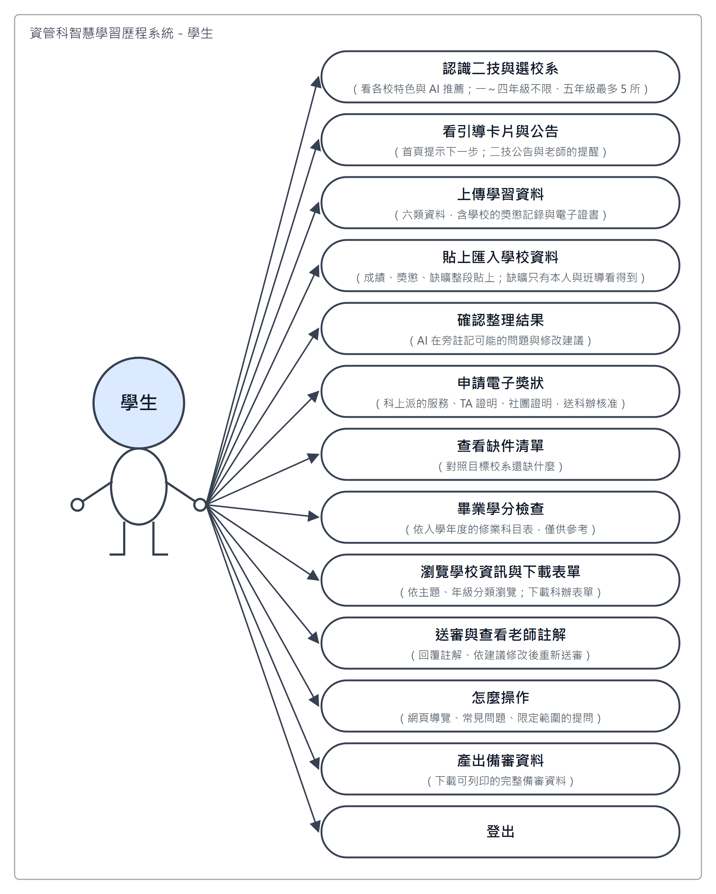

圖 1：使用案例圖－學生

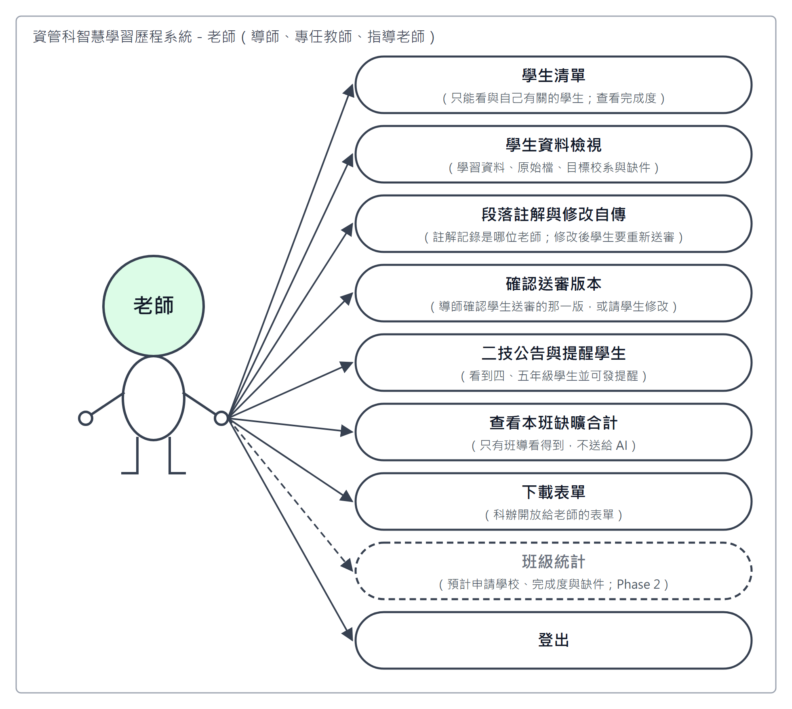

圖 2：使用案例圖－老師（導師、專任教師、指導老師）

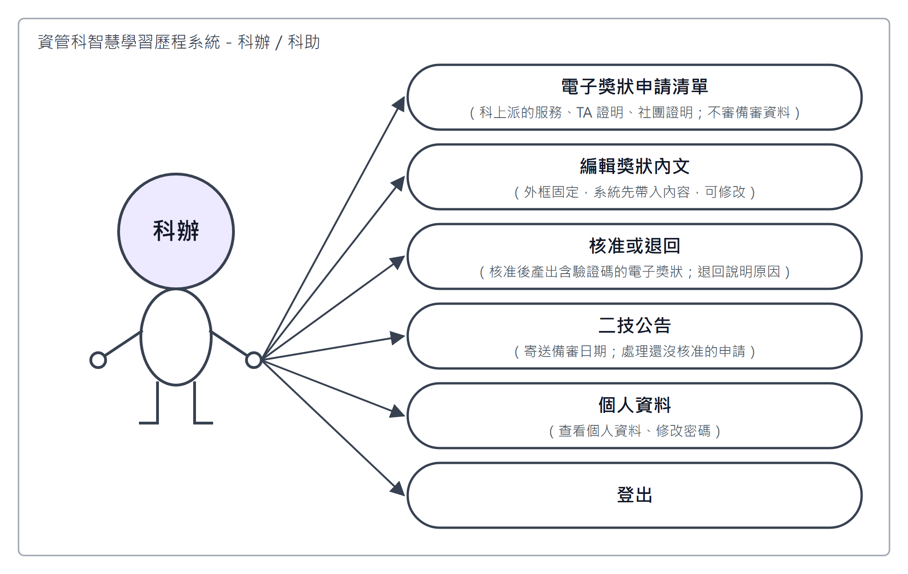

圖 3：使用案例圖－科辦／科助

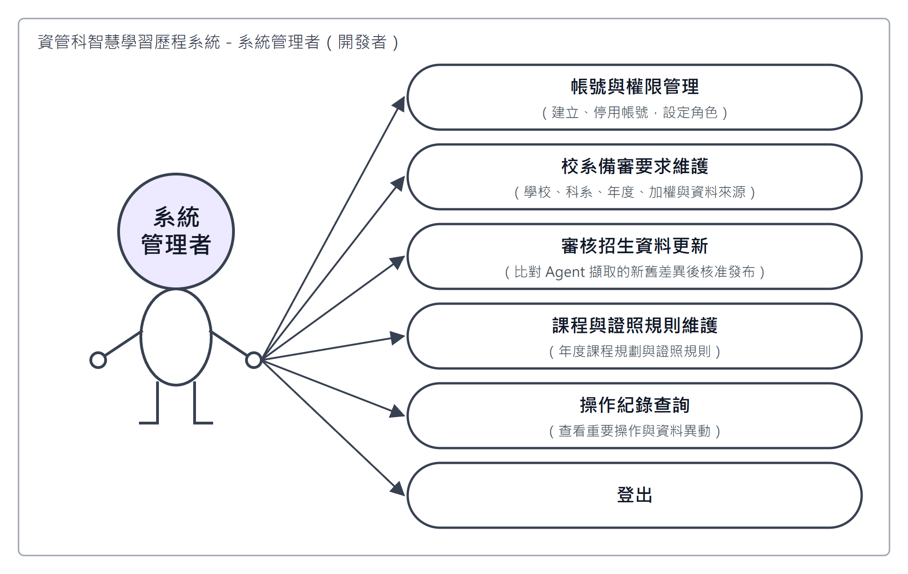

圖 4：使用案例圖－系統管理者（開發者）

### 第三節 使用者流程圖

> 2026-10-10 圖號從頭重排（新舊對照見「2026-10-10 功能確認總表」第七點）。原本的「行政表單數位化與申請追蹤流程圖」與「專題共同審查流程圖」和定案衝突（收件暫停、科辦不審備審、專題模板先隱藏），已從規格書移除，圖檔搬到 `docs/99_封存_歷史與待確認/03_舊版流程圖與圖片/`。

#### 一、系統首頁與使用者登入流程圖

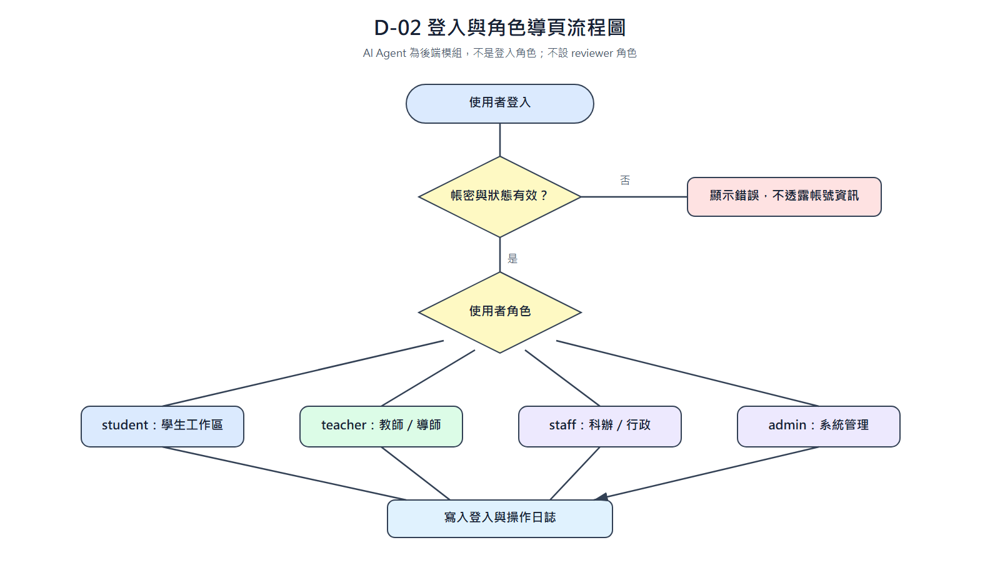

圖 5：登入與角色導頁流程圖

#### 二、學生主線：選校系、收資料到產出備審資料

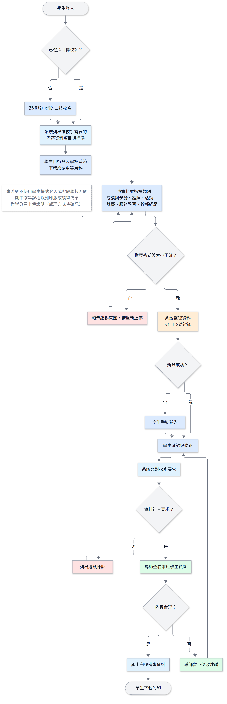

圖 6：學生主線流程圖

#### 三、學校資料匯入流程（成績、獎懲、缺曠）

學生自己從學校的學生資訊系統複製或下載資料，系統不登入、不爬學校系統。網頁成績標示「僅供參考」，正式以紙本成績單為準；缺曠只存合計、只有學生本人與班導看得到、不送給 AI，備審預設不放。規格：[學校資料匯入與官網資料來源](../02_需求與設計/AI_設計規格_學校資料匯入與官網資料來源_2026-10-10.md)。

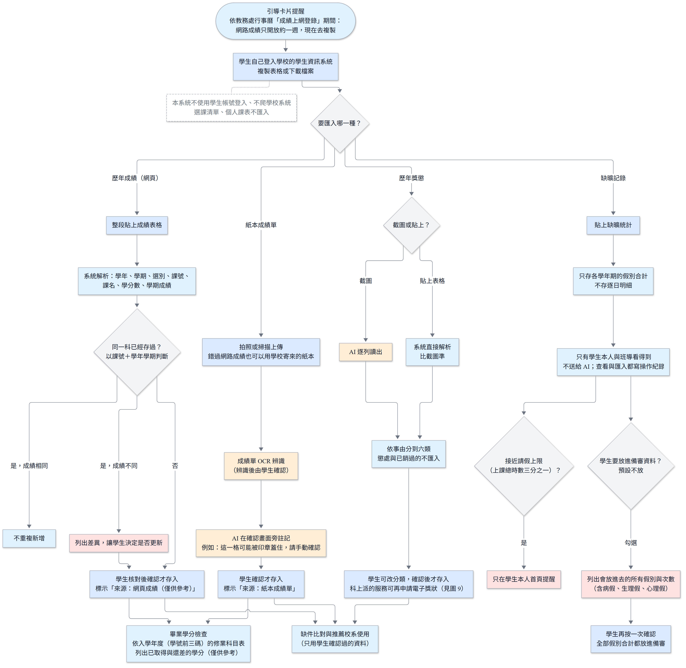

圖 7：學校資料匯入流程圖

#### 四、導師確認流程

導師只能確認學生送審的那一版；確認畫面同時顯示送審版與目前最新版。導師改過自傳後要學生重新送審。和學生有關的老師都可以加段落註解，學生可以回覆。規格：[導師確認版本與段落註解](../02_需求與設計/AI_設計規格_導師確認版本與段落註解_2026-10-10.md)。

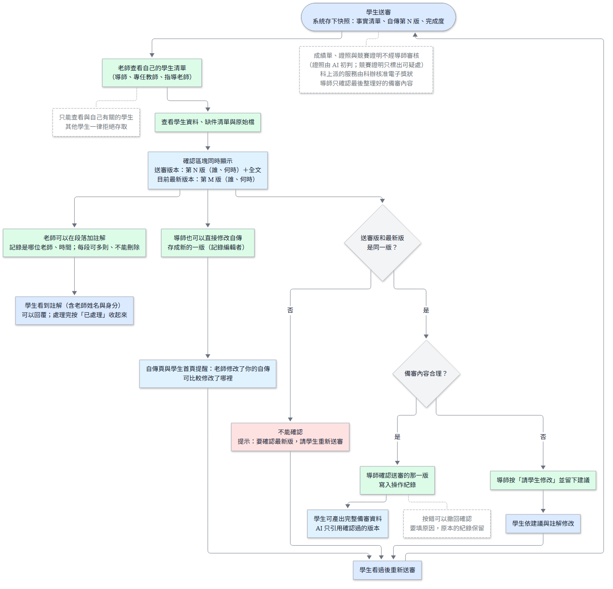

圖 8：導師確認流程圖

#### 五、科辦核准電子獎狀流程

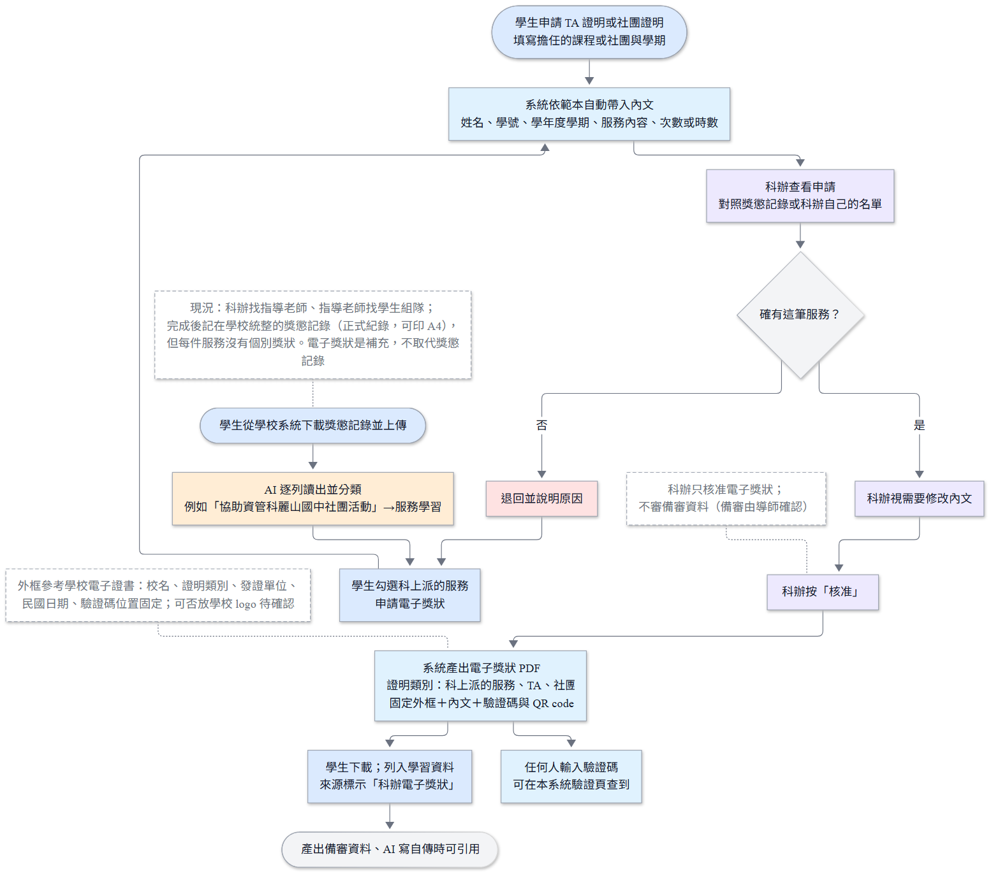

圖 9：科辦核准電子獎狀流程圖

#### 六、科辦表單下載區流程

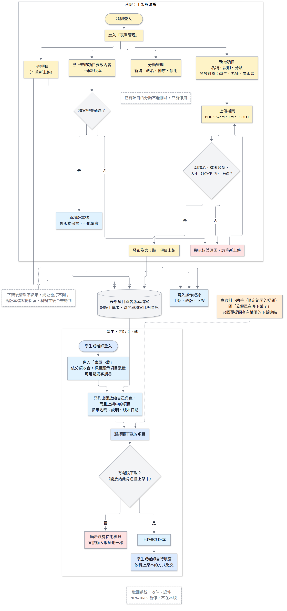

圖 10：科辦表單下載區流程圖

科辦上架、改版、下架表單；學生與老師只看得到開放給自己角色、而且上架中的項目。表單發布後不可覆寫，修正時建立新版本，舊版本保留。收件（繳回系統、退件）2026-10-09 暫停，不在本版。

#### 七、招生資料更新流程（系統亮點）

第一階段由系統管理者手動建立；第二、三階段由 Agent 自動檢查與擷取。兩條路都先產生候選版本（`candidate`），管理者核准後才成為正式版本（`published`），學生端只讀取正式版本。

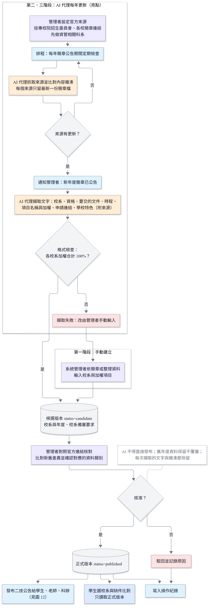

圖 11：招生資料更新流程圖

#### 八、二技招生公告與 AI 推薦校系流程

管理員核准招生資料後發布公告；學生、老師（看到自己的四、五年級學生）、科辦各自收到需要的內容。推薦校系由規則算出符合程度，AI 只寫理由。規格：[二技公告與 AI 推薦校系](../02_需求與設計/AI_設計規格_二技公告與AI推薦校系_2026-10-10.md)。

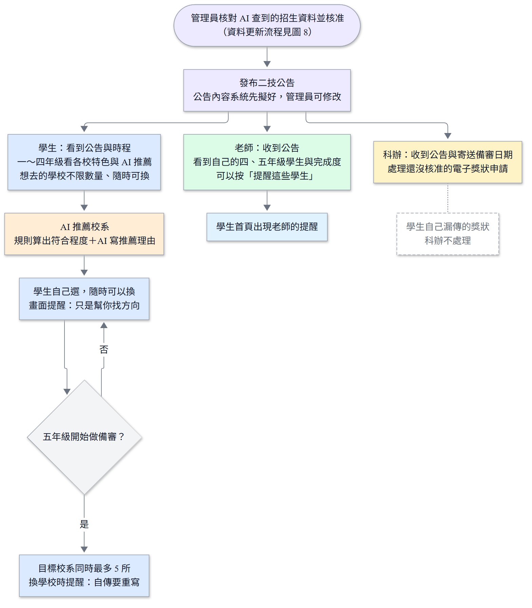

圖 12：二技招生公告與 AI 推薦校系流程圖

#### 九、官網資料來源、資料分類與來源維護流程

資管科官網、資圖中心、教務處行事曆照二技公告的機制：AI 代理只抓管理員登記的頁面、只存文字與連結，先擬分類，管理員核對後才給學生看。來源失效時在「資料來源維護」頁標紅，管理員可換網址、停用或手動輸入。

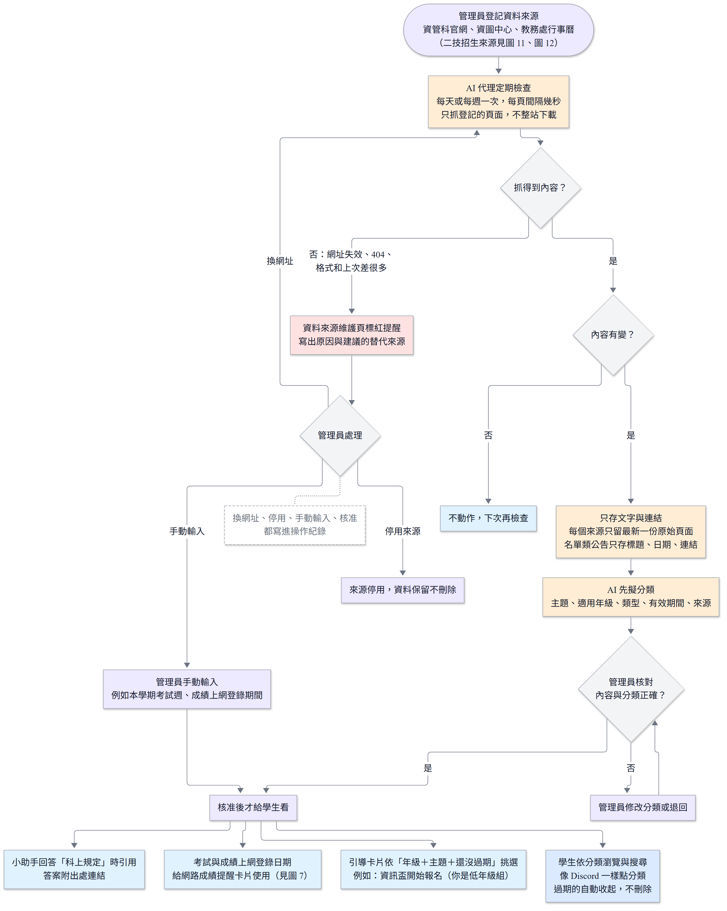

圖 13：官網資料來源、資料分類與來源維護流程圖

#### 十、系統管理者維護校系備審要求流程

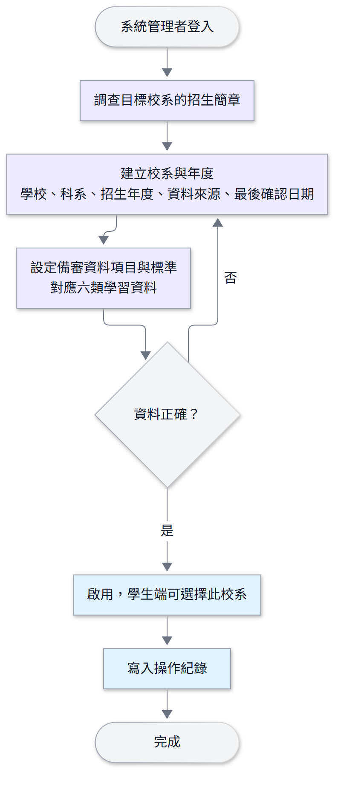

圖 14：系統管理者維護校系備審要求流程圖

#### 十一、二技配分試算流程（後續擴充）

學生輸入成績及經歷 → 選擇招生年度與校系 → 系統讀取已核准配分規則 → 計算原始分數、權重與加分 → 顯示計算過程及資料來源 → 比較多個校系 → 匯出參考結果。

本版的「AI 推薦校系」已用規則算出符合程度；完整配分試算不在 12 月審核範圍。

### 第四節 權限矩陣

| 角色 | 權限 |
| --- | --- |
| 學生 (`student`) | 管理本人歷程、附件、貼上匯入的成績獎懲缺曠、目標校系與自傳；送審、回覆註解；查看公告、學校資訊與開放給學生的表單 |
| 教師／導師 (`teacher`) | 查看與自己有關的學生資料與備審準備狀態；加段落註解、修改自傳；**導師**確認送審的那一版並可撤回；收到二技公告並提醒四、五年級學生；**只有班導**看得到本班缺曠合計；不能登錄正式行政結果 |
| 科辦／行政 (`staff`) | 查看電子獎狀申請與相關獎懲記錄，編輯內文後核准或退回；管理表單下載區；收到二技公告；不審核備審資料，不修改學生自己上傳的資料，看不到缺曠 |
| 管理員 (`admin`) | 由開發者擔任；管理帳號、入學學年度、班級導師、各校系備審要求、招生規則、資料來源與資料分類、二技公告、AI 任務、操作紀錄與報表；看不到缺曠 |
| AI Agent | 依任務授權讀取必要資料，不能刪除、給分、退件或發布正式規則；**不讀缺曠資料** |

#### 管理員角色與開發者維護界線

本系統只保留一種管理員角色：`admin`。管理員可批次建立與停用假帳號、管理班級與入學年度、管理公開資料來源與資料分類、查看 AI 任務與操作紀錄，以及修改系統允許設定的文字與展示內容。專題類型與成果要求模板先隱藏。

本系統不另設 `Administrator` 或「系統維護管理員」使用者。程式碼、套件、資料庫結構、環境變數、部署設定與作業系統維護，必須由開發者透過 IDE、Git、伺服器或本機部署環境處理，不開放網站執行任意程式碼或修改作業系統。

為支援老師現場查詢，後續可建立「開發者診斷／功能檢視器」，輸入系統路徑後顯示功能編號、Endpoint、模板、服務、資料表、角色與外部連接。此功能只讀取預先登錄的路由與功能對照，不直接顯示原始碼，也不允許透過網址修改程式。

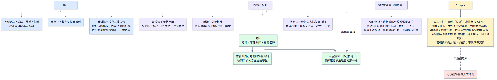

圖 15：角色與責任圖

## 四、需求分析

### 第一節 功能性需求

- F-01 登入與登出
- F-02 帳號管理
- F-03 學生基本資料管理
- F-04 學習歷程 CRUD
- F-05 作品分類
- F-06 檔案上傳
- F-07 作品連結
- F-08 草稿與提交
- F-09 Agent 任務管理
- F-10 備審主張拆解
- F-11 證據擷取
- F-12 一致性檢核
- F-13 檢核狀態
- F-14 人工覆核
- F-15 補件與修改建議
- F-16 面試提問建議
- F-17 官方來源管理
- F-18 招生規則擷取
- F-19 新舊版本比較
- F-20 候選更新審核
- F-21 招生規則版本管理
- F-22 二技配分試算
- F-23 校系比較
- F-24 試算限制提示
- F-25 教師工作台
- F-26 統計 Dashboard
- F-27 報表匯出
- F-28 操作紀錄
- F-29 學生帳號假資料規則
- F-30 轉學生抵免申請輔助
- F-31 畢業門檻與證照檢核提醒
- F-32 二技備審資料包與加權提醒
- F-33 重補修與補件提醒
- F-34 專題評量對照與佐證整理
- F-35 行政表單類型與年度版本管理
- F-36 教師表單發布與指定對象
- F-37 學生表單下載、電子回傳與補件版本
- F-38 表單必備附件與完整性檢查
- F-39 教師初檢與科辦正式行政狀態
- F-40 行政進度、未繳／待補名單與稽核紀錄
- F-41 目標校系選擇與備審要求查看
- F-42 六類學習資料上傳與確認
- F-43 校系要求與學生資料缺件比對
- F-44 完整備審資料產出與下載
- F-45 導師確認與班級統計

- F-46 二技公告與已讀標記
- F-47 AI 推薦校系（規則算符合程度＋AI 寫理由）
- F-48 貼上匯入成績、獎懲、缺曠
- F-49 缺曠合計與隱私保護
- F-50 畢業學分檢查
- F-51 段落註解與回覆
- F-52 引導卡片與「怎麼操作」說明區
- F-53 表單下載區
- F-54 資料來源維護與資料分類
- F-55 操作紀錄查詢頁
- F-56 電子獎狀（科上派的服務、TA 證明、社團證明）

F-41 至 F-45 為 2026-10-06 確認的主線功能；F-46 至 F-56 為 2026-10-10 定案的功能。F-35 至 F-40（行政表單發布與收件）2026-10-09 暫停，只保留 F-53 表單下載區；F-39 的「科辦正式行政狀態」2026-10-10 拿掉。

#### 帳號假資料規則

展示與開發階段不得使用真實身分證字號作為密碼。學生測試帳號可採用學號格式，密碼使用假資料或預設測試密碼，並在文件與系統畫面中註明「僅為測試資料」。

學號格式說明：

| 位置 | 範例 | 說明 |
| --- | --- | --- |
| 前三碼 | 111 | 入學年度 |
| 第四碼 | 5 | 五專部 |
| 第五至六碼 | 34 | 資訊管理科編號 |
| 第七碼 | 1 | 班級 |
| 第八至九碼 | 05 | 座號 |

範例帳號：`111534105`。範例密碼不得使用真實小寫身分證字號，建議開發階段使用 `test@111534105`、`student105` 或由系統產生一次性假密碼。

#### 校務與升學規則整合需求

| 功能 | 第一版做法 | 不做或未來擴充 |
| --- | --- | --- |
| 轉學生抵免 | 提供校方抵免系統連結，紀錄申請狀態、日期、備註與教師確認 | 不直接登入或讀取校方抵免系統 |
| 表單下載區 | 科辦上架表單、設定開放對象、改版保留舊版；學生與老師下載 | 收件暫停；不取代教務或正式抵免系統 |
| 學校成績資料 | 學生複製網頁成績貼上（僅供參考），或上傳紙本成績單（OCR） | 不使用學生帳號登入或爬取學校系統 |
| 獎懲、缺曠 | 學生上傳截圖或貼上表格；缺曠只存合計，只有本人與班導看得到 | 不存缺曠逐日明細、不送給 AI |
| 畢業學分 | 依入學年度的修業科目表對照已確認成績 | 不自動判定正式畢業資格 |
| 學校公開資訊 | AI 代理抓管理員登記的頁面，只存文字與連結，管理員核對分類後才給學生看 | 不整站下載、不存名單類公告的學生姓名 |
| 畢業門檻 | 依資管科畢業門檻 PDF 建立證照與補救措施提醒 | 不自動判定正式畢業資格 |
| 二技備審 | 依備審資料類型、加權與時程建立資料包提醒 | 不保證升學結果，不預測錄取 |
| 重補修 | 記錄學生需補修或補件狀態，提醒查核課程與學分 | 不取代教務選課與學分審核 |
| 專題評量 | 依專題學習目標與評量對照表整理佐證資料 | 不自動給專題成績 |

### 第一之一節 MVP / Phase 2 / Future 功能切割

為避免開發範圍過大，系統功能依完成優先度切分如下：

| 階段 | 必做功能 | 說明 |
| --- | --- | --- |
| MVP | 登入與角色權限 | 支援學生、教師（導師）、科辦、管理員的導頁與授權 |
| MVP | 學生學習歷程 CRUD | 學生可新增、查詢、修改、刪除與提交歷程 |
| MVP | 檔案與外部連結佐證 | 支援 PDF、圖片或外部連結欄位，包含 GitHub / Canva |
| MVP | 目標校系與缺件比對 | 學生選擇校系後，比對該校系備審要求並顯示還缺什麼 |
| MVP | 校系備審要求維護（亮點第一階段） | 管理者手動建立校系、招生類別、原始項目名稱、加權百分比與對應資料類別；先載入種子資料 |
| Phase 2 | 招生資料 Agent（亮點第二、三階段） | 定期偵測官方簡章更新並擷取加權，建立候選版本，管理者核准後發布 |
| MVP | 完整備審資料產出 | 資料齊全並經導師確認後，產出可列印的備審資料 |
| MVP | 導師工作台 | 查看本班學生資料、確認內容並留下修改建議 |
| MVP | 歷程狀態管理 | 支援草稿、提交、退回、通過、鎖定等狀態 |
| MVP | 管理者基本維護 | 帳號、角色、基本統計與結果查看 |
| MVP | 學生測試帳號規則 | 使用學號格式建立假帳號，密碼不得使用真實身分證字號 |
| MVP | 轉學生抵免入口 | 顯示校方抵免系統連結，並提供人工狀態紀錄 |
| MVP | 畢業門檻提醒 | 建立證照與補救措施檢核欄位，僅供提醒 |
| 12 月審核 | 表單下載區 | 科辦上架、改版、下架；收件暫停 |
| Phase 2 | 導師班級統計 | 本班預計申請學校、資料完成度、缺件與最近更新統計 |
| Phase 2 | AI 一致性檢核 | 建立主張—證據矩陣，由教師人工覆核 |
| Phase 2 | GitHub API | 擷取專案摘要、提交紀錄或作品連結資訊 |
| 12 月審核 | 二技公告與 AI 推薦校系 | 管理員核對後公告；規則算符合程度＋AI 寫理由 |
| 12 月審核 | 導師確認版本與段落註解 | 只能確認送審的那一版；老師段落註解、學生回覆 |
| 12 月審核 | 引導卡片與說明區 | 首頁一次最多 3 張；網頁導覽、常見問題、限定範圍的提問 |
| 12 月審核 | 學校資料匯入 | 成績、獎懲、缺曠貼上；畢業學分檢查 |
| 12 月審核 | 資料來源維護與資料分類 | 來源失效標紅；管理員核對分類 |
| 12 月審核 | 操作紀錄查詢頁 | 依使用者、動作、日期查詢重要異動與審核紀錄 |
| Phase 2 | 報表匯出 | 匯出統計 |
| MVP | 備審加權提醒 | 依校系加權比例排序準備重點，例如北商資管證照證明 30% 時，證照排在前面 |
| Phase 2 | 重補修/補件追蹤 | 提醒學生確認課程、學分、缺件與補救措施 |
| 12 月審核 | 紙本成績單 OCR | 組員完成、待整合；先產生可編輯草稿，學生確認後才寫入 |
| Future | 二技落點或配分強化 | 只做規則試算與比較，不預測錄取結果 |
| Future | WebAuthn 或進階登入 | 視導入需求再加入 |
| Future | 更完整 AI 推薦 | 僅做整理與建議，不取代人工判斷 |
| Future | 正式校務介接 | 若校方授權，才可使用 SSO、唯讀 API 或去識別化資料 |

### 第二節 系統架構圖與 DFD

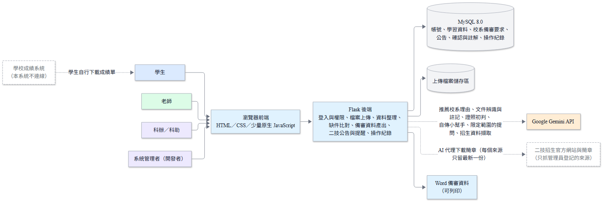

圖 16：系統架構圖

#### 一、DFD 資料流程圖

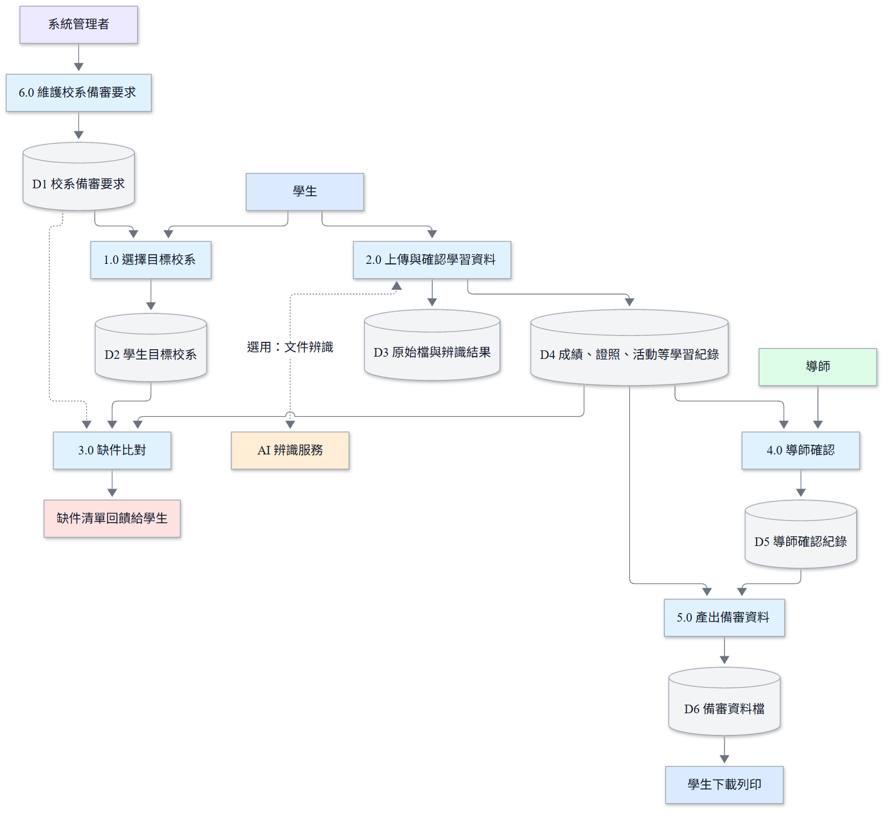

圖 17：DFD 資料流程圖

DFD 的 9.0～12.0（貼上匯入、畢業學分檢查、資料來源維護與資料分類、表單下載區）是 2026-10-10 新增；D9 缺曠合計只有學生與班導可讀，不送給 AI。

### 第三節 非功能性需求

- 安全性：密碼雜湊、角色權限、後端驗證、安全檔案名稱。
- 個資保護：送往外部 AI 前遮蔽不必要敏感資訊；缺曠資料不送給 AI，只存合計，只有學生本人與班導看得到。
- 不刪除：公告只能下架、註解只能標「已處理」、自傳版本不能刪；重要操作寫進 `audit_logs`。
- 好維修：外部資料來源失效時在管理員頁面標紅，可換網址或手動輸入。
- 可追溯性：Agent 結果保留資料來源、擷取時間、資料版本、分析狀態與人工確認結果。
- 可靠性：AI 輸出需經 JSON Schema 驗證。
- 可用性：主要畫面支援桌機、筆電、平板，錯誤訊息需明確。
- 效能：較久 Agent 任務採背景處理並顯示狀態。
- 可維護性：前端、後端、資料庫與 AI 模組分層。
- 公平性：Agent 不依無關資料評定學生，教師可駁回建議。

### 第四節 AI Agent 設計與限制

Agent 必須能接收任務、選擇允許工具、讀取資料、交叉比對、產生結構化結果、保存紀錄並等待人工確認，不只是聊天機器人。

主要 Agent：

1. 招生規則更新 Agent（系統亮點；主線的校系資料來源；擷取資格、文件、時程、加權、申請連結與學校特色）
2. 資料來源 Agent（資管科官網、資圖中心、教務處行事曆；只存文字與連結並擬分類，管理員核對）
3. 推薦校系理由（規則算出符合程度後，AI 只寫理由）
4. 文件辨識與確認畫面旁的註記（成績單、獎懲記錄、證照、電子證書）
5. 自傳小幫手（只引用確認過的資料）
6. 資管科小助手的限定範圍提問（只答操作、科上規定、個人進度，附出處）
7. 備審一致性檢核 Agent（後續擴充）

禁止事項：

- 不得自行退件。
- 不得直接給予成績。
- 不得宣稱學生說謊或造假。
- 不得在沒有資料集時宣稱預測錄取率。
- 不得未經人工確認發布招生規則。
- 不得修改已發布表單、學生原始附件或正式行政狀態。
- 不得讀取缺曠資料。
- 不得回答限定範圍以外的提問。

### 第五節 需求可行性與驗收原則

第一版測試範圍應控制為三至五所主要二技學校，每校一至三個相關科系，保存至少兩個招生年度或規則版本，使用三至五份匿名測試備審資料。

核心驗收：

1. 是否完成指定任務完整流程。
2. 是否產生符合 Schema 的結構化資料。
3. 是否保存可開啟的原始來源。
4. 是否能辨識測試資料中的已知缺件或矛盾。
5. 管理員是否能核准或駁回候選更新。
6. 教師是否能採納或駁回 AI 提示。
7. AI 失敗時是否能顯示錯誤並保留人工處理方式。
8. 學生選擇目標校系後，是否能看到該校系的備審要求與自己還缺什麼。
9. 導師是否只能查看本班學生，並能確認內容或留下修改建議。
10. 資料齊全並經確認後，是否能產出可列印的完整備審資料。
11. 送審後學生或導師又存了新版時，導師的確認是否被伺服器擋下。
12. 管理員核准前，學生是否看不到 AI 代理查到的招生資料與學校資訊。
13. 貼上成績、獎懲、缺曠是否解析正確、重複貼上不重複新增；缺曠是否只有本人與班導看得到、AI 的提示詞裡找不到缺曠資料。
14. 首頁引導卡片是否不超過 3 張、做完後自動消失。
15. 科辦選單與網址是否都找不到「登錄送件審查結果」，舊資料仍在。
16. 操作紀錄頁是否只有管理員看得到，並能依使用者、動作、日期篩選。

各功能更細的驗收標準寫在 10-10 的各份設計規格裡。

### 第六節 系統頁面與路由規劃

#### 一、頁面規劃原則

本系統不為學生、教師／導師及管理員各做一個獨立登入頁，而是使用一個共用登入頁。登入成功後，後端依帳號角色導向不同工作區，並在每個 API 再次檢查權限。這樣可以避免登入邏輯重複，也能清楚展示 RBAC 角色權限設計。

頁面分成三個層次：

1. 公開區：任何人可查看的系統首頁、系統特色、使用說明與登入入口。
2. 角色工作區：登入後依學生、教師／導師、科辦／行政與管理員顯示不同選單與資料。
3. 維護與報表區：管理員維護帳號、規則、關卡、來源、操作日誌與統計資料。

視覺與互動另外分為兩層：公開首頁、學生首頁與五年歷程屬於 `Experience Layer`，允許文字豐富、受控不對稱、拼圖／節點／路徑與較強動畫；教師、科辦／行政、審查與維護頁屬於 `Work Layer`，以搜尋、篩選、表格、狀態、批次操作與低程度回饋動畫為主。完整色彩、文案、動畫時序與響應式規格集中於 [UI／UX 設計與動畫規格](../04_圖表與介面/UI_UX_設計與動畫規格_2026-09-21.md)。

#### 二、一個月版必做頁面（12 個）

| 編號 | 頁面名稱 | 建議路由 | 使用者 | 主要功能 | 報告展示重點 |
| --- | --- | --- | --- | --- | --- |
| P01 | 公開首頁 | `/` | 訪客 | 顯示「五年，會留下很多東西」主題、系統特色、五年路線與登入按鈕 | 展示散落資料如何整理成學習歷程 |
| P02 | 共用登入頁 | `/login` | 全部角色 | 輸入測試帳號密碼、顯示錯誤、依角色導頁 | 說明一個登入入口、多角色權限 |
| P03 | 學生首頁／儀表板 | `/student/dashboard` | 學生 | 顯示年級、五年路線、完成數、缺件數、下一步 | 展示學生看到自己的進度 |
| P04 | 學習成果列表 | `/student/portfolio` | 學生 | 查詢成果、依類型篩選、查看草稿與已提交狀態 | 展示作品集中管理 |
| P05 | 成果新增／編輯 | `/student/portfolio/new`、`/student/portfolio/:id/edit` | 學生 | 填寫標題、類型、說明、技術、檔案或 GitHub／Canva 連結 | 現場新增一筆假作品 |
| P06 | 目標與需求頁 | `/student/goals` | 學生 | 選擇二技升學、實習或就業目標，顯示對應需求 | 展示目標會影響後續任務 |
| P07 | 關卡與進度頁 | `/student/milestones` | 學生 | 顯示 6 個共通關卡、未開始／進行中／已完成狀態 | 展示「關卡式養成」特色 |
| P08 | AI 小助手建議頁 | `/student/ai-advice` | 學生 | 顯示已完成、還缺什麼、下一步三件事；資料不足時明確提示 | 展示 AI 輔助但不取代人工判斷 |
| P09 | 目標校系缺件比對 | `/student/target-gap` | 學生 | 對照所選校系的備審要求，顯示已有與還缺的資料 | 展示「選校系 → 告訴你缺什麼」 |
| P10 | 導師工作台 | `/teacher/dashboard` | 教師／導師 | 查看本班學生資料、確認內容、留下修改建議 | 展示導師確認流程 |
| P11 | 完整備審資料產出 | `/student/admission-package` | 學生 | 預覽並下載可列印的完整備審資料 | 展示最終成果 |
| P12 | 管理員資料維護 | `/admin/maintenance` | 管理員 | 維護帳號、角色、校系備審要求、規則、來源與展示假資料 | 現場修改一項系統設定 |

一個月版的實作重點是「頁面少而流程完整」。P02、P03、P05、P06、P09、P10、P11 是主線一定要能操作的頁面；P01、P08 是報告展示時的招牌畫面。若時間不足，P04 可與 P05 合併，P07 關卡頁可延後；不能刪除 P06 → P05 → P09 → P10 → P11 的完整主線只留下上下載檔案。

#### 三、最終版擴充頁面（再增加 10 個）

| 編號 | 頁面名稱 | 建議路由 | 使用者 | 主要功能 |
| --- | --- | --- | --- | --- |
| ~~P13~~ | ~~個人資料與密碼設定~~ | — | — | **2026-10-10 拿掉**：不占系統資源；使用者不能自己改密碼，只有管理員可以改（見 P19） |
| P14 | 畢業門檻檢核 | `/student/graduation-check` | 學生、教師 | 檢查證照、課程、專題、補件與補救措施提醒 |
| P15 | 轉學生抵免紀錄 | `/student/transfer-credit` | 學生、教師 | 開啟校方抵免系統連結，記錄申請狀態、備註與人工確認結果 |
| P16 | 表單下載區 | `/forms`（學生、老師）、`/staff/forms`（科辦） | 學生、教師、科辦 | 科辦上架、改版、下架；學生與老師依開放對象下載；收件暫停 |
| P17 | 二技配分試算 | `/student/admission-score` | 學生、教師 | 依已輸入規則試算項目與分數，標示資料來源與限制 |
| P18 | 教師學生清單 | `/teacher/students` | 教師 | 搜尋、篩選與自己有關的學生，查看完成度 |
| P19 | 管理員帳號與角色 | `/admin/users` | 管理員 | 建立帳號、停用帳號、設定角色、匯入入學學年度；**修改密碼只有管理員能做**（例如學生換了身分證字號），寫操作紀錄 |
| P20 | 規則與來源版本管理 | `/admin/rules` | 管理員 | 管理招生規則、畢業門檻、重補修與資料來源版本 |
| P21 | AI 任務與操作日誌 | `/admin/agent-tasks`、`/admin/logs` | 管理員 | 查看任務狀態、失敗原因、人工核准紀錄與重要異動 |
| P22 | 統計報表與匯出 | `/admin/statistics` | 管理員、教師 | 顯示完成度、缺件、審核與使用統計，匯出報告資料 |

#### 三之一、2026-10-10 定案新增的頁面

路由為建議名稱，開發時依現有程式調整。

| 編號 | 頁面名稱 | 建議路由 | 使用者 | 主要功能 |
| --- | --- | --- | --- | --- |
| P23 | 公告 | `/announcements` | 全部角色 | 二技公告、未讀標記；老師看到自己的四、五年級學生並可提醒 |
| P24 | 認識二技與推薦校系 | `/student/explore` | 學生 | 各校特色、要求、時程；規則算的符合程度與 AI 寫的理由 |
| P25 | 貼上匯入學校資料 | `/student/import` | 學生 | 貼上成績、獎懲、缺曠，解析後確認 |
| P26 | 畢業學分檢查 | `/student/graduation-check`（取代 P14） | 學生、班導 | 依入學年度的修業科目表列出還差的學分 |
| P27 | 學校資訊 | `/info` | 學生、教師 | 依主題、年級、類型分類瀏覽與搜尋；過期自動收起 |
| P28 | 怎麼操作 | `/help` | 全部角色 | 網頁導覽、常見問題、找誰問、限定範圍的提問 |
| P29 | 資料來源維護 | `/admin/sources` | 管理員 | 來源狀態、失效標紅、換網址、停用、手動輸入 |
| P30 | 資料分類核對 | `/admin/info-items` | 管理員 | 核對 AI 擬好的分類後發布 |
| P31 | 操作紀錄 | `/admin/logs`（取代 P21 的日誌部分） | 管理員 | 依使用者、動作、日期篩選 `audit_logs` |

#### 四、角色與頁面可見範圍

| 角色 | 登入後首頁 | 可操作範圍 | 不可操作範圍 |
| --- | --- | --- | --- |
| 學生 | `/student/dashboard` | 自己的成果、目標、引導卡片、公告、貼上匯入、畢業學分檢查、學校資訊、表單下載 | 其他學生資料、系統規則、角色權限、操作紀錄 |
| 教師／導師 | `/teacher/dashboard` | 與自己有關的學生資料、段落註解、修改自傳、導師確認、公告與提醒、班導看缺曠合計 | 修改系統帳號權限、發布招生規則、查看未授權學生、非班導看缺曠 |
| 科辦／行政 | `/staff/dashboard` | 電子獎狀申請（科上派的服務、TA、社團）、對照獎懲記錄、核准或退回；表單下載區；公告 | 審核備審資料、查看與申請無關的學生資料、缺曠、修改核心系統設定與管理員權限 |
| 管理員 | `/admin/dashboard` | 帳號、入學學年度、班級導師、校系備審要求、招生資料 Agent、二技公告、資料來源維護、資料分類、操作紀錄 | 不直接替學生撰寫成果或代替教師做評量結論；看不到缺曠 |

#### 五、前後端模組對應

前端路由應依角色分區，後端 API 也要依功能模組拆分，避免只有畫面分開但後端沒有權限保護：

| 前端區域 | 後端模組 | 代表 API |
| --- | --- | --- |
| 共用登入 | `auth` | `POST /api/auth/login`、`POST /api/auth/logout` |
| 學生端 | `student`、`portfolio`、`goals`、`milestones` | `GET /api/student/me`、`GET /api/portfolios`、`POST /api/portfolios` |
| 目標校系與備審產出 | `goals`、`admission` | `GET /api/student/target-gap`、`GET /api/student/admission-package` |
| 教師端 | `teacher`、`review` | `GET /api/teacher/students`、`POST /api/teacher/feedback` |
| 表單下載區 | `forms` | `GET /forms`、`POST /staff/forms/<item_id>/versions` |
| 科辦端 | `staff` | `GET /staff/certificates`、`POST /staff/certificates/<cert_id>`（核准或退回）（舊的 `/staff/reviews/<id>/result` 2026-10-10 拿掉） |
| 公告 | `announcements` | `GET /announcements`、`POST /admin/announcements` |
| 學校資料匯入 | `student` | `POST /student/import/grades`、`POST /student/import/awards`、`POST /student/import/attendance` |
| 資料來源與分類 | `admin` | `GET /admin/sources`、`POST /admin/info-items/<id>/publish` |
| 管理員端 | `admin`、`rules`、`logs` | `GET /api/admin/users`、`PUT /api/admin/rules/:id`、`GET /api/admin/logs` |
| AI 小助手 | `agent` | `POST /api/agent/advice`、`GET /api/agent/tasks/:id` |
| 報表與匯出 | `reports` | `GET /api/reports/progress`、`GET /api/reports/export` |

#### 六、現場報告建議操作順序

報告時不需要逐一展示全部 22 個頁面，建議使用 7 個畫面完成一條可理解的故事線：

1. 公開首頁：說明五年資料整理與下一站概念。
2. 共用登入頁：使用假學生帳號登入，說明角色導頁。
3. 學生首頁：查看路線、完成度與缺件。
4. 成果新增頁：新增一筆假證照成果（例如乙級證照）並確認。
5. 目標校系缺件比對頁：選擇校系後顯示還缺什麼。
6. 教師工作台與學生詳情：看到送審版本與「新增：乙級證照」，加段落註解並確認送審的那一版。
7. 完整備審資料產出：資料齊全並經導師確認後，下載可列印的備審資料。

這套頁面規劃可直接轉成 BMAD 的 UX、架構、前端與測試任務；開發日誌則以 P 編號記錄「完成頁面、使用者角色、API、測試結果與待修問題」。

## 五、資料表結構

### 第一節 資料庫設計原則

資料庫採 MySQL 8.0 關聯式資料庫，至少完成第一、第二及第三正規化。基本資料集中管理，其他資料表以主鍵與外來鍵關聯。重要狀態使用明確列舉值或參照表，避免同一狀態有多種寫法。

### 第二節 ERD 資料庫關聯圖

資料表共 29 張（含 2026-10-10 定案、標「待新增」的資料表），一張圖太寬，依功能拆成三張。分圖中只當「被參照」的資料表（例如使用者）只畫主鍵與辨識欄位。全部資料表的總覽圖與原始碼見 [系統流程圖與架構圖](../04_圖表與介面/diagrams.md)，三張分圖與總覽由 `docs/images/D-09-erd-build.py` 一起產生。

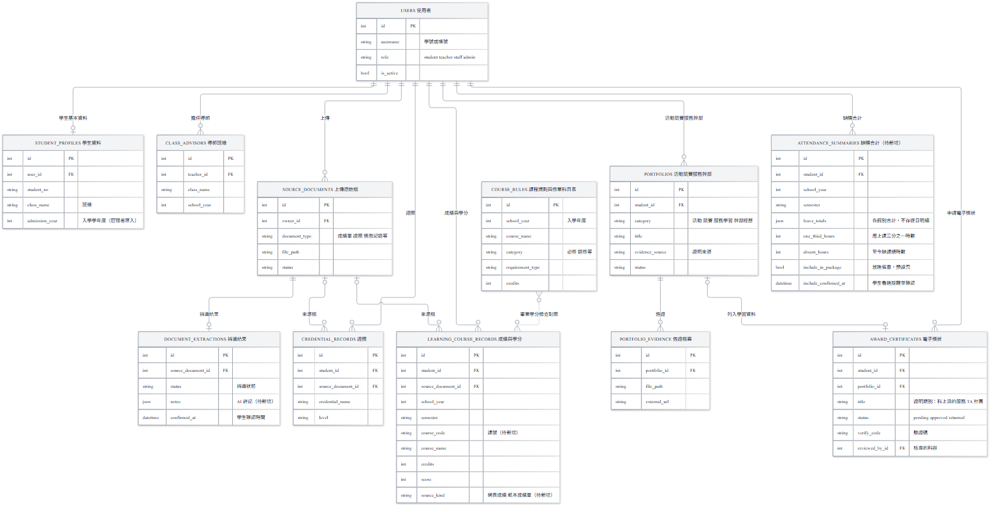

圖 18-1：ERD－帳號、學習資料與學校資料匯入

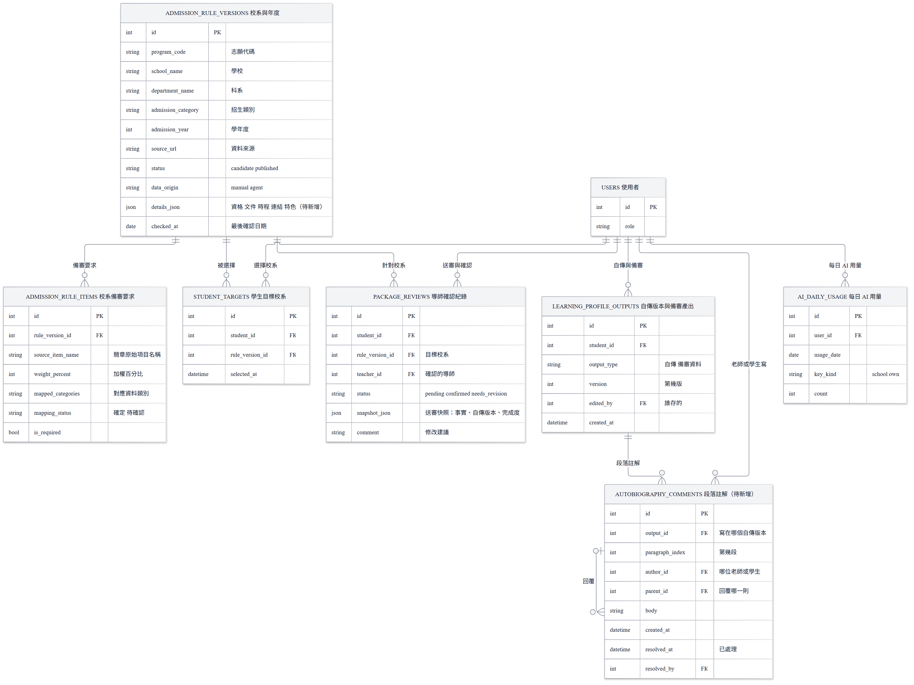

圖 18-2：ERD－校系、目標校系、導師確認與自傳

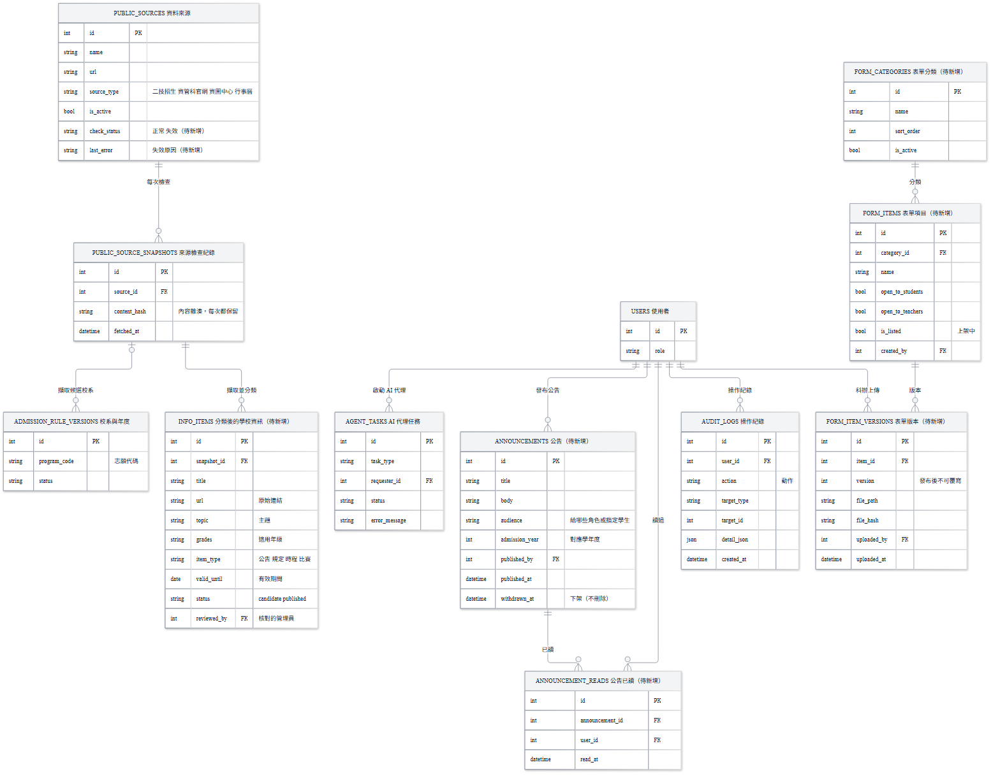

圖 18-3：ERD－資料來源、公告、表單與操作紀錄

主線所需資料表已建立（2026-10-06，migration `b7d2e9a41c35`）；送審快照、每日 AI 用量等 10-09～10-10 的資料表也已建立，只在 SQLite 測過，MySQL 先備份並問過使用者才執行。

### 第三節 核心資料表

依 2026-10-10 的 ERD（圖 18-1～18-3），依功能分組：

| 分組 | 資料表 |
| --- | --- |
| 帳號與權限 | Users、Student_Profiles、Class_Advisors |
| 學習資料與學校資料匯入 | Source_Documents、Document_Extractions、Learning_Course_Records、Credential_Records、Portfolios、Portfolio_Evidence、Attendance_Summaries（待新增）、Course_Rules、Award_Certificates |
| 校系、目標與導師確認 | Admission_Rule_Versions、Admission_Rule_Items、Student_Targets、Learning_Profile_Outputs、Package_Reviews、Autobiography_Comments（待新增）、AI_Daily_Usage |
| 資料來源、公告、表單與紀錄 | Public_Sources、Public_Source_Snapshots、Agent_Tasks、Info_Items（待新增）、Announcements（待新增）、Announcement_Reads（待新增）、Form_Categories（待新增）、Form_Items（待新增）、Form_Item_Versions（待新增）、Audit_Logs |

早期規劃的 Portfolio_Claims、AI_Audit_Reports、Claim_Evidence_Links（一致性檢核）、Simulation_Results（配分試算）屬於後續擴充；Project_*（專題共同審查）不在本系統範圍，已存在的資料不刪除；Administrative_*（行政表單收件）由上面的 Form_* 下載區取代，收件暫停。

### 第四節 資料字典摘要

| 資料表 | 主要用途 |
| --- | --- |
| Users | 使用者帳號、角色與狀態 |
| Student_Profiles | 學生基本資料與升學試算必要資料 |
| Portfolios | 學習歷程主檔 |
| Portfolio_Evidence | 附件、作品連結與證據資料 |
| Portfolio_Claims | 從備審拆解出的可驗證主張 |
| Agent_Tasks | Agent 任務、進度與錯誤紀錄 |
| AI_Audit_Reports | 一致性檢核報告 |
| Claim_Evidence_Links | 主張與證據關聯 |
| Official_Sources | 官方招生資料來源 |
| Admission_Rule_Versions | 校系與招生年度版本：志願代碼、學校、科系、招生類別、資料來源、狀態（candidate／published）、資料來源方式（manual／agent） |
| Admission_Rule_Items | 校系備審項目：簡章原始項目名稱、加權百分比、對應本系統資料類別與對應狀態（確定／待確認） |
| Simulation_Results | 配分試算結果 |
| Human_Reviews | 教師或管理員人工覆核 |
| Teacher_Feedback | 教師補件、備審與面試建議 |
| Audit_Logs | 重要操作與資料異動紀錄 |
| Attendance_Summaries | 各學年期的假別合計、三分之一時數、是否放進備審（只有學生與班導可讀，不送 AI） |
| Course_Rules | 課程規則與依入學年度的修業科目表，用於畢業學分檢查 |
| Award_Certificates | 電子獎狀：證明類別（科上派的服務、TA、社團）、狀態、驗證碼、核准的科辦 |
| Package_Reviews | 送審快照（事實清單、自傳版本、完成度）、導師確認狀態與修改建議 |
| Autobiography_Comments | 段落註解：寫在哪個自傳版本、第幾段、作者、回覆哪一則、已處理時間與處理人 |
| AI_Daily_Usage | 每人每天的 AI 使用次數與金鑰種類 |
| Public_Sources、Public_Source_Snapshots | 資料來源（二技招生、資管科官網、資圖中心、行事曆）與每次檢查的內容雜湊；來源狀態與失效原因（待新增） |
| Info_Items | 分類後的學校資訊：主題、適用年級、類型、有效期間、原始連結、核對的管理員 |
| Announcements、Announcement_Reads | 通用公告（不能刪除、可下架）與已讀紀錄 |
| Form_Categories、Form_Items、Form_Item_Versions | 表單下載區的分類、項目（開放對象、上架中）與版本（發布後不可覆寫） |

#### 主線資料表對照（2026-10-06）

下表對應 ERD 的主線資料模型。「程式已有」表示 `app/models/` 已建立；「待新增」表示主線需要但尚未實作。

| 資料表 | 主要用途 | 狀態 |
| --- | --- | --- |
| Users | 帳號、角色（student／teacher／staff／admin）與啟用狀態 | 程式已有 |
| Student_Profiles | 學號、班級、入學年度 | 程式已有 |
| Class_Advisors | 導師負責的班級與學年度，用來限制導師只看本班 | 程式已有（2026-10-06） |
| Source_Documents | 學生上傳的原始檔（成績單、證照等） | 程式已有 |
| Document_Extractions | 文件辨識結果與學生確認時間 | 程式已有 |
| Learning_Course_Records | 各年成績與學分 | 程式已有 |
| Credential_Records | 證照 | 程式已有 |
| Portfolios | 活動、競賽、服務學習、幹部經歷（以類別區分） | 程式已有 |
| Portfolio_Evidence | 佐證檔案與連結 | 程式已有 |
| Admission_Rule_Versions | 志願代碼、校系、招生類別、學年度、資料來源、候選／正式狀態與最後確認日期 | 程式已有（2026-10-06） |
| Admission_Rule_Items | 簡章原始項目名稱、加權百分比，以及對應的本系統資料類別 | 程式已有（2026-10-06） |
| Student_Targets | 學生選擇的目標校系 | 程式已有（2026-10-06） |
| Learning_Profile_Outputs | 產出的備審資料檔 | 程式已有 |
| Package_Reviews | 學生針對目標校系請導師確認；狀態（pending／confirmed／needs_revision）、修改建議與送審快照 | 程式已有（2026-10-06；快照 10-10） |
| Award_Certificates | 電子獎狀 | 程式已有（2026-10-09） |
| Audit_Logs、AI_Daily_Usage | 操作紀錄、每日 AI 用量 | 程式已有 |
| Attendance_Summaries、Autobiography_Comments、Info_Items、Announcements、Announcement_Reads、Form_* | 10-10 定案的新功能 | 待新增 |

Administrative_* 六張資料表（行政表單收件）不建立，由 Form_* 下載區取代。

`Users.role` 建議允許值如下：

| role 值 | 對應角色 | 說明 |
| --- | --- | --- |
| `student` | 學生 | 預設學生帳號 |
| `teacher` | 教師／導師 | 導師查看本班學生資料、確認送審版本；專任教師、指導老師也使用此角色，以關係決定可查看範圍；可加段落註解 |
| `staff` | 科辦／行政（科助） | 核准電子獎狀（科上派的服務、TA、社團）、管理表單下載區；不審核備審資料 |
| `admin` | 系統管理者 | 由開發者擔任；系統設定、帳號權限、日誌與校系備審要求維護 |

目前程式已移除 `reviewer` 導頁與正式登入角色。科辦「登錄送件審查結果」2026-10-10 拿掉，開發時一併移除頁面與選單（舊資料保留）。

## 六、開發時程

**重要日期**：11/4 交專題報告簡報給導師、11 月中完成 70%、12 月初專題審核（班導公告）。二技技優（以 115 年度推估）簡章約 11/20 公告、寄送備審 4/20–4/24。

1. 需求與設計：使用者訪談、歷屆比較、Use Case、權限矩陣、架構、ERD、資料字典。
2. 主線流程圖：學生從登入、選校系、上傳資料到產出備審資料的完整流程，先經指導老師確認。
3. 主線系統：登入、角色權限、選擇目標校系、六類資料上傳與確認、缺件比對、導師確認、完整備審資料產出。
4. 校系資料：載入種子資料（亮點第一階段），確認項目與資料類別的對應；並確認學校成績系統的限制（期中修畢課程、微學分）與處理方式。
5. AI 輔助：協助辨識上傳文件；AI 失敗時學生仍可手動輸入，不阻塞主線。
6. 招生資料 Agent（亮點第二、三階段）：先做官方來源更新偵測與通知，再做加權擷取、候選版本與管理者核准。
7. 2026-10-10 定案功能（依「2026-10-10 功能確認總表」第九點的順序）：導師確認版本與段落註解 → 二技公告與推薦校系 → 引導卡片與說明區 → 上傳後 AI 註記 → 學校資料匯入與畢業學分檢查 → 資料來源維護與資料分類 → 科辦 TA／社團證明、表單下載區與操作紀錄頁。
8. 後續擴充：導師班級統計、GitHub／README 證據初檢、配分試算、學習地圖與拼圖動畫。
9. 統計、測試與文件：權限、防呆、檔案安全、AI 測試、錯誤處理、簡報與展示腳本。

## 七、系統展示與功能說明

### 第一節 展示情境

1. 學生登入，首頁出現引導卡片與二技公告；看 AI 推薦的校系並選擇想申請的校系，系統列出該校系需要的備審資料與標準。
2. 學生貼上網頁成績，並上傳證照、活動、競賽、服務學習、幹部經歷等資料。
3. 系統整理資料，AI 在確認畫面旁註記可能的問題與修改建議，學生確認並修正。
4. 系統顯示「還缺什麼」，學生補齊資料。
5. 學生送審；導師看到送審版本與新增的內容（例如乙級證照），加段落註解，確認送審的那一版或請學生修改。
6. 學生產出並下載可列印的完整備審資料。
7. 系統管理者展示招生資料 Agent：偵測到新年度簡章、擷取各校系加權成為候選版本，比對新舊差異後核准，學生端的缺件比對隨即更新（系統亮點）。
8. 展示者說明哪些是系統規則、哪些是 AI 協助，以及正式資格仍以學校與招生簡章為準。
9. 科辦核准電子獎狀與表單下載區、管理員的資料來源維護與操作紀錄頁可作為補充展示；配分試算列為後續擴充。

### 第二節 報告用圖片版總體流程圖

圖 19：報告用總體流程圖

## 八、工作分配

在專題報告書與評分規範中，團隊成員的分工權責如下：

- **111534105 田心于（專題隊長 / 系統分析 / 前端與文件）**：
  - 需求整理、歷屆專題差異比較分析。
  - 學生端前端介面開發、學習歷程分類與檔案上傳介面。
  - 專題系統規格設計書彙整、開發日誌維護與展示報告撰寫。
- **111534107 張馨羽（後端開發 / 資料庫工程師）**：
  - MySQL 資料庫正規化設計、ERD 圖建立與數據表建置。
  - Flask 後端 RESTful API 設計與路由開發。
  - 角色權限控制 (RBAC)、登入驗證、招生規則版本管理與配分計算模組。
- **111534124 林承諺（AI Agent 模組 / 系統測試工程師）**：
  - AI Agent 模組封裝 (Gemini API / JSON Schema 結構化輸出)。
  - GitHub REST API 介接與 PDF/OCR 文字擷取處理。
  - 備審主張—證據矩陣邏輯、單元測試 (pytest) 與系統整合測試。
- **全體組員共同負責**：
  - 系統架構討論、前後端整合除錯、Agent 驗收、使用者測試、簡報製作與上台展示。

> **獨立開發補充說明**：目前由田心于同學進行系統全端實作與測試，開發過程結合 Antigravity IDE 與 BMAD AI Agent（Mary, Winston, Paige, Amelia 等）進行協同開發與日誌自動維護。

## 九、參考資料

- 康寧大學資訊管理科資訊軟體開發組專題規定
- 康寧大學資訊管理科近五年畢業專題成果報告
- Google Gemini API 官方文件
- GitHub REST API 官方文件
- Flask 官方文件
- MySQL 8.0 Reference Manual
- Chart.js 官方文件
- 二技招生及技優甄審各校官方招生簡章與公開資料
- 康寧大學台北校區公開資訊：五專資訊管理科隸屬商業資訊學院，台北校區地址為臺北市內湖區康寧路三段75巷137號。
- 康寧大學資訊管理科入學專區：資管科成立於民國87年，招收國中畢業生，五專入學管道包含五專完全免試、五專優先免試與五專聯合免試。
- 康寧大學課程地圖：五專部列有資訊管理科課程地圖連結。
- 康寧大學招生中心五專與五專轉學考公開公告。
- 康寧大學抵免系統入口：<https://ec.ukn.edu.tw/CT_web/login.aspx>
- 113-康寧資管科畢業門檻 PDF。
- 116二技技優甄審_時程與備審加權_修訂版 PDF。
- 重補修選課原則簡報 PDF。
- 專題審查學習目標與評量對照表 PDF。

## 附錄一、歷屆專題差異比較

- 114 年「升學競賽全方位資源網」：備審素材分類、備審匯出、二技校系資訊、志願序及教師查看。
- 113 年「修業科目表管理系統」：修業科目表、替代課程、版本差異及畢業資格審查。
- 115 年「招生平台」：RAG 招生智能助手、招生資料管理、線上評分與來源連結。
- 115 年「智慧實習平台」：AI 履歷潤飾、成績單辨識、履歷審查及實習媒合。
- 114 年「軟丙軟乙學習平台」：術科自動批改、學習紀錄與教師統計。

本系統差異集中在下列閉環：

1. 主線：選擇目標校系 → 收齊六類學習資料 → 比對缺件 → 導師確認 → 產出完整備審資料。
2. 整合而不重做：學校已有證照上傳、競賽報名、電子證書等系統，本系統把這些資料整合進備審，並以引導卡片、分類好的學校資訊依年級主動提醒。
3. 招生資料 Agent（系統亮點）：每年自動偵測二技簡章更新、擷取各校系備審加權並建立候選版本，管理者核准後才給學生使用；歷屆專題的校系資料都需人工逐年重新輸入。

## 附錄二、需求與功能檢核表

| 需求 | 對應功能 | 驗收 |
| --- | --- | --- |
| R-01 學生作品容易散落 | F-04 至 F-08 | 學生能分類、保存、查詢並提交完整歷程 |
| R-02 教師需人工核對備審及作品 | F-09 至 F-16 | Agent 產生可追溯主張—證據矩陣，教師可人工覆核 |
| R-03 招生資料每年人工更新 | F-17 至 F-21 | Agent 建立候選更新，未核准資料不得發布 |
| R-04 學生難以比較校系配分 | F-22 至 F-24 | 系統顯示公式、來源及資料不足提示 |
| R-05 教師需快速掌握重點學生 | F-25 至 F-27 | 教師能查看缺件、待確認項目及統計 |
| R-06 重要操作必須可追溯 | F-28 | 發布、覆核及重要異動均有操作紀錄 |
| R-07 測試與展示不得使用真實個資 | F-29 | 測試帳號使用學號格式與假密碼，畫面標示僅為測試資料 |
| R-08 校務規則需提醒但不取代正式審核 | F-30 至 F-34 | 抵免、畢業門檻、備審、重補修與專題評量僅提供提醒與佐證整理，不自動判定 |
| R-09 學生不知道學校有哪些表單可以自己下載 | F-53 | 科辦上架的表單學生與老師可依開放對象下載；改版保留舊版（收件暫停） |
| R-10 學生不知道目標校系還缺什麼 | F-41 至 F-45 | 學生選擇校系後看到缺件清單；資料齊全並經導師確認後可產出完整備審資料 |
| R-11 學生看不完各校簡章、不知道二技什麼時候公告 | F-46、F-47 | 管理員核對後公告；推薦結果附規則與理由 |
| R-12 學校資訊分散、新生不知道去哪查 | F-52、F-54 | 引導卡片依年級出現；學校資訊依主題、年級分類可瀏覽；來源失效時管理員收到提醒 |
| R-13 學校資料要重打、缺曠屬於隱私 | F-48 至 F-50 | 成績、獎懲、缺曠可貼上匯入；缺曠只存合計、只有本人與班導看得到、不送 AI |
| R-14 導師確認的內容要可查證 | F-51、F-55 | 只能確認送審的那一版；註解與確認都留紀錄，管理員可查操作紀錄 |

## 附錄三、分年學習歷程任務地圖與資料介接原則

### 第一節 分年任務

- 專一：建立基地，完成基本資料、帳號、GitHub、第一份課程成果與心得。
- 專二：累積證據，每學期建立課程成果並完成分類欄位。
- 專三：技能成長，整理證照、競賽、社團、服務或實作經驗。
- 專四：實習準備與經驗整理；專題方向、組員與指導老師媒合從專五開始。
- 專五：備審整合，二技公告、縮減到 5 所目標校系、完成自傳、送導師確認、補缺件。

各年級的任務會以**引導卡片**出現在首頁（一次最多 3 張，依年級＋時間點＋學生做了什麼），例如專一的「歡迎、認識二技、存第一份成果」、學期末的「網路成績只開放一週，現在去複製」。卡片方向見 [引導卡片與科辦、管理員功能清單](../02_需求與設計/AI_設計規格_引導卡片與科辦管理員功能清單_2026-10-10.md)。

### 第二節 任務完成原則

任務必須對應實際資料或證據，不得只以點擊按鈕作為完成條件。任務完成度用於協助整理與輔導，不直接等同學業成績或審查分數。

### 第三節 資料介接原則

專題開發不得索取、複製或直接連接學校核心資料庫。測試帳號可使用假資料，也可依學號格式建立示範帳號，例如 `111534105`、`111534107`、`111534124`；但密碼不得使用真實小寫身分證字號，應使用假密碼或一次性測試密碼。

若日後正式導入，應由校方資訊單位提供唯讀 API、SSO 或去識別化資料。

學校成績、獎懲、缺曠資料由學生自行登入學校系統複製或下載後交給本系統（整段貼上表格或上傳檔案）；本系統不得保存學生的學校帳號密碼，也不得以學生帳號登入或爬取學校系統。網頁成績只開放約一週、標示「僅供參考」，正式以紙本成績單為準；期中已修畢的部分課程只有列印成績單才完整；微學分課程不會印在成績單上；學校沒有微學分系統，微學分要寫紙本向教務處申請，學生怎麼把證明放進本系統待確認。缺曠只存假別合計，不存逐日明細。

學校公開網站（資管科官網、資圖中心、教務處）只抓管理員登記的頁面，只存文字與連結，每頁間隔幾秒、每天或每週一次；名單類公告只存標題、日期、連結。

轉學生抵免系統採「外部連結＋人工紀錄」方式處理。本系統只放置校方抵免系統入口，並保存學生自行填寫的申請狀態、申請日期、抵免科目備註、需補交資料與教師確認狀態。系統不得擅自抓取抵免系統中的個資或審核結果。

畢業門檻、重補修、二技備審加權與專題評量資料，均以「提醒與佐證整理」為定位。正式畢業資格、抵免結果、補修學分、二技招生規定與專題成績，仍以學校、教務單位、招生簡章與指導老師/審查委員公告為準。

## 附錄四、AI Agent 模組與測試資料規範

### 第一節 Agent 定位

AI Agent 是後端輔助模組，不是獨立聊天視窗，也不取代學生、科辦或審查委員權限。

### 第二節 主要任務

1. 成績單資料擷取（紙本 OCR）與確認畫面旁的註記。
2. 招生資料更新與二技公告的候選內容。
3. 學校公開資訊擷取與分類（資料來源 Agent）。
4. 推薦校系理由、自傳小幫手、限定範圍的提問。
5. 備審主張—證據檢核（後續擴充）。

### 第三節 成績單擷取流程

學生上傳成績單圖片或 PDF → 系統檢查身分、格式與大小 → 建立 Agent 任務 → AI 擷取課程、學分與成績 → 系統顯示可編輯草稿 → 學生確認或修正 → 寫入正式資料庫。

AI 擷取結果不得直接寫入正式成績資料。

### 第四節 後端模組規劃

- `routes/transcript.py`：成績單上傳、草稿確認及正式儲存。
- `routes/agent.py`：建立 Agent 任務、查詢任務狀態及取得報告。
- `services/ocr_service.py`：PDF 文字擷取或影像辨識處理。
- `services/gemini_client.py`：呼叫 Gemini API 並要求固定 JSON 輸出。
- `services/evidence_audit.py`：主張拆解與證據比對。
- `services/milestone_service.py`：依資料庫規則判斷任務地圖解鎖狀態。
- `services/admission_source_service.py`：抓取官方來源、比對內容雜湊並建立更新通知（亮點第二階段）。
- `services/admission_extract_service.py`：擷取校系加權並建立候選版本（亮點第三階段）。
- 2026-10-10 新增（暫名）：`services/announcement_service.py`（公告與已讀）、`services/recommend_service.py`（規則算符合程度）、`services/school_import_service.py`（貼上成績、獎懲、缺曠）、`services/graduation_check_service.py`（畢業學分檢查）、`services/info_source_service.py`（資料來源維護與分類）。

### 第五節 開發優先順序

1. 學生歷程 CRUD、檔案／連結上傳、成績單與證照擷取 → 學生確認 → 儲存（主線）。
2. 目標校系備審要求（手動建立與種子資料）、缺件比對、導師確認與完整備審資料產出（主線）。
3. 招生資料 Agent：官方來源更新偵測與通知，再到加權擷取、候選版本與管理者核准（系統亮點）。
4. 2026-10-10 定案功能（順序見「2026-10-10 功能確認總表」第九點）。
5. 備審主張—證據矩陣、教師人工覆核與面試提問建議（後續擴充）。
6. 二技配分試算（後續擴充）。

## 附錄五、系統長期使用的重要規則

1. **目標可以改**：學生在五年內可以更改升學、實習或就業方向。系統保留過去目標，成果不用重傳；改目標後只要重新比對目前還缺什麼。
2. **學校條件會變**：每筆校系或職涯條件都要記錄資料年度、來源網址和最後確認日期。正式規定仍以學校或公司公告為準。
3. **成果不只檔案**：學生可以上傳檔案，也可以貼 GitHub、影片、Canva 或作品網站連結。成果要填名稱、類型和日期，避免資料日後看不懂。
4. **完成不等於已確認**：學生上傳後是「已上傳」；學生校正確認或依規則完成檢查後才成為正式資料。導師查看後可標示「已確認」或「需要補充」。
5. **不同身分看不同資料**：學生只看自己的資料；老師看負責學生；管理者才可維護校系條件與帳號。
6. **轉科、休學或轉學也能使用**：系統保留歷年成果與成績紀錄，並依目前狀態重新整理；科目抵免與畢業資格仍由教務單位確認。
7. **保護個資與留下備份**：正式使用時要有資料保留規則，並讓學生可以匯出自己的作品清單或備審資料；開發展示階段只使用假帳號與測試資料。
8. **關卡是提醒，不是壓力**：畫面應顯示「下一步可以做什麼」，而不是用排名或責備方式讓學生焦慮。

以上是完整系統未來可以逐步加入的規則。本專題第一版不需要把每一項都做成自動功能，先完成主線：選校系、收齊資料、比對缺件、導師確認與產出完整備審資料；其餘規則依優先順序逐步加入。

## 附錄六、網頁視覺與使用體驗設計原則

### 設計核心

本系統的網頁設計不以常見的科技藍 Dashboard、紫色 AI 漸層或大量統計卡片作為主要風格，而以「把五年，拼成下一站」作為整體設計概念。學生從專一到專五累積的課程、作品、證照、競賽、專題、實習、成績與反思，就像一塊一塊散落的資料。系統要做的不只是保存，而是協助學生留下、整理、連接、看見成長、發現缺漏，再依升學、實習或就業目標整理成下一站需要的資料。

整體視覺可使用三個主要元素：「拼圖」代表一件學習成果；「路徑與節點」代表專一到專五的成長與重要事件；「檔案／資料夾」代表成果被整理、分類與保存。畫面可以有資訊圖表與雜誌編排的藝術感，但每個圖形都應與功能有關，不為了好看加入過多裝飾。

### 整體視覺風格

網站以 Interactive Editorial Learning Journey（互動式資訊設計 x 五年成長旅程 x 個人數位檔案）為方向。視覺比例以約 70% 安靜、乾淨、成熟，20% 資訊視覺化與藝術編排，10% 小型互動驚喜為原則。

公開首頁與學生首頁可以有較強的藝術性；教師與行政後台以工作效率為主，使用清楚的表格、搜尋、篩選、狀態與編輯功能，但保留相同字體、色彩、線條與節點語言，使整套系統看起來仍屬於同一個網站。

### 公開首頁故事流程

公開首頁不先用大量文字介紹功能，而用捲動方式說明系統存在的原因：

1. 第一幕以「五年，會留下很多東西。」為主題，讓課程、作品、證照、GitHub、專題、競賽、實習等資料散落在畫面中。
2. 第二幕呈現散落資料被細線連接、分類與整理，表達「留下，只是第一步」。
3. 第三幕呈現資管科五年規劃，以路徑、節點或階段式資訊圖呈現專一到專五。
4. 第四幕在專五後分成二技升學、實習、就業三個方向，表達「五年不是終點，是開始選擇下一站的地方」。
5. 第五幕把五年累積資料整理成完整個人歷程，最後提供登入或開始整理入口。

### 學生端設計

學生登入後的首頁延續公開首頁的五年路徑，但內容改為學生自己的資料。專一時畫面可以較空，隨著學生逐年新增作品、證照、活動、競賽、專題與實習，節點逐漸增加，使同一套介面會跟著學生一起成長。

缺漏資料不只用紅色警告表示，也可以利用空白拼圖、未完成節點或空的資料位置呈現。學生補齊資料後，空白位置變成完成狀態，提供小幅動畫或文字回饋。此設計目的仍是提醒與整理，不直接代表成績或能力高低。

### 目標導航與 AI 小助手

學生選擇某個二技校系、實習或就業方向後，系統可將五年累積資料重新聚焦。與該目標有關的成績、作品、證照、專題或經歷顯示得較明顯，其他資料降低視覺強度，使學生看見現在真正需要補強的是哪些。

AI 不必用大型機器人圖示或獨立聊天首頁搶走注意力，可設計成「看看我的歷程還少了什麼」或「幫我整理下一步」等小入口。開啟後以側邊卡片或編輯註記方式顯示已經有什麼、還缺什麼、下一步可以先做什麼。AI 仍只提供建議，不直接修改正式資料，也不預測錄取結果。

### 教師與行政端設計

教師工作區以清楚、耐看和高效率為主。班級清單應支援搜尋、篩選、缺件狀態與最近更新時間。點入學生後，可先看到縮小版五年歷程圖，快速了解學生在哪些學年有成果、哪一段較缺資料，再查看正式成果與留言。

行政端同樣以表格、搜尋、分類與編輯為主，負責維護五年規劃、校系／職涯需求、關卡與來源資料。藝術性集中在公開首頁、學生首頁、五年歷程與成果展示；工作頁面優先讓老師與行政人員容易找到資料、容易修改、長時間使用不疲勞。

### 實作原則

網頁開發仍採「功能先完成，再逐步美化」。先完成資料庫、登入、成果管理、目標、關卡、AI 建議與教師／管理員功能，再建立共用的字體、色彩、按鈕、間距、線條與卡片規則，最後製作公開首頁和學生首頁的展示級互動。

動畫以 CSS 與 JavaScript 能穩定完成的捲動、淡入、位移、節點亮起與簡單拼圖回饋為主，不為追求效果而影響讀取速度、手機操作或功能可用性。

## 附錄七、校務公開資料與專題規則整合

### 第一節 康寧資管科公開資料定位

本系統以台北校區五專資訊管理科學生為主要使用對象。公開資料顯示，康寧大學台北校區設有五專資訊管理科，資管科屬於商業資訊學院；資管科入學專區說明資訊管理科成立於民國87年，招收國中畢業生，五專入學可參考五專完全免試、五專優先免試與五專聯合免試等管道。

系統文件與展示資料引用公開資料時，應保留來源名稱與查核日期。若招生、課程或聯絡資訊日後更新，系統中的資料必須由管理者人工確認後再更新，不得由 AI 自動覆蓋正式內容。

### 第二節 畢業門檻整合

依資管科畢業門檻資料，109學年度含以後入學之日間部五年制學生適用；轉學、復學及轉科學生比照所屬班級辦理。系統可將畢業門檻整理成提醒項目，例如專業證照、輸入證照、丙級或乙級證照、競賽成果、加選學分、輔導課程或資訊技術實作等。

系統僅協助學生整理「已取得證照、尚缺證照、可補救方式、佐證檔案」等資料，不自行判定正式畢業資格。正式畢業門檻審核仍以學校規定與審核委員會結果為準。

**畢業學分檢查（2026-10-10）**：資管科官網每個入學年度有一份修業科目表 PDF（99～114 年度入學已下載到 `school/public-sources/修業科目表/`），「○○年度入學」對應學號前三碼。系統依學生的入學學年度（管理者匯入）選對應的科目表，對照學生確認過的成績，列出已取得與還差的學分。PDF 要先整理成結構化資料並人工核對；實習一年與半年的選修學分不同，科目表要能表達這種選擇。結果標明「僅供參考，正式以學校審查為準」。

### 第三節 二技技優與備審資料整合

二技技優甄審資料顯示，備審資料常見類型包含歷年成績單、自傳、讀書計畫、證照、競賽成果、專題或作品集、其他有利資料。不同校系評分權重不同，因此系統可讓管理者維護校系、招生類別、備審資料項目與加權比例，學生端則依目標校系顯示準備順序。115 學年度共 83 個志願代碼，其中資管相關的四個志願已整理為[種子資料](../02_需求與設計/AI_種子資料_二技技優資管相關校系備審加權_115.csv)；各校項目名稱不同，需記錄每個項目對應的本系統資料類別。

第一版只做「資料包提醒」與「來源註記」，不保證錄取、不預測分發結果，也不將前一年度簡章直接視為下一年度正式規定。正式資料需以當年度招生簡章及各校系分則為準。

### 第四節 重補修與補件提醒

重補修或補件資料應被視為學生學習歷程中的風險提醒。系統可以記錄學生需確認的課程名稱、學分、開課狀態、是否影響畢業、是否已與科辦或導師確認。若 PDF 或簡報資料無法完整機器辨識，仍以人工整理後的正式規則為準。

本系統不取代選課系統、學分審核或教務判定，只提供整理、提醒與教師輔導紀錄。

### 第五節 專題評量對照

專題審查學習目標與評量對照表可作為專題成果資料整理依據。專題是小組共用的學習成果，不另發展場地、委員會或公告管理系統；每位組員只在個人學習歷程連結該成果並記錄分工、答詢與個人佐證。學生上傳專題成果時，系統可要求填寫專題名稱、組員分工（「我負責的部分」）、使用技術、成果檔案、GitHub 或作品連結、展示影片、測試紀錄與反思。專題的繳交與審查用學校已有的資管科畢業專題管理系統，本系統不登錄共同審查結論。

AI Agent 可協助整理「學生聲稱的能力」與「實際佐證資料」是否一致，但不得自動給分，也不得取代專題審查委員判斷。
