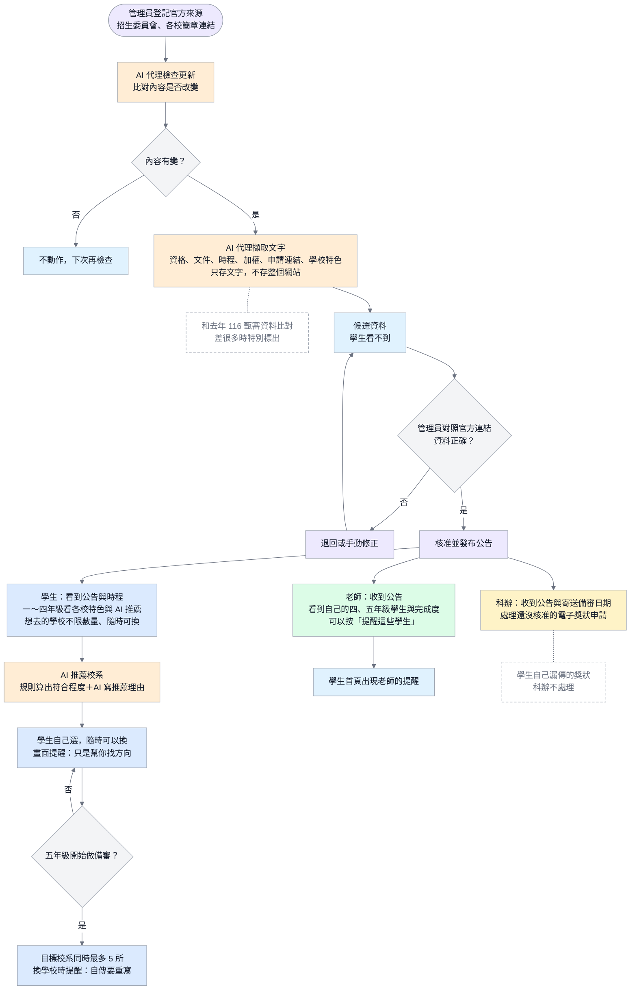

# 設計規格：二技招生公告與 AI 推薦校系

- 日期：2026-10-10
- 狀態：**定案（2026-10-10，使用者回答第八節）**；還沒開發
- 來源：使用者 2026-10-10 VS Code 對話；小助手規格 `AI_設計規格_資管科小助手_引導式Agent_2026-10-09.md` 第 10.7 節；10-07 指導老師錄音（「學生想選哪個學校，可以用 Agent 去判斷……他想看那麼多東西，他看不完」）
- 接在現有功能上：招生資料 Agent（`app/services/admission_agent_service.py`，第二、三階段）、校系資料（`AdmissionProgram`／`AdmissionRequirementItem`）、目標校系（`StudentTarget`）、年級判斷（`journey_service.current_grade()`）

## 一、要做什麼（一句話）

小助手的 AI 代理去查**資管相關**二技校系的招生資料，**只存文字**；管理員核對後**公告**給學生、老師、科辦；學生依自己的條件看到 **AI 推薦的校系**與各校特色，選校系不寫死。

## 二、範圍

| 做 | 不做（這次） |
| --- | --- |
| **資管相關科系**的二技校系（使用者 10-10 決定，資料量小、管理員核對得完） | 所有二技學校科系（之後再擴大） |
| 只存文字：申請入學連結、報名資格、要交的文件、時程、評分項目與加權、學校特色 | 下載整個學校網站 |
| 管理員核對後才公告 | AI 查到就直接公告 |
| 系統內公告與提醒 | 電子郵件、手機推播 |

## 三、四種使用者分別看到什麼

### 3.1 管理員（核對與發布）

1. 在「招生資料 Agent」頁登記官方來源（技專校院招生委員會聯合會、各校招生網頁或簡章連結）。
2. 按「檢查更新」→ AI 代理下載、比對；有變更就建立「候選資料」。
3. 按「擷取」→ AI 代理擷取**文字**：校系名稱、學年度、報名資格、要交的文件、時程（簡章公告、報名、資格審查、寄送備審、甄審）、評分項目與加權、申請入學連結；另外整理一段「學校特色」（附來源）。
4. 管理員看到「候選資料」和去年正式資料的差異（現有功能），**逐筆核對官方來源連結**後按「核准」。
5. 核准時勾選要不要**同時發布公告**；公告內容系統先擬好，管理員可以修改。

### 3.2 學生

| 年級 | 看到什麼 |
| --- | --- |
| 一～四年級 | 「認識二技」：各校特色、要求、時程；**AI 推薦校系**（第五節）；可以把學校加進「想去的學校」，**不限數量、隨時可以換**。畫面提醒：「這只是幫你找方向，過程中隨時可以換學校。」「五年級做備審資料時只能選 5 所。」 |
| 五年級 | 開始做備審資料時，目標校系**同時最多 5 所**（只算最新學年度）。換掉一所時提醒：「已經寫好的自傳要重寫，會浪費時間。」 |
| 全部 | 首頁與「公告」頁看到二技公告（例如「116 學年度二技技優甄審簡章已公告，資格審查 4/9–4/13」），未讀的有標記。專一可以看（「下一年級可以看但不能用」，10.5 (甲)），但不能送審。 |

### 3.3 老師（導師、專任教師、指導老師）

- 首頁與「公告」頁收到二技公告。
- 公告下方列出**自己有關的四、五年級**學生（五年級是今年要申請的、四年級提早準備；使用者 10-10 決定），以及每位學生的目標校系與完成度，方便提醒學生。
- 可以按「提醒這些學生」：系統在那些學生的首頁加一則提醒（記錄是哪位老師發的）。

### 3.4 科辦（行政端）

- 首頁與「公告」頁收到二技公告與重要時程（特別是**寄送備審**的日期）。
- 看到「截止前要處理的事」：還沒核准的**電子獎狀申請**（科上派的服務），以及科辦開得出來的證明類別（例如 TA 證明、社團證明）。
- **學生自己漏傳的獎狀、比賽證明，科辦不處理**（使用者 10-10：科辦只補科辦能開的證明）。

## 四、AI 代理怎麼查資料（只存文字）

- 沿用現有招生資料 Agent 的流程：登記來源 → 檢查更新（比對內容雜湊）→ 有變更才擷取 → 候選 → 管理員核准。
- **改變**：現在的程式每次檢查都把簡章檔存一份在 `instance/agent-sources/`。改成**每個來源只留最新一份簡章檔**（方便管理員對照），新的下載後取代舊檔；**每次擷取出來的文字、內容雜湊與來源連結都保留**，所以歷史仍查得到。不下載整個學校網站，只抓管理員登記的那幾個網址或簡章。
- 資料範圍：先用關鍵字篩出**資管相關科系**（資訊管理、資訊科技、智慧商務等，關鍵字可在設定調整）。
- 去年的 `school/Documents/116二技技優甄審_時程與備審加權_修訂版.pdf` 當**示範資料與比對基準**：AI 查到的新資料和它比較，差很多時特別標出來讓管理員注意。
- 每次執行都記在 `agent_tasks`（現有），成功、失敗都看得到。AI 代理**不會自己發布**。

## 五、AI 推薦校系

- **依據**：學生已確認的資料（成績、證照、競賽、服務、幹部經歷）和各校系的評分項目與加權。
- **做法（使用者 10-10 決定）**：系統先用規則算出「和你條件比較符合的校系」與符合程度（例如：這所學校證照占 30%，你已有 2 張乙級證照）；再請 AI 用白話寫推薦理由與各校特色。規則可以說明、可以測試，不會每次推薦都不一樣；AI 只負責寫理由。
- 推薦結果是**建議**，學生自己選、可以重選；畫面提醒：「這只是幫你找方向。」
- 一年級資料很少時：不硬算分數，改成介紹各校特色，並提醒「累積資料後推薦會更準」。
- 用到 AI 寫理由時算進每天 5 次（現有額度規則）；額度用完仍可看規則算出的結果，只是沒有 AI 寫的說明。

## 六、資料（給開發用）

| 資料 | 做法 |
| --- | --- |
| 校系的報名資格、要交的文件、時程、申請連結、學校特色 | 在 `AdmissionProgram` 增加欄位或一個 JSON 欄位（例如 `details_json`），沿用 candidate／published 狀態 |
| 公告（新資料表，暫名 `announcements`） | 標題、內容、給哪些角色、對應學年度與校系、發布者、發布時間；**不能刪除**，可以下架（記錄是誰、何時） |
| 已讀（新資料表，暫名 `announcement_reads`） | 使用者、公告、讀取時間 |
| 老師發給學生的提醒 | 可以共用公告資料表（對象是指定學生），或另開一張；開發時決定 |
| 目標校系上限 | 改 `student_targets` 的檢查：只有五年級、做備審時才限 5 所 |

- 需要新的資料庫遷移；只在測試用 SQLite 建立，**MySQL 先備份、問過使用者才執行**。
- 發布、下架、核准、老師發提醒都寫進 `audit_logs`。

## 七、流程圖（新圖草稿）

草稿圖片：[`docs/images/二技公告與AI推薦校系流程圖_草稿_2026-10-10.png`](../../images/二技公告與AI推薦校系流程圖_草稿_2026-10-10.png)。定案後再編入 `diagrams.md` 的正式圖號。

## 八、使用者的決定（2026-10-10）

| 問題 | 決定 |
| --- | --- |
| 推薦校系怎麼算 | **規則算符合程度＋AI 寫理由** |
| 簡章原始檔要不要保存 | **每個來源只留最新一份簡章檔**（擷取的文字與雜湊每次都保留） |
| 老師收到公告時列出哪個年級 | **四、五年級** |
| 一般公告 | **資料表做成通用的，這次畫面只做二技公告** |
| 查詢範圍 | **先做資管相關科系**，之後再擴大 |

## 九、驗收標準

1. AI 代理擷取後只產生候選資料，學生看不到；管理員核准後學生才看得到。
2. 每個來源只留最新一份簡章檔；再次下載後舊檔被取代，但每次擷取的文字與雜湊紀錄都還在。
3. 發布公告後，學生、相關老師、科辦的首頁都看到，未讀有標記，讀過後標記消失。
4. 老師看到的學生只限和自己有關的四、五年級學生；按「提醒這些學生」後學生首頁出現提醒，`audit_logs` 有紀錄。
5. 一～四年級加入想去的學校不限數量；五年級做備審時第 6 所被擋下；五年級換學校時出現「自傳要重寫」的提醒。
6. 推薦結果附理由；額度用完時仍顯示規則算出的結果。
7. 公告不能刪除，只能下架，並留紀錄。
8. 範圍只有資管相關科系（關鍵字可調整）。
