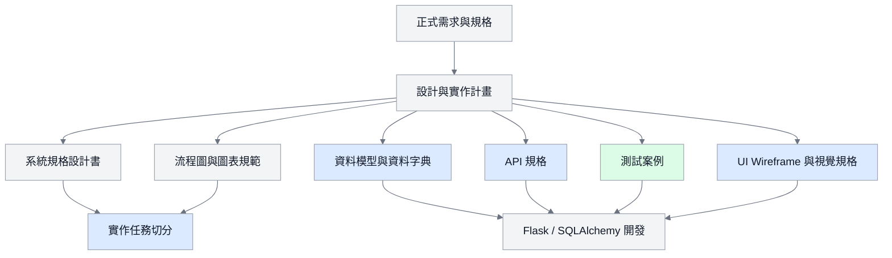
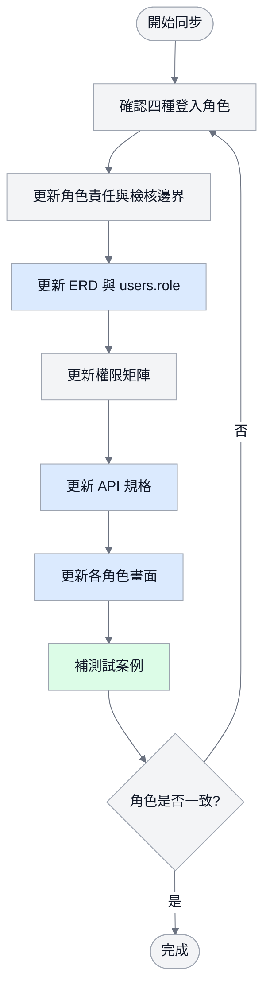

# 系統設計更新行動計畫

> **2026-09-23 優先順序註記：** 本文件的角色、圖表與資料模型同步原則仍有效；但開發順序改由 [檔案分析與學習歷程產出需求基準](AI_需求基準_檔案分析與學習歷程產出_2026-09-23.md) 決定。P0 完成前，不以文件厚度、圖表或視覺設計取代可操作成果。

> 來源：Google Docs「資管科智慧學習歷程系統－系統規格設計書（最終版）」與 ChatGPT 分享對話「補強系統設計書-網頁設計」。
>
> 目的：把文件新增內容同步到本地開發環境，讓 BMAD、程式碼、資料庫、流程圖與 UI/UX 方向使用同一套系統設計。

## 1. 核心結論

目前系統不需要急著一直加新功能，優先工作是補齊「系統設計厚度」並同步版本。

現在最容易被問到的風險是：文件、資料庫、角色權限、流程圖與畫面設計沒有完全對齊。例如早期角色可能只有 `student/admin/reviewer`，但新版設計已經包含學生、教師、科辦／行政、系統管理者與 AI Agent。如果這些角色沒有同步到 Use Case、ERD、API、權限矩陣、測試案例與畫面，報告時會被看出版本不一致。

## 2. 角色版本同步

新版系統角色應統一如下：

| 角色 | 建議 role 值 | 主要責任 |
| --- | --- | --- |
| 學生 | `student` | 維護個人資料、建立學習歷程、上傳佐證、查看 AI 檢核與教師回饋 |
| 教師/導師 | `teacher` | 查看被分派學生、提供回饋、參與共同審查並人工覆核 AI 提示 |
| 科辦/行政 | `staff` | 建立專案、分派委員、管理批次通知與結果彙整 |
| 系統管理者 | `admin` | 帳號權限、系統設定、日誌、AI 任務監控、資料維護 |
| AI Agent | 系統模組 | OCR、主張證據檢核、任務地圖分析、官方資料更新建議 |

目前程式碼的 `User.role` 是自由字串，已具備擴充空間，但後續要在資料庫文件、權限矩陣與測試中明確定義允許值。

## 3. 必補文件清單

優先補齊下列 10 件事：

1. 完整 Use Case Diagram
2. ERD 實體關聯圖
3. 系統架構圖
4. 角色流程圖
5. 資料字典 Data Dictionary
6. API Specification
7. 權限矩陣 Role Permission Matrix
8. UI Wireframe
9. Test Case 測試案例
10. MVP / Phase 2 / Future 功能切割表

本地已存在 `docs/04_圖表與介面/03_檢查與圖表規範/diagrams.md`，可作為流程圖與 ERD 的主要維護位置。這份行動計畫負責定義「要補什麼、補到哪裡、開發順序怎麼排」。

## 4. MVP / Phase 2 / Future 切分

### MVP：一定要完成

- 登入與基本權限
- 學生建立學習歷程
- 上傳 PDF、圖片或外部連結佐證
- GitHub / Canva 連結欄位
- 教師查看被分派學生資料
- 評分與回饋留言
- 歷程狀態：草稿、提交、退回、通過、鎖定
- 系統管理者查看基本結果
- 基本資料庫初始化與測試

### Phase 2：專題亮點

- 教師 Dashboard
- AI 備審主張與佐證一致性檢核
- GitHub API 擷取專案資訊
- 教師分派與避嫌規則
- 批次通知
- AI 任務狀態監控
- 操作日誌與錯誤日誌
- 報表匯出

### Future：有時間再做

- OCR 成績單擷取
- 二技升學落點分析
- WebAuthn 或更進階登入
- 更複雜的 AI 推薦
- 更完整的統計報表
- 自動擷取官方招生資料並建立版本

## 5. 文件同步流程圖

## 6. 角色權限同步檢查流程

## 7. UI/UX 方向

新版視覺概念是：

> 把五年，拼成下一站。

整體方向不是一般科技藍 Dashboard，也不是 AI 紫色漸層，而是：

> Interactive Editorial Learning Journey  
> 互動式資訊設計 x 五年成長旅程 x 個人數位檔案

最新 UI/UX 比例：

- 55% 文字與內容層級
- 25% 路徑、節點、卡片與圖像
- 15% 受控不對稱與重疊編排
- 5% 微互動與裝飾動畫

設計原則：

- 公開首頁與學生首頁必須有較強的五年旅程、拼圖、節點、路徑與 Scroll 動畫，不能只做靜態卡片。
- 教師與行政後台以效率為主，使用表格、搜尋、篩選、狀態與編輯功能。
- AI 不應搶走主畫面，可做成「看看我的歷程還少了什麼」或「幫我整理下一步」的小入口。
- 缺漏資料可用空白拼圖、未完成節點、空資料位置呈現，不只用紅色警告。
- 所有文案使用台灣常見網路服務口語，避免機器翻譯感、中國用語與每張卡片相同長度的制式句型。
- 不對稱必須是受控的編輯式排版，不可隨機破壞欄位對齊、表單操作與可讀性。
- 首頁／學生端動畫要解釋資料關係；教師／行政／審查端只保留低程度狀態回饋。
- 動畫必須支援 `prefers-reduced-motion`，關閉動畫後仍看得懂內容狀態。
- 開發仍採「功能先完成，再逐步美化」。

完整規格請參考：[UI/UX 設計與動畫規格](../../04_圖表與介面/02_設計規格/UI_UX_設計與動畫規格_2026-09-21.md)。

## 8. 目前程式碼對照

目前程式碼已具備的基礎：

- `app/models/user.py`：`User`、`StudentProfile`
- `app/models/portfolio.py`：`Portfolio`、`PortfolioEvidence`
- `app/models/agent_task.py`：`AgentTask`
- `app/models/audit_log.py`：操作紀錄模型
- `app/routes/main.py`：首頁 `/`、角色工作台與管理者頁 `/admin`

需要補強的設計項目：

- `User.role` 的正式允許值與權限矩陣
- 教師、科辦／行政與系統管理者的權限矩陣
- 評分與回饋資料表
- 人工覆核 AI 報告資料表
- 歷程鎖定狀態與退回原因
- 通知與分派機制
- API 路由與測試案例

## 9. BMAD 接下來任務順序

建議 BMAD 依序處理：

1. 更新 PRD：同步新版角色、MVP/Phase 2/Future 與 UI/UX 概念。
2. 更新 Architecture：補系統架構、角色流程、AI Agent 流程與資料流。
3. 更新 ERD：確認 `users.role`、評分、回饋、分派、AI 報告與日誌資料表。
4. 建立 Data Dictionary：列出欄位、型別、是否必填、用途。
5. 建立 API Specification：依學生、教師、行政、AI 任務分組。
6. 建立 Role Permission Matrix：確認每個角色可看、可新增、可修改、可審核、可匯出。
7. 建立 Test Case：每個 MVP 流程至少一個成功案例與一個失敗案例。
8. 建立 UI Wireframe：先完成低保真線框，不先追求美化。

## 10. 開發落地順序

### 第一輪：讓系統骨架穩定

- 初始化 Git。
- 確認 MySQL 可連線。
- 建立資料表初始化流程。
- 寫入種子帳號：學生、教師、行政、管理者。
- 補上基本登入與角色導頁。
- 維持 `pytest -q` 通過。

### 第二輪：完成 MVP 主流程

- 學生新增、修改、提交學習歷程。
- 學生新增佐證資料與外部連結。
- 教師查看被分派學生。
- 教師評分、留言、退回或通過。
- 管理者查看狀態與結果。

### 第三輪：加入亮點

- AI 任務建立與狀態顯示。
- 備審主張證據檢核報告。
- 教師人工覆核 AI 提示。
- GitHub 連結或 API 資訊擷取。
- 批次通知與報表。

## 11. 每次更新檢查表

修改系統設計或程式前，檢查：

- 新功能是否屬於 MVP、Phase 2 或 Future？
- 是否影響角色權限？
- 是否需要更新 ERD？
- 是否需要更新 API Specification？
- 是否需要補流程圖？
- 是否需要補測試案例？
- 是否需要更新 UI/UX 規格？
- 是否已寫入 `docs/03_開發紀錄/development-log.md`？

## 12. 下一個建議動作

短期最建議先做三件事：

1. 在 `docs/04_圖表與介面/03_檢查與圖表規範/diagrams.md` 補「角色權限同步流程」與「MVP 主流程」。
2. 在系統規格書補「MVP / Phase 2 / Future 功能切割」章節。
3. 開始建立 Data Dictionary 與 API Specification，避免程式開發時欄位與角色越長越散。
