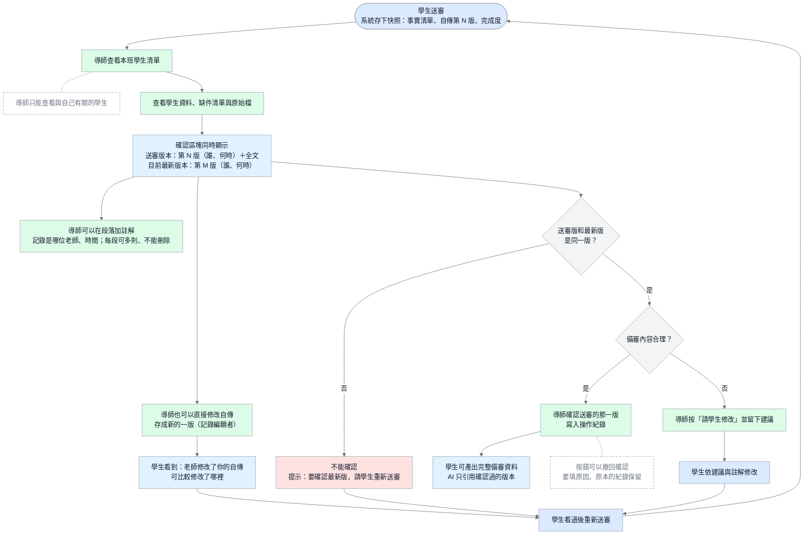

# 設計規格：導師確認版本一致、雙版本顯示、段落註解

- 日期：2026-10-10
- 狀態：**草稿，待使用者確認第六節的問題後定案**；定案後才開發（使用者 10-10：先把功能和流程圖確定，再同步雲端正式版，最後才開發）
- 來源：AI 會議室 `20261009-185407` #63（獨立審查）、#65（GPT 主筆）；使用者 10-10 對三題的決定（交接文件第 1 項）
- 關聯：資管科小助手規格 `AI_設計規格_資管科小助手_引導式Agent_2026-10-09.md` 第 10.3、10.6 節；流程圖 圖 9

## 一、要解決的問題

現在導師頁顯示的自傳是**最新版**，但按「確認」時，系統記下的是**學生送審當時那一版**。

例子：學生送審時是第 3 版 → 導師在頁面上直接修改，存成第 4 版 → 導師讀完第 4 版按確認 → 系統卻記成「導師確認了第 3 版」。導師改的字不在確認範圍內，而第 3 版導師其實沒有完整看過。

目前的檢查（比對送審時間 `taken_at`）擋不到這種情況，因為學生送審後再改、或導師自己改，都不會更新送審時間。

另外，現在每一段只能留**一則**老師意見，也沒有記錄是哪位老師寫的。

## 二、使用者已經決定的事（2026-10-10）

1. 導師改過自傳後，**要學生重新送審**，才能確認新的版本（不能直接確認自己改過的版本）。
2. 確認畫面要**同時顯示「送審版本」和「目前最新版本」**，標出版本號與修改者。
3. 要做像 Google 文件「新增註解」的**段落註解**：老師對建議修改的地方加註解，學生看得到**是哪位老師**寫的；每段可以有多則，記錄老師與時間。
4. 修完要跑完整測試＋瀏覽器實際操作驗收，**Claude 和 GPT 都要各自針對修過的地方驗收**，通過才推送。

## 三、功能規格

### 3.1 導師只能確認「送審的那一版」

- 導師按「確認」時，系統檢查：**目前最新的自傳，是不是學生送審時那一版**。
  - 是 → 照常確認。
  - 不是（送審後學生或導師又存了新版）→ **擋下**，顯示：「學生送審的是第 3 版，目前最新是第 4 版（導師 王老師 10/12 修改）。要確認最新版，請學生重新送審。」
- 「請學生修改」（退回）不受影響，任何時候都可以按。
- 這個檢查要做在**伺服器端**（`review_snapshot_service.decide()`），不能只靠畫面隱藏按鈕。
- 擋下時寫進操作紀錄嗎？→ 不寫（沒有改變任何資料），只顯示提示。

### 3.2 確認畫面同時顯示兩個版本

導師的學生頁，每個目標校系的確認區塊顯示：

| 區塊 | 內容 |
| --- | --- |
| 送審版本 | 「學生送審的版本：第 3 版（學生 王小明 10/11 14:20 儲存）」＋**全文** |
| 目前最新版本 | 和送審版相同時：只顯示「目前最新也是第 3 版」。不同時：「目前最新：第 4 版（導師 王老師 10/12 09:05 修改）」＋**和送審版逐段比較**（刪掉的劃線、新增的標色，沿用現有 `version_diff()`） |
| 確認按鈕 | 兩版相同才能按；不同時按鈕變灰，旁邊寫「要確認最新版，請學生重新送審」 |

### 3.3 導師改過自傳之後

1. 導師在頁面上修改自傳 → 存成新的一版（現在就是這樣，記錄編輯者）。
2. 學生的自傳頁顯示提示：「王老師在 10/12 修改了你的自傳（第 4 版），請看過修改的地方，沒問題再重新送審。」並能看到和上一版的差異（現有功能）。
3. 學生重新送審 → 新的送審快照記第 4 版 → 導師才能確認。

### 3.4 段落註解（像 Google 文件的「新增註解」）

- **誰可以加**：與這位學生有關的老師（教師端 `teacher` 角色，依「與學生的關係」判斷，見規格書 10-08 決定）。
- **加在哪裡**：自傳的某一段（之後可以延伸到「選取某幾個字」，這次先做到段落）。
- **一則註解記錄**：哪位老師（帳號＋姓名）、寫的時間、內容、寫在第幾版的第幾段。
- **每段可以有多則**，依時間排列；學生看得到每則是**哪位老師**寫的。
- **不能刪除**（專案原則）。修改的方式見第六節問題 2。
- **自傳改版後註解跟著走**：註解記錄寫在哪一版；新版仍顯示在對應段落，並標示「寫在第 3 版」，方便學生知道是針對舊文字。
- **舊資料**：現在每段的 `teacher_comment`（沒有記錄是誰）顯示為「導師意見（舊紀錄，未記錄是哪位老師）」，不搬移、不刪除。
- 新增、處理（見問題 2）都寫進操作紀錄 `audit_logs`。

### 3.5 資料（給開發用）

- 新資料表（暫名 `autobiography_comments`）：編號、學生、校系、寫在哪個自傳版本（`learning_profile_outputs.id`）、段落序號、作者（使用者編號）、內容、建立時間；依第六節的決定再加「回覆哪一則」「已處理時間／處理人」。
- 需要一份新的資料庫遷移；只在測試用 SQLite 建立，**MySQL 先備份、問過使用者才執行**。
- 不改 `PackageReview` 的結構：送審快照本來就記了自傳版本（`output_id`、`version`）。

## 四、驗收標準（自動測試＋瀏覽器）

1. 學生送審（第 3 版）→ 導師改成第 4 版 → 按確認被擋下，提示要學生重新送審；送審快照仍是第 3 版、狀態仍是等待確認。
2. 學生送審後自己再改成新版 → 導師按確認也被擋下。
3. 送審版和最新版相同 → 正常確認，確認的是那一版。
4. 確認畫面同時列出送審版與最新版的版本號、修改者、時間；兩版不同時有逐段差異，確認按鈕不能按。
5. 有人直接送出確認的請求（繞過畫面）→ 伺服器一樣擋下。
6. 學生看到「老師修改了你的自傳」的提示與差異；重新送審後導師可以確認第 4 版。
7. 兩位老師在同一段各加一則註解 → 學生看到兩則，各自寫出老師姓名與時間；`audit_logs` 有兩筆。
8. 註解沒有刪除功能；舊的 `teacher_comment` 顯示為「舊紀錄」。
9. 別班老師、學生本人都不能替別人加註解（權限）。
10. Claude 與 GPT 各自跑一次自動測試與瀏覽器驗收，結果寫進開發日誌。

## 五、流程圖：圖 9 導師確認（修改草稿）

和現在的圖 9 相比，新增：送審版與最新版的比對、版本不同時要學生重新送審、段落註解、導師修改後通知學生。定案後同步更新 `docs/images/D-16-teacher-confirm-flow.mmd`、PNG／SVG 與 `docs/04_圖表與介面/diagrams.md`。

## 六、要請使用者決定的問題

1. **學生可以回覆註解嗎？**（例如學生回「已改成…」讓老師看到）
   - 建議：可以，回覆掛在那則註解底下，像 Google 文件的留言串。
2. **註解處理完要怎麼辦？**（不能刪除）
   - 建議：老師或學生可以按「已處理」，註解收起來（還看得到、不會消失），記錄誰在什麼時候按的。
3. **導師改過自傳後，學生在哪裡看到通知？**
   - 建議：自傳頁最上方的提示＋學生首頁的提醒；先不做 email。
4. **哪些老師可以加註解？**
   - 建議：和這位學生有關的老師都可以（導師、專任教師、指導老師），學生看得到每位老師的姓名與身分。
5. **註解這次只做到「段落」，還是要能選取某幾個字加註解？**
   - 建議：這次先做段落，選取文字留到之後（比較複雜，11/4 前不需要）。

## 七、定案後的步驟

1. 依第六節的回答修改本文件，狀態改為「定案」。
2. 更新規格書（功能總表與相關章節）、圖 9 的 `.mmd`／PNG／SVG 與 `diagrams.md`。
3. 同步雲端正式版文件（使用者確認要同步的是哪一份）。
4. 才開始開發：開獨立工作資料夾（git worktree）與新分支，先寫測試；完成後 Claude、GPT 各自驗收，通過才合併、推送。
