# ERD：目前已實作 ORM 資料模型

> 日期：2026-10-13（台灣時間）  
> 狀態：實作模型草稿；與正式規格中的規劃型 ERD 分開。

目前 ORM 中繼資料共 **42 張表、312 個欄位、60 個外鍵欄位**。本圖只畫程式明確宣告的外鍵關係；多型欄位（例如 `target_type` + `target_id`）不會假裝成資料庫外鍵。圖表和資料字典均未經 MySQL 實際結構或老師核准。

```mermaid
erDiagram
    ADMISSION_RULE_VERSIONS ||--|{ ADMISSION_RULE_ITEMS : "rule_version_id"
    USERS ||--|{ AGENT_TASKS : "requester_id"
    USERS ||--|{ AI_DAILY_USAGE : "user_id"
    USERS ||--|{ API_KEY_METADATA : "student_id"
    USERS ||--o{ AUDIT_LOGS : "user_id"
    USERS ||--|{ CLASS_ADVISORS : "teacher_id"
    USERS ||--|{ EDITABLE_DRAFTS : "student_id"
    USERS ||--|{ LEARNING_PROFILE_OUTPUTS : "student_id"
    USERS ||--|{ PACKAGE_REVIEWS : "student_id"
    ADMISSION_RULE_VERSIONS ||--|{ PACKAGE_REVIEWS : "rule_version_id"
    USERS ||--o{ PACKAGE_REVIEWS : "teacher_id"
    PROJECT_TYPES ||--|{ PROJECT_GROUPS : "project_type_id"
    USERS ||--o{ PROJECT_GROUPS : "teacher_id"
    PUBLIC_SOURCES ||--|{ PUBLIC_SOURCE_SNAPSHOTS : "source_id"
    USERS ||--|{ PUZZLE_PIECES : "student_id"
    PROJECT_TYPES ||--|{ REQUIREMENT_TEMPLATES : "project_type_id"
    USERS ||--|{ SOURCE_DOCUMENTS : "owner_id"
    USERS ||--|{ STUDENT_PROFILES : "user_id"
    USERS ||--|{ STUDENT_TARGETS : "student_id"
    ADMISSION_RULE_VERSIONS ||--|{ STUDENT_TARGETS : "rule_version_id"
    USERS ||--|| TRANSFER_CREDIT_RECORDS : "student_id"
    USERS ||--o{ TRANSFER_CREDIT_RECORDS : "teacher_id"
    USERS ||--|{ CONSENT_RECORDS : "student_id"
    SOURCE_DOCUMENTS ||--|{ CONSENT_RECORDS : "source_document_id"
    USERS ||--|{ CREDENTIAL_RECORDS : "student_id"
    SOURCE_DOCUMENTS ||--o{ CREDENTIAL_RECORDS : "source_document_id"
    SOURCE_DOCUMENTS ||--|| DOCUMENT_EXTRACTIONS : "source_document_id"
    USERS ||--o{ DOCUMENT_EXTRACTIONS : "confirmed_by_id"
    USERS ||--|{ LEARNING_COURSE_RECORDS : "student_id"
    SOURCE_DOCUMENTS ||--o{ LEARNING_COURSE_RECORDS : "source_document_id"
    USERS ||--|{ PORTFOLIOS : "student_id"
    SOURCE_DOCUMENTS ||--o{ PORTFOLIOS : "source_document_id"
    PROJECT_GROUPS ||--|{ PROJECT_MEMBERS : "project_group_id"
    USERS ||--|{ PROJECT_MEMBERS : "student_id"
    PUBLIC_SOURCE_SNAPSHOTS ||--|{ PUBLIC_SOURCE_CHANGES : "snapshot_id"
    PUBLIC_SOURCE_SNAPSHOTS ||--|| PUBLIC_SOURCE_PUBLICATIONS : "snapshot_id"
    USERS ||--|{ PUBLIC_SOURCE_PUBLICATIONS : "published_by"
    PUZZLE_PIECES ||--|{ PUZZLE_EVIDENCE : "piece_id"
    REQUIREMENT_TEMPLATES ||--|{ REQUIREMENT_ITEMS : "template_id"
    USERS ||--|{ STUDENT_PROJECT_ASSIGNMENTS : "student_id"
    PROJECT_GROUPS ||--o{ STUDENT_PROJECT_ASSIGNMENTS : "project_group_id"
    REQUIREMENT_TEMPLATES ||--|{ STUDENT_PROJECT_ASSIGNMENTS : "template_id"
    USERS ||--|{ AWARD_CERTIFICATES : "student_id"
    PORTFOLIOS ||--|| AWARD_CERTIFICATES : "portfolio_id"
    USERS ||--o{ AWARD_CERTIFICATES : "reviewed_by_id"
    PORTFOLIOS ||--|{ PORTFOLIO_EVIDENCE : "portfolio_id"
    PORTFOLIOS ||--|{ PORTFOLIO_SUBMISSIONS : "portfolio_id"
    PORTFOLIO_SUBMISSIONS ||--o{ PORTFOLIO_SUBMISSIONS : "previous_submission_id"
    PORTFOLIO_SUBMISSIONS ||--|{ PORTFOLIO_GOAL_SNAPSHOTS : "submission_id"
    REQUIREMENT_ITEMS ||--o{ PORTFOLIO_GOAL_SNAPSHOTS : "requirement_item_id"
    PORTFOLIO_SUBMISSIONS ||--|{ PROJECT_REVIEW_RESULTS : "submission_id"
    USERS ||--|{ PROJECT_REVIEW_RESULTS : "recorded_by_id"
    PORTFOLIO_SUBMISSIONS ||--|{ SUBMISSION_ASSIGNMENTS : "submission_id"
    USERS ||--|{ SUBMISSION_ASSIGNMENTS : "teacher_id"
    PORTFOLIO_SUBMISSIONS ||--|{ SUBMISSION_EVIDENCE : "submission_id"
    PORTFOLIO_EVIDENCE ||--|{ SUBMISSION_EVIDENCE : "evidence_id"
    PORTFOLIO_SUBMISSIONS ||--|{ TEACHER_REVIEW_FEEDBACK : "submission_id"
    USERS ||--|{ TEACHER_REVIEW_FEEDBACK : "teacher_id"
    PROJECT_REVIEW_RESULTS ||--o{ PROJECT_REVISION_RECORDS : "review_result_id"
    PORTFOLIO_SUBMISSIONS ||--|{ PROJECT_REVISION_RECORDS : "submission_id"

    ADMISSION_RULE_VERSIONS {
        int id PK
    }
    COURSE_RULES {
        int id PK
    }
    PROJECT_TYPES {
        int id PK
    }
    PUBLIC_SOURCES {
        int id PK
    }
    USERS {
        int id PK
    }
    ADMISSION_RULE_ITEMS {
        int id PK
        int rule_version_id FK
    }
    AGENT_TASKS {
        int id PK
        int requester_id FK
    }
    AI_DAILY_USAGE {
        int id PK
        int user_id FK
    }
    API_KEY_METADATA {
        int id PK
        int student_id FK
    }
    AUDIT_LOGS {
        bigint id PK
        int user_id FK
    }
    CLASS_ADVISORS {
        int id PK
        int teacher_id FK
    }
    EDITABLE_DRAFTS {
        int id PK
        int student_id FK
    }
    LEARNING_PROFILE_OUTPUTS {
        int id PK
        int student_id FK
    }
    PACKAGE_REVIEWS {
        int id PK
        int student_id FK
        int rule_version_id FK
        int teacher_id FK
    }
    PROJECT_GROUPS {
        int id PK
        int project_type_id FK
        int teacher_id FK
    }
    PUBLIC_SOURCE_SNAPSHOTS {
        int id PK
        int source_id FK
    }
    PUZZLE_PIECES {
        int id PK
        int student_id FK
    }
    REQUIREMENT_TEMPLATES {
        int id PK
        int project_type_id FK
    }
    SOURCE_DOCUMENTS {
        int id PK
        int owner_id FK
    }
    STUDENT_PROFILES {
        int id PK
        int user_id FK
    }
    STUDENT_TARGETS {
        int id PK
        int student_id FK
        int rule_version_id FK
    }
    TRANSFER_CREDIT_RECORDS {
        int id PK
        int student_id FK
        int teacher_id FK
    }
    CONSENT_RECORDS {
        int id PK
        int student_id FK
        int source_document_id FK
    }
    CREDENTIAL_RECORDS {
        int id PK
        int student_id FK
        int source_document_id FK
    }
    DOCUMENT_EXTRACTIONS {
        int id PK
        int source_document_id FK
        int confirmed_by_id FK
    }
    LEARNING_COURSE_RECORDS {
        int id PK
        int student_id FK
        int source_document_id FK
    }
    PORTFOLIOS {
        int id PK
        int student_id FK
        int source_document_id FK
    }
    PROJECT_MEMBERS {
        int id PK
        int project_group_id FK
        int student_id FK
    }
    PUBLIC_SOURCE_CHANGES {
        int id PK
        int snapshot_id FK
    }
    PUBLIC_SOURCE_PUBLICATIONS {
        int id PK
        int snapshot_id FK
        int published_by FK
    }
    PUZZLE_EVIDENCE {
        int id PK
        int piece_id FK
    }
    REQUIREMENT_ITEMS {
        int id PK
        int template_id FK
    }
    STUDENT_PROJECT_ASSIGNMENTS {
        int id PK
        int student_id FK
        int project_group_id FK
        int template_id FK
    }
    AWARD_CERTIFICATES {
        int id PK
        int student_id FK
        int portfolio_id FK
        int reviewed_by_id FK
    }
    PORTFOLIO_EVIDENCE {
        int id PK
        int portfolio_id FK
    }
    PORTFOLIO_SUBMISSIONS {
        int id PK
        int portfolio_id FK
        int previous_submission_id FK
    }
    PORTFOLIO_GOAL_SNAPSHOTS {
        int id PK
        int submission_id FK
        int requirement_item_id FK
    }
    PROJECT_REVIEW_RESULTS {
        int id PK
        int submission_id FK
        int recorded_by_id FK
    }
    SUBMISSION_ASSIGNMENTS {
        int id PK
        int submission_id FK
        int teacher_id FK
    }
    SUBMISSION_EVIDENCE {
        int id PK
        int submission_id FK
        int evidence_id FK
    }
    TEACHER_REVIEW_FEEDBACK {
        int id PK
        int submission_id FK
        int teacher_id FK
    }
    PROJECT_REVISION_RECORDS {
        int id PK
        int review_result_id FK
        int submission_id FK
    }
```

關係端點依 ORM 欄位是否可為空及欄位唯一性推導：每筆子資料均對應一筆父資料；子端以 0..1、1..1、0..多或 1..多呈現。若程式邏輯另有條件（例如角色權限、審核狀態或多型關聯），仍須閱讀路由／服務與正式規格，不能只看此圖。
