# 系統流程圖與架構圖

> 這份文件使用 Mermaid。Antigravity / VS Code 通常可用 Markdown Preview 或 Mermaid 外掛預覽。
>
> AI 做得出流程圖、架構圖、ERD。開發階段建議先用 Mermaid，因為它可以直接放進 `.md`、容易用 BMAD 修改，也能轉成圖片放進報告或簡報。

## 1. 系統總架構圖

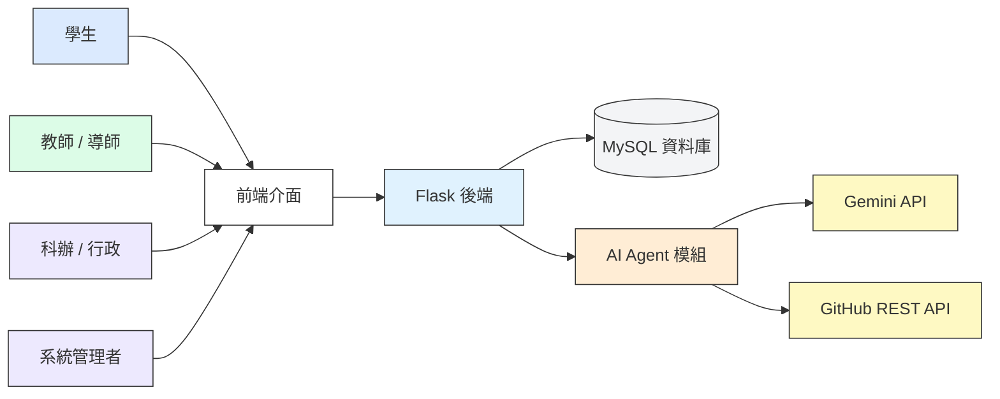

## 2. 角色功能架構圖 (使用者案例)

```mermaid
flowchart TD
    classDef student fill:#DBEAFE,stroke:#333;
    classDef teacher fill:#DCFCE7,stroke:#333;
    classDef admin fill:#EDE9FE,stroke:#333;
    classDef ai fill:#FFEDD5,stroke:#333;
    classDef backend fill:#E0F2FE,stroke:#333;

    System[前端介面與後端]:::backend

    System --> Student[學生]:::student
    System --> Teacher[教師 / 導師]:::teacher
    System --> Staff[科辦 / 行政]:::admin
    System --> Admin[系統管理者]:::admin
    System --> Agent[AI Agent]:::ai

    Student --> S1[學習歷程管理]:::student
    Student --> S2[上傳佐證資料]:::student
    Student --> S3[任務地圖解鎖]:::student
    Student --> S4[提交備審與成績]:::student
    Student --> S5[查看 AI 檢核報告]:::student

    Teacher --> T1[查看被分派學生]:::teacher
    Teacher --> T2[提供輔導與補件建議]:::teacher
    Teacher --> T3[人工覆核 AI 提示]:::teacher
    Teacher --> T4[提供補件建議]:::teacher

    Staff --> F1[登錄共同審查結論]:::admin
    Staff --> F2[整理補正項目]:::admin

    Admin --> A1[帳號與權限管理]:::admin
    Admin --> A2[系統設定維護]:::admin
    Admin --> A3[操作與錯誤日誌]:::admin
    Admin --> A4[監控 AI 任務狀態]:::admin
    Admin --> A5[審核並發布招生規則]:::admin

    Agent --> G1[成績單文字擷取]:::ai
    Agent --> G2[備審主張證據檢核]:::ai
    Agent --> G3[分析任務地圖進度]:::ai
    Agent --> G4[擷取官方招生資料]:::ai
```

## 3. 學生學習歷程流程圖

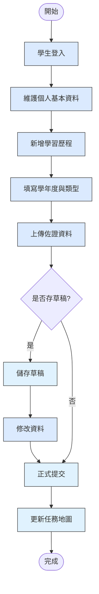

## 4. 小組專題成果與共同審查流程圖

> 報告圖片來源：`images/D-03-group-project-review-flow.mmd`。專題是學習歷程中的小組共用成果，不另做評審帳號、場地或網站公告管理系統。

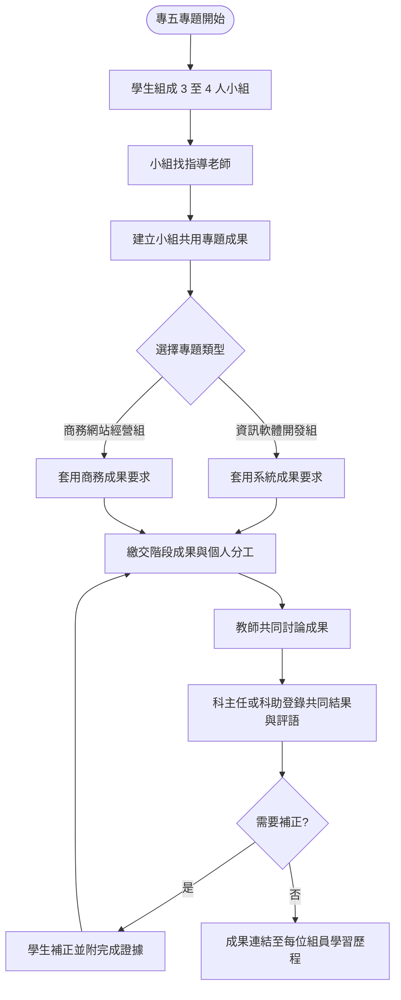

## 5. AI 備審主張－證據檢核流程圖

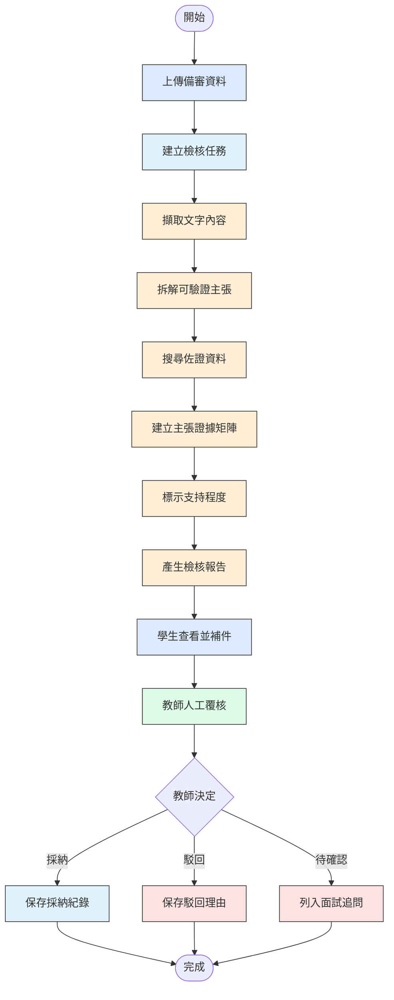

## 6. 成績單擷取流程圖

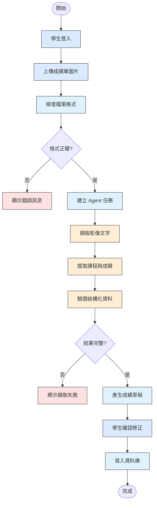

## 7. 招生資料更新流程圖

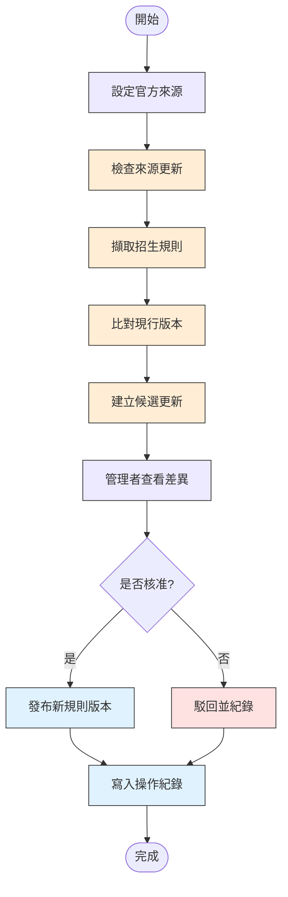

## 8. 管理者維護流程圖

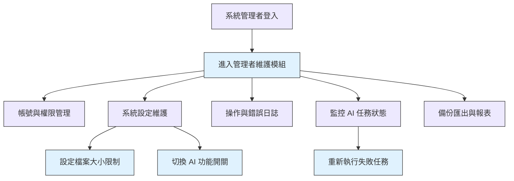

## 9. ERD 草圖

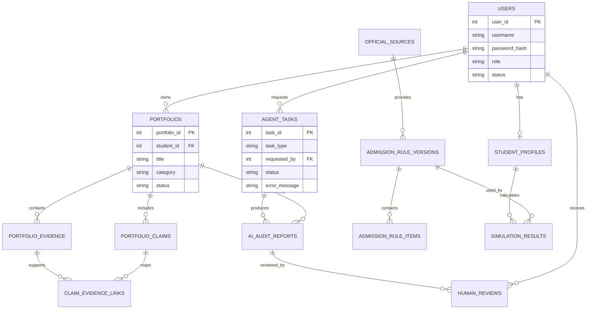

## 10. DFD 資料流程圖

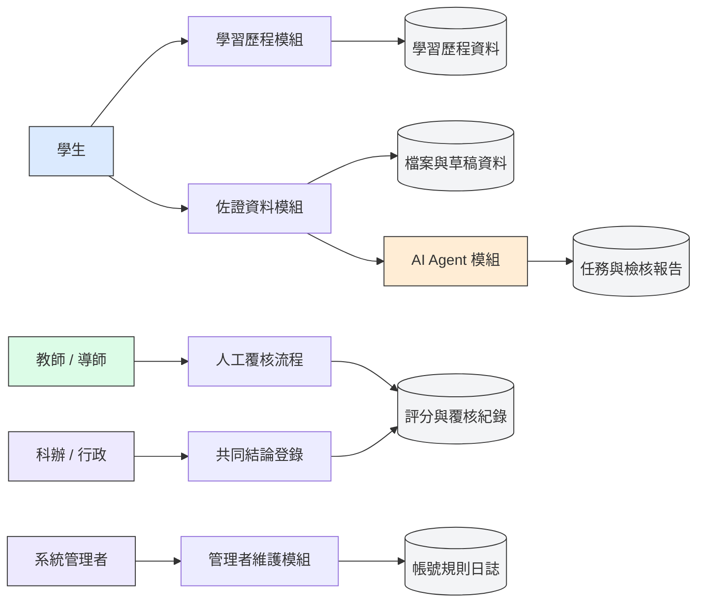

## 11. AI 可以幫你做哪些圖

AI 可以做：

- 系統架構圖
- 使用者流程圖
- DFD 資料流程圖
- ERD 資料庫關聯圖
- 權限矩陣圖
- AI Agent 任務流程圖
- 管理者維護流程圖
- 報告用圖片版流程圖

建議順序：

1. 先用 Mermaid 產生 `.md` 可讀版本。
2. 確認流程正確。
3. 再轉成圖片放到報告書或簡報。
4. 最後才做美化版圖表。

## 12. 文件與開發同步流程圖

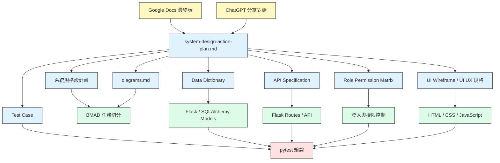

## 13. 角色權限同步流程圖

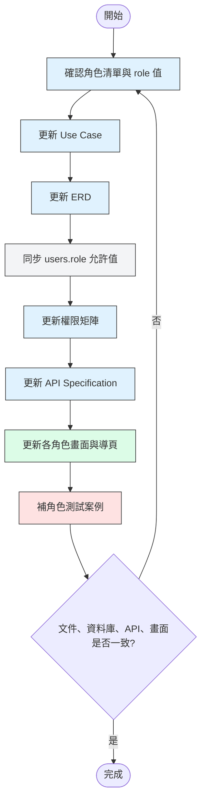

## 14. MVP 主流程圖

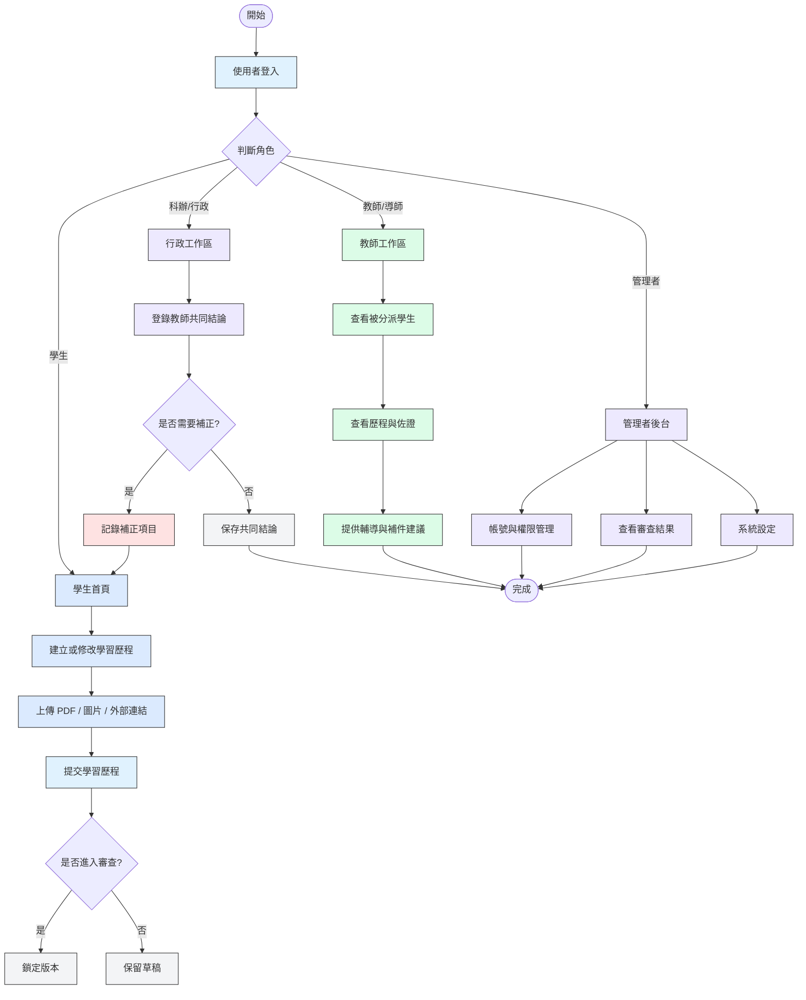

## 15. UI/UX 視覺概念流程圖

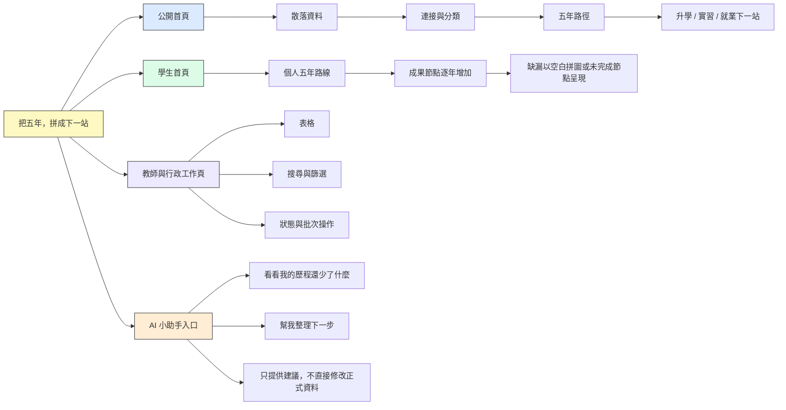
