# 系統流程圖與架構圖

> 版本：2026-10-08（依 10-07 錄音討論更新角色與主線）
> 每張圖的原始碼存放在 `docs/images/` 的 `.mmd` 檔，本文件內容與 `.mmd` 檔一致；PNG／SVG 由 Mermaid CLI 匯出，正式規格書引用 PNG。
> 流程以正式規格書為準；登入導頁與資料表以目前程式（`app/routes/main.py`、`app/models/`）為準，尚未實作的部分在圖中標示「待新增」或以虛線框表示。

## 圖表閱讀方式

| 顏色 | 代表 |
| --- | --- |
| 淺藍 | 學生 |
| 淺綠 | 導師 |
| 淺紫 | 系統管理者（開發者）、科主任或科助 |
| 淺灰藍 | 系統自動處理 |
| 淺橘 | AI 輔助（選用，失敗時可人工處理） |
| 淺紅 | 錯誤或缺件提示 |
| 虛線框 | 待確認、後續擴充或補充說明 |

## 圖表清單

| 規格書圖號 | 圖表 | 原始碼與圖檔 |
| --- | --- | --- |
| 參考 | 使用者案例總覽（所有角色合併；規格書改用圖 1～3） | `images/D-01-use-case-v2.mmd`／`.png`／`.svg` |
| 圖 4 | 登入與角色導頁流程圖 | `images/D-02-login-role-routing.mmd`／`.png`／`.svg` |
| 圖 5 | 學生主線流程圖 | `images/D-10-main-line-flow.mmd`／`.png`／`.svg` |
| 圖 6 | 行政表單數位化與申請追蹤流程圖（後續擴充） | `images/D-11-admin-forms-flow.mmd`／`.png`／`.svg` |
| 圖 7 | 專題共同審查流程圖（後續擴充） | `images/D-03-group-project-review-flow.mmd`／`.png`／`.svg` |
| 圖 8 | 招生資料更新流程圖 | `images/D-13-admission-rule-update-flow.mmd`／`.png`／`.svg` |
| 圖 9 | 導師確認流程圖 | `images/D-16-teacher-confirm-flow.mmd`／`.png`／`.svg` |
| 圖 10 | 系統管理者維護校系備審要求流程圖 | `images/D-17-admin-maintain-requirements.mmd`／`.png`／`.svg` |
| 圖 11 | 角色與責任圖 | `images/D-14-role-responsibility.mmd`／`.png`／`.svg` |
| 圖 12 | 系統架構圖 | `images/D-05-system-architecture.mmd`／`.png`／`.svg` |
| 圖 13 | DFD 資料流程圖 | `images/D-06-dfd.mmd`／`.png`／`.svg` |
| 圖 14 | ERD 資料庫關聯圖 | `images/D-09-erd-v2.mmd`／`.png`／`.svg` |
| 圖 15 | 報告用總體流程圖 | `images/D-15-report-overview.mmd`／`.png`／`.svg` |
| 圖 16 | 科辦上傳紀錄流程圖 | `images/D-18-staff-service-record-flow.mmd`／`.png`／`.svg` |

## 圖 1～3：依角色的使用案例圖

規格書的圖 1～3 依角色分開畫（人形＋功能橢圓），樣式參考歷屆專題報告書。這三張不是 Mermaid 圖，而是由 `images/D-01-use-case-by-role.py` 產生：

| 規格書圖號 | 角色 | 圖檔 |
| --- | --- | --- |
| 圖 1 | 學生 | `images/D-01-use-case-student.png`／`.svg` |
| 圖 2 | 導師 | `images/D-01-use-case-teacher.png`／`.svg` |
| 圖 3 | 系統管理者（開發者） | `images/D-01-use-case-admin.png`／`.svg` |
| 圖 1-1 | 科辦／科助 | `images/D-01-use-case-staff.png`／`.svg` |

修改方式：打開 `D-01-use-case-by-role.py`，修改最上方 `ROLES` 裡的功能清單，再到 `docs/images` 資料夾執行 `python D-01-use-case-by-role.py`，四張圖（含科辦）會一起更新。

### 2026-10-08 錄音討論後的流程圖基準

依 [10-07 會議紀錄](../06_會議錄音與逐字稿/AI_會議紀錄_科助使用者端與小助手_2026-10-07.md) 與 10-08 使用者決定：

| 項目 | 決定 |
| --- | --- |
| 選校系 | AI Agent 依學生條件推薦，學生自己選，可選多個 |
| 上傳後 | AI 辨識並判斷格式；辨識失敗時說明可能原因與修正方式；確認前 AI 標出可疑處，一定要學生本人確認 |
| 成績單、證照、競賽證明 | 不經導師審核；證照與競賽證明由 AI 判斷。競賽證明由主辦方（例如 AREC）開立，學生自行上傳 |
| 科辦／科助 | 用固定 Excel 範本上傳服務（例如帶高中機器人社團）、公假、嘉獎紀錄，依學號列入學生資料並可產出電子證明；不逐筆審核、**不審備審資料** |
| 自傳與備審 | AI 可引用學生資料與科辦紀錄撰寫，標示依據 |
| 備審資料 | 只由導師確認 |

待確認（不畫進主線）：學生發現漏列時可否線上請科辦補登；電子證明版面；科辦是否在系統開放競賽報名、處理公假與嘉獎申請（後續擴充，性質同行政表單）。

## 參考：使用者案例總覽（所有角色合併；規格書改用圖 1～3）

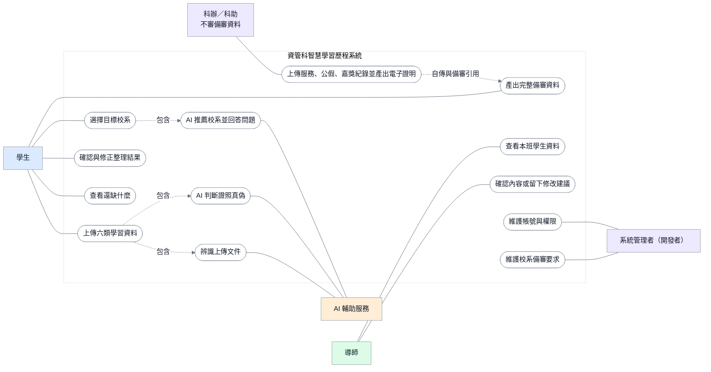

## 圖 4：登入與角色導頁流程圖

依目前程式：帳號不存在、已停用或密碼錯誤時顯示同一個錯誤訊息；帳號沒有可用角色時拒絕登入；登入後每個頁面再用 `role_required` 檢查角色。

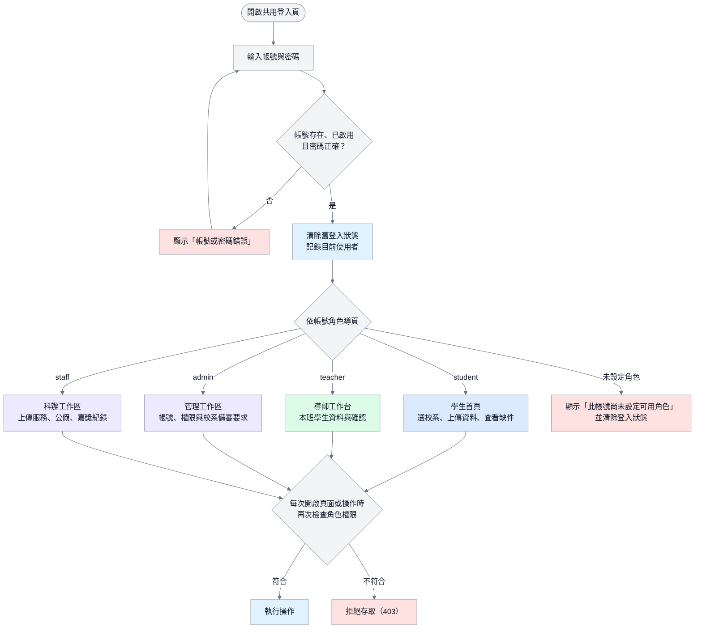

## 圖 5：學生主線流程圖

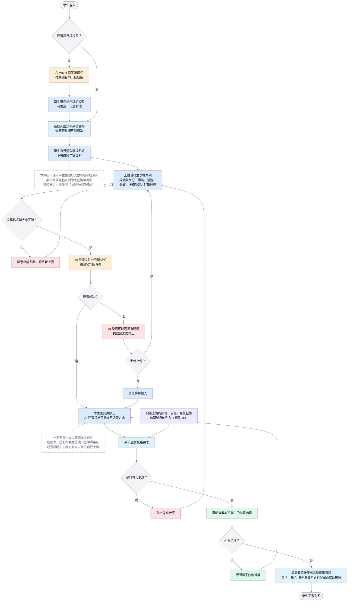

## 圖 6：行政表單數位化與申請追蹤流程圖（後續擴充）

主線完成前不實作；保留供日後評估。

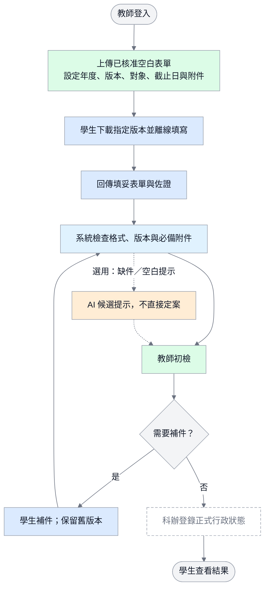

## 圖 7：專題共同審查流程圖（後續擴充）

狀態值與 [專題成果評量範本](../01_正式規格/專題成果評量範本-第一版.md) 及目前程式一致。

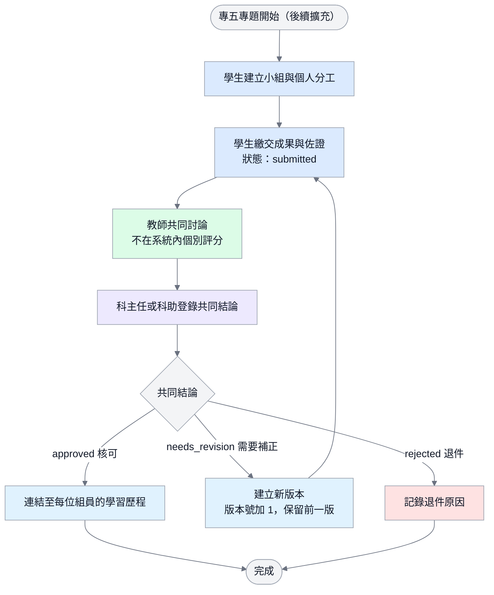

## 圖 8：招生資料更新流程圖

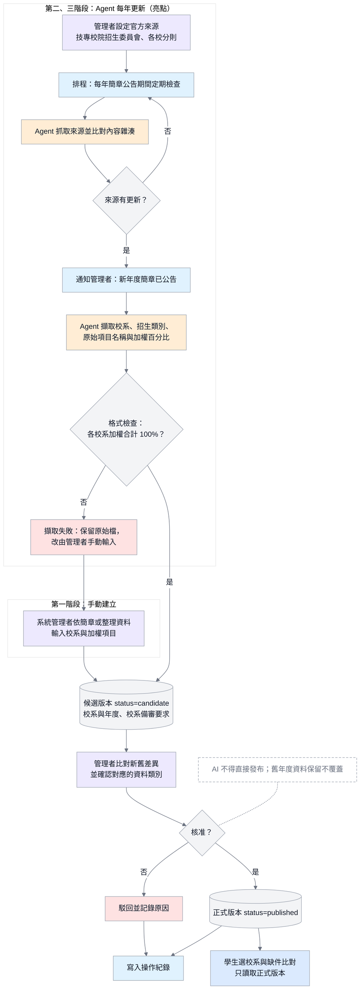

## 圖 9：導師確認流程圖

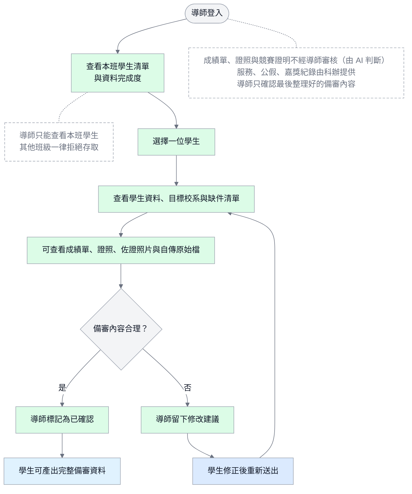

## 圖 10：系統管理者維護校系備審要求流程圖


## 圖 11：角色與責任圖

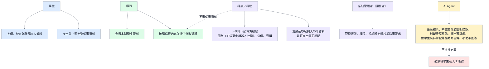

## 圖 12：系統架構圖

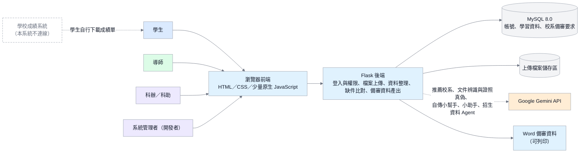

## 圖 13：DFD 資料流程圖

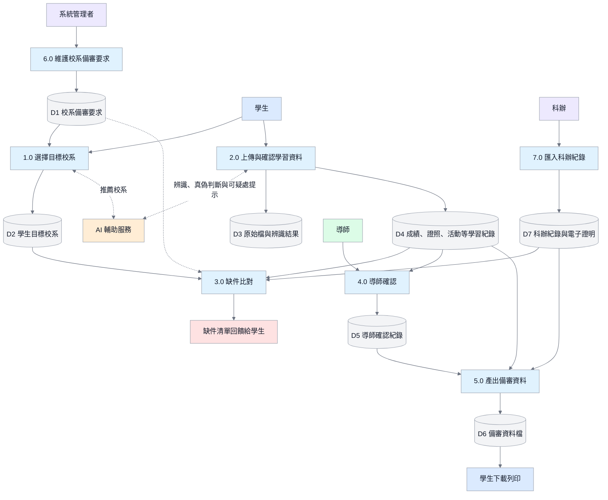

## 圖 14：ERD 資料庫關聯圖

標示「待新增」的資料表是主線需要、但目前程式還沒有的資料表；其餘資料表已存在於 `app/models/`。

```mermaid
%%{init: {'theme':'base','themeVariables': {'fontFamily':'Arial, Microsoft JhengHei, sans-serif','fontSize':'14px','primaryColor':'#F3F4F6','primaryTextColor':'#111827','primaryBorderColor':'#9CA3AF','lineColor':'#6B7280'},'er':{'minEntityWidth':160,'entityPadding':20}}}%%
erDiagram
    USERS ||--o| STUDENT_PROFILES : "學生基本資料"
    USERS ||--o{ CLASS_ADVISORS : "擔任導師"
    USERS ||--o{ SOURCE_DOCUMENTS : "上傳"
    SOURCE_DOCUMENTS ||--o| DOCUMENT_EXTRACTIONS : "辨識結果"
    USERS ||--o{ LEARNING_COURSE_RECORDS : "成績與學分"
    SOURCE_DOCUMENTS |o--o{ LEARNING_COURSE_RECORDS : "來源檔"
    USERS ||--o{ CREDENTIAL_RECORDS : "證照"
    SOURCE_DOCUMENTS |o--o{ CREDENTIAL_RECORDS : "來源檔"
    USERS ||--o{ PORTFOLIOS : "活動競賽服務幹部"
    PORTFOLIOS ||--o{ PORTFOLIO_EVIDENCE : "佐證"
    ADMISSION_RULE_VERSIONS ||--o{ ADMISSION_RULE_ITEMS : "備審要求"
    USERS ||--o{ STUDENT_TARGETS : "選擇校系"
    ADMISSION_RULE_VERSIONS ||--o{ STUDENT_TARGETS : "被選擇"
    USERS ||--o{ LEARNING_PROFILE_OUTPUTS : "產出備審資料"
    LEARNING_PROFILE_OUTPUTS ||--o{ PACKAGE_REVIEWS : "導師確認"
    USERS ||--o{ PACKAGE_REVIEWS : "確認者"

    USERS["USERS 使用者　　　"] {
        int id PK
        string username "學號或帳號"
        string role "student teacher staff admin"
        bool is_active
    }
    STUDENT_PROFILES["STUDENT_PROFILES 學生資料　　　"] {
        int id PK
        int user_id FK
        string student_no
        string class_name "班級"
    }
    CLASS_ADVISORS["CLASS_ADVISORS 導師班級　　　"] {
        int id PK "待新增"
        int teacher_id FK
        string class_name
        int school_year
    }
    SOURCE_DOCUMENTS["SOURCE_DOCUMENTS 上傳原始檔　　　"] {
        int id PK
        int owner_id FK
        string document_type "成績單 證照等"
        string file_path
        string status
    }
    DOCUMENT_EXTRACTIONS["DOCUMENT_EXTRACTIONS 辨識結果　　　"] {
        int id PK
        int source_document_id FK
        string status "辨識狀態"
        datetime confirmed_at "學生確認時間"
    }
    LEARNING_COURSE_RECORDS["LEARNING_COURSE_RECORDS 成績與學分　　　"] {
        int id PK
        int student_id FK
        int source_document_id FK
        string course_name
        int credits
        int score
    }
    CREDENTIAL_RECORDS["CREDENTIAL_RECORDS 證照　　　"] {
        int id PK
        int student_id FK
        int source_document_id FK
        string credential_name
        string level
    }
    PORTFOLIOS["PORTFOLIOS 活動競賽服務幹部　　　"] {
        int id PK
        int student_id FK
        string category "活動 競賽 服務學習 幹部經歷"
        string title
        string status
    }
    PORTFOLIO_EVIDENCE["PORTFOLIO_EVIDENCE 佐證檔案　　　"] {
        int id PK
        int portfolio_id FK
        string file_path
        string external_url
    }
    ADMISSION_RULE_VERSIONS["ADMISSION_RULE_VERSIONS 校系與年度　　　"] {
        int id PK "待新增"
        string program_code "志願代碼"
        string school_name "學校"
        string department_name "科系"
        string admission_category "招生類別"
        int admission_year "學年度"
        string source_url "資料來源"
        string status "candidate published"
        string data_origin "manual agent"
        date checked_at "最後確認日期"
    }
    ADMISSION_RULE_ITEMS["ADMISSION_RULE_ITEMS 校系備審要求　　　"] {
        int id PK "待新增"
        int rule_version_id FK
        string source_item_name "簡章原始項目名稱"
        int weight_percent "加權百分比"
        string mapped_categories "對應資料類別"
        string mapping_status "確定 待確認"
        string requirement "需要的資料與標準"
        bool is_required
    }
    STUDENT_TARGETS["STUDENT_TARGETS 學生目標校系　　　"] {
        int id PK "待新增"
        int student_id FK
        int rule_version_id FK
        datetime selected_at
    }
    LEARNING_PROFILE_OUTPUTS["LEARNING_PROFILE_OUTPUTS 備審資料產出　　　"] {
        int id PK
        int student_id FK
        string output_type "備審資料"
        datetime created_at
    }
    PACKAGE_REVIEWS["PACKAGE_REVIEWS 導師確認紀錄　　　"] {
        int id PK "待新增"
        int output_id FK
        int teacher_id FK
        string result "confirmed needs_revision"
        string comment "修改建議"
    }
```

## 圖 15：報告用總體流程圖

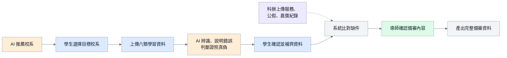

## 圖 16：科辦上傳紀錄流程圖

依 2026-10-07 錄音討論與 2026-10-08 使用者決定：科辦是「科上官方紀錄」的資料來源，用固定 Excel 範本一次上傳服務、公假、嘉獎名單，不逐筆審核、不審備審資料。

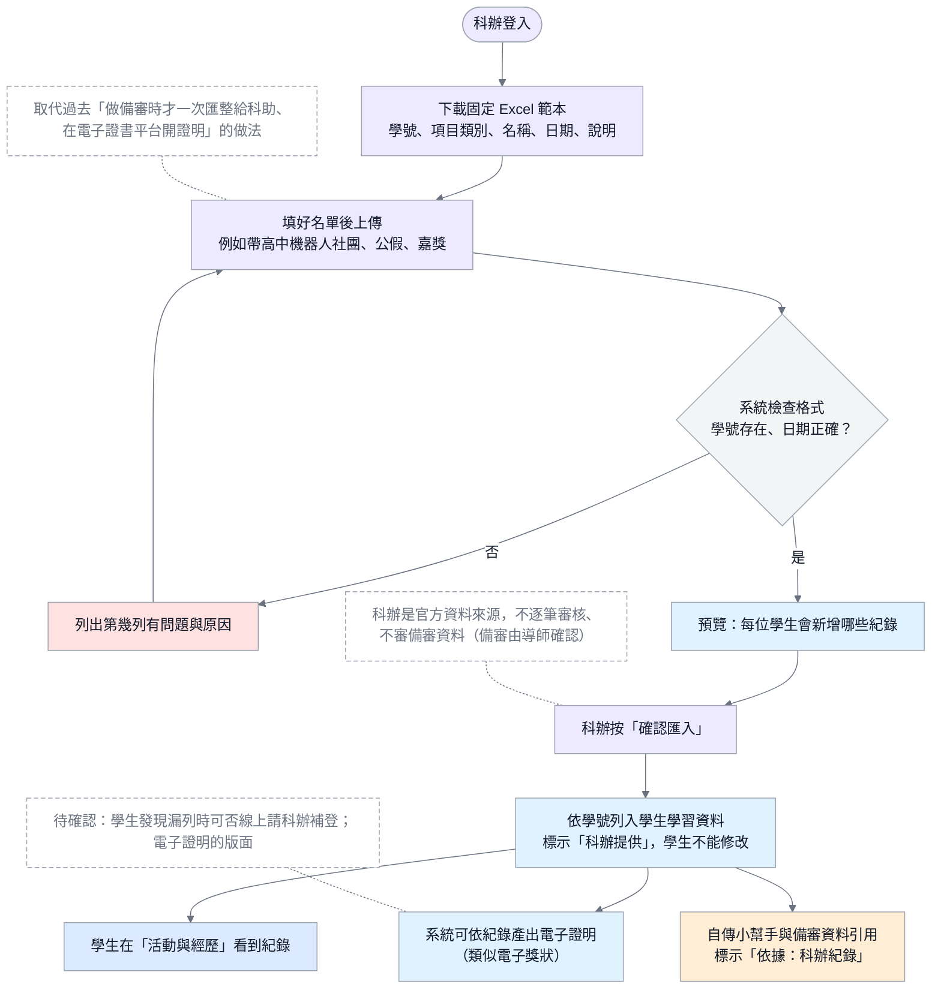

## 修改圖表的步驟

1. 修改 `docs/images/` 裡對應的 `.mmd` 檔。
2. 匯出圖片（需先安裝 Mermaid CLI）：

   ```bash
   mmdc -i D-10-main-line-flow.mmd -o D-10-main-line-flow.png -b white -s 2
   mmdc -i D-10-main-line-flow.mmd -o D-10-main-line-flow.svg -b white
   ```

3. 重新產生本文件，或把 `.mmd` 內容貼回對應章節，確保兩邊一致。
