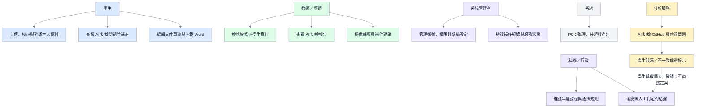
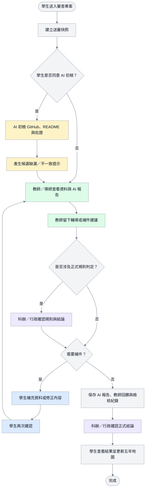
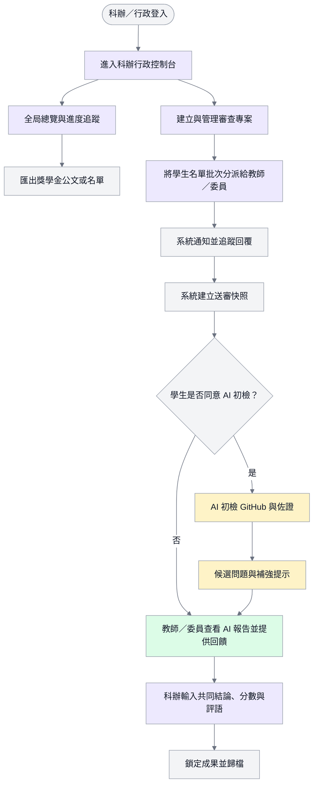
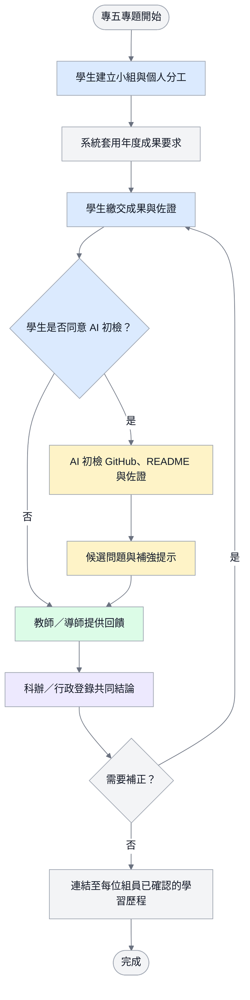
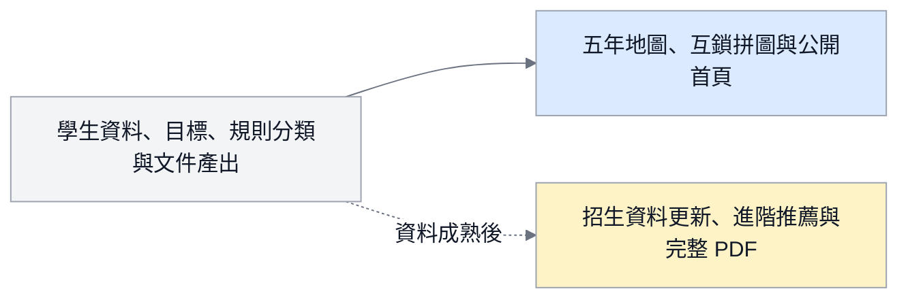
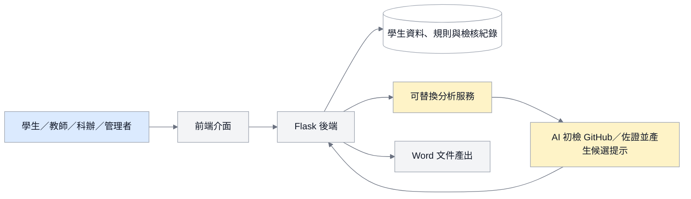
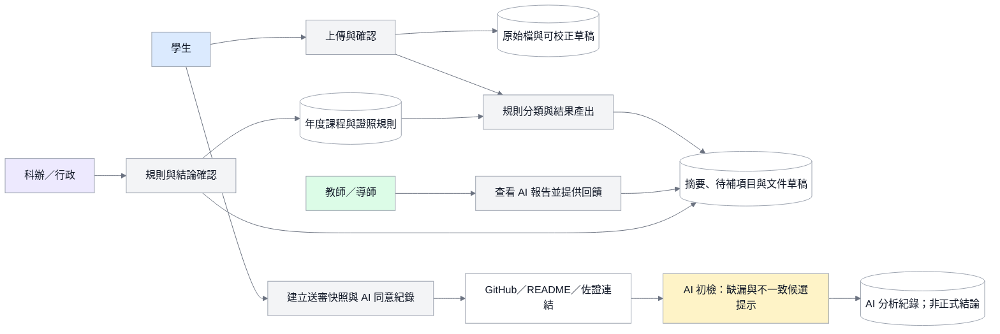
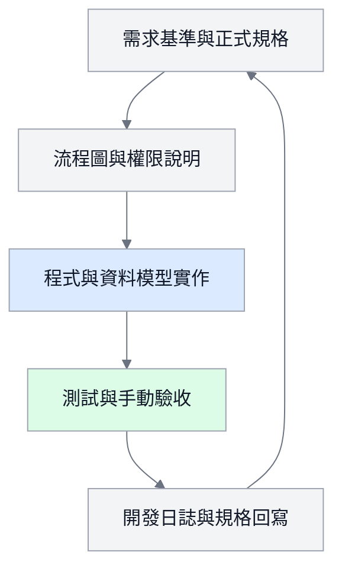

# 系統流程圖與架構圖

> 本文件的 Mermaid 原始碼是正式圖表來源。所有圖採白底、細灰框、深灰箭頭與繁中易讀字型；角色與系統節點只以低飽和淡色區分。
> AI 初檢目前只呈現 GitHub／README／佐證的缺漏與不一致候選問題；AI 不直接形成通過、退件、分數或其他正式結論。

## 1. 圖表閱讀方式

- **P0 根流程**：學生從上傳資料到取得可使用文件的完整流程。
- **檢核與補件**：學生、教師／導師、科辦／行政各自負責的確認工作。
- **P1／P2／Future**：延伸功能，不能取代 P0 根流程。

## 2. 角色與責任圖

## 3. 學生學習歷程、目標與送審流程

```mermaid
%%{init: {'theme':'base','themeVariables': {'fontFamily':'Microsoft JhengHei, Noto Sans TC, Arial, sans-serif','primaryColor':'#F3F4F6','primaryTextColor':'#111827','primaryBorderColor':'#9CA3AF','lineColor':'#6B7280','edgeLabelBackground':'#FFFFFF'}}}%%
flowchart TD
    classDef student fill:#DBEAFE,stroke:#9CA3AF,color:#111827,stroke-width:1px;
    classDef system fill:#F3F4F6,stroke:#9CA3AF,color:#111827,stroke-width:1px;
    classDef teacher fill:#DCFCE7,stroke:#9CA3AF,color:#111827,stroke-width:1px;
    classDef staff fill:#EDE9FE,stroke:#9CA3AF,color:#111827,stroke-width:1px;
    classDef alert fill:#FEE2E2,stroke:#9CA3AF,color:#111827,stroke-width:1px;
    classDef ai fill:#FEF3C7,stroke:#9CA3AF,color:#111827,stroke-width:1px;

    Start([開始]) --> Login[學生登入]:::student
    Login --> Goal{是否已設定目標？}
    Goal -- 否 --> Choose[選擇升學、就業或實習目標]:::student
    Choose --> Map[建立個人五年學習地圖]:::system
    Goal -- 是 --> Upload
    Map --> Upload[上傳成績單、證照、作品與其他資料]:::student
    Upload --> Extract[系統擷取可辨識欄位]:::system
    Extract --> Draft[建立可校正資料草稿]:::system
    Draft --> Confirm[學生校正、補充與確認]:::student
    Confirm --> Complete{資料是否完整？}
    Complete -- 否 --> Missing[顯示待補資料]:::alert
    Missing --> Upload
    Complete -- 是 --> Rules[套用適用年度課程與證照規則]:::system
    Rules --> Review{是否需要人工確認？}
    Review -- 是 --> Teacher[教師／導師提供回饋]:::teacher
    Teacher --> Staff[科辦／行政確認規則或結論]:::staff
    Staff --> Fix{需要補件或修正？}
    Fix -- 是 --> Confirm
    Fix -- 否 --> Results[產生摘要、分類、待補清單與下一步]:::system
    Review -- 否 --> Results
    Results --> Gap[對照目標顯示差距與下一步]:::system
    Gap --> Portfolio[累積個人作品集與五年地圖]:::system
    Portfolio --> Document[產生自傳與學習／入學計畫草稿]:::system
    Document --> Edit[學生編輯、下載 Word 或送入審查專案]:::student
    Edit --> Submit[建立送審快照]:::student
    Submit --> Consent{是否同意 AI 初檢？}
    Consent -- 否 --> TeacherReview[教師／導師檢視學生資料]:::teacher
    Consent -- 是 --> AICheck[AI 初檢 GitHub、README 與佐證]:::ai
    AICheck --> AIReport[產生候選問題與補強提示]:::ai
    AIReport --> StudentCheck[學生查看問題並補充／修正]:::student
    StudentCheck --> TeacherReview
    TeacherReview --> TeacherAdvice[教師提供回饋，不直接改正式結論]:::teacher
    TeacherAdvice --> StaffReview[科辦／行政登錄正式結論]:::staff
    StaffReview --> End([完成])
```

## 4. 教師回饋、審查與補件流程

## 5. 科辦審查專案與成果管理流程

## 6. 小組專題成果流程

## 7. 延伸功能位置

## 7. 系統架構圖

## 8. DFD 資料流程圖

## 9. 文件與開發同步流程

