# 資管科智慧學習歷程系統 \- 分支 · 網頁設計

**Date**: September 21, 2026 at 02:39 PM
**Turns**: 10
**Source**: [ChatGPT Chat](https://chatgpt.com/g/g-p-6aa7d84775dc819195e3b85b87136492/c/6aa98c8d-1584-83e8-84eb-37a679efe563)

---

## Turn 1: 資管科智慧學習歷程系統－系統規格設計書（最終版）這個檔案內容做得好沒有五專資管生會有的程度，請修正

### 🤖 GPT

已修正好了： 資管科智慧學習歷程系統－系統規格設計書（最終版）
我這次把它改成比較像「五專資管生真的會寫、真的能開發」的版本，不再像太大的業界系統規劃。主要修正方向是：

- 把內容改成學生專題口吻，不用太多 AI 專業術語。
- 保留「目標校系導航 × 關卡式養成 × AI 備審小助手」三個亮點。
- 明確寫開發階段使用假資料，不串接學校正式資料庫。
- 把 AI Agent 降成「備審小助手」，只整理完成項目、缺少項目、下一步建議。
- 把功能寫成你開發時看得懂的頁面、資料表、流程、按鈕與展示方式。
- 保留完整系統感，但不寫成一個月內不可能完成的超大型平台。
這版比較能跟老師說：「我們有把系統收斂，而且知道自己要做什麼。」

## Turn 2: 我覺得\[資管科智慧學習歷程系統－系統規格設計書（新版）\]內容比較貼近我說的五專資管生會有的程度，請對\[資管科智慧學習歷程系統－系統規格設計書（最終版）\]修正，同時請修正文件格式和字體，全部都是用標楷體，字體大小都是跟 \[資管科智慧學習歷程系統－系統規格設計書（新版）\]一樣，例如： 康寧學校財團法人康寧大學 資訊管理科 畢業專題 資管科智慧學習歷程系統 專 題 生：111534105田心于<br>111534107張馨羽<br>111534124林承諺<br><br><br><br><br><br><br><br><br><br><br><br>指導老師：李栢松 老師 中 華 民 國 116 年 06 月 \-\-\-\-\-這頁，目錄一樣也是，同時要保留我前面跟你討論出來要用的部分 顯示更多顯示較少

### 🤖 GPT

修好了。新的最終版在這裡：
資管科智慧學習歷程系統－系統規格設計書（最終版）
我這次不是用上一版純文字去改，而是用「新版」當格式母版重做，所以：

- 封面格式、表格、目錄都跟「新版」一致。
- 全文已統一成標楷體。
- 字級保留新版原本設定，例如封面大字、目錄大字、內文章節大小。
- 原本那份比較不像正式專題書的「最終版」已改名成「最終版－舊版備份」，避免混在一起。
- 內容保留新版那種五專資管專題的完整程度，但把我們討論出的核心方向放進去了： 「目標校系導航 × 關卡式養成 × AI 備審小助手」
- 也有把 AI Agent 從太大的自動化系統，修成比較合理的「AI 備審小助手」，比較不會被老師覺得好高騖遠。
我也檢查過：封面表格有保留、目錄有保留、附錄四名稱已改成「AI Agent 模組與測試資料規範」，標楷體也套上去了。

## Turn 3: 我剛想到如果在這5年中轉入非資管科但是是我們學校的，同時他們都有共同學校必修科目（像是英文、國文、自然、化學、數學）等等，哪他們要怎麼搞歷年成績單？

### 🤖 GPT

這個問題很重要，而且你想到的是「真實學校會遇到的例外狀況」。這其實可以讓系統更合理，但不要把它做太大。
我的建議是：不要讓系統自己處理「轉科抵免」這種複雜校務判斷，而是把它設計成「歷年成績單上傳 + 科別/入學狀態標記 + 人工確認」。
白話講就是：

> 系統可以幫忙整理成績資料，但不能自己判斷哪些科目一定能抵、哪些不能抵。 轉科、抵免、共同必修這種事情，最後還是要由教務或老師確認。
你們可以這樣設計。

| 狀況 | 系統怎麼處理 |
| --- | --- |
| 一直都是資管科學生 | 直接依資管科五年課程與升學需求整理 |
| 從本校其他科轉入資管科 | 保留原科成績，標記「轉科前修課紀錄」 |
| 有共同必修，例如國文、英文、數學 | 系統先分類成「共同科目」，顯示可供參考 |
| 專業科目不同，例如護理、應外、幼保轉資管 | 系統標記為「非資管專業科目」，不自動當成資管能力 |
| 是否可抵免 | 系統只顯示「待老師／教務確認」，不要自動判定 |

所以歷年成績單可以這樣做：

1. 學生上傳歷年成績單。
2. 學生填寫自己的狀態： 「本來就是資管科」或「從其他科轉入」。
3. 如果是轉科生，學生選原本科別，例如護理科、應外科、幼保科。
4. 系統把課程分成三類：
  - 共同必修：國文、英文、數學、自然、化學、體育等。
  - 資管專業：程式設計、資料庫、網頁設計、專題、資訊相關課程。
  - 其他科專業：原本科別的專業課程。
5. 系統顯示提醒：

> 你有轉科紀錄，部分共同科目可作為學習歷程參考；是否可抵免或列入資管專業能力，需由老師或教務確認。
這樣就很穩。
千萬不要寫成：

> 系統自動判斷轉科學生所有科目是否可抵免。
這會太危險，也太像學校教務系統，不適合你們專題。
比較適合寫成：

> 本系統針對轉科學生提供「成績資料標記與分類」功能。系統可將共同必修、資管專業科目及原科專業科目分開顯示，協助學生與老師了解歷年學習紀錄。但科目抵免、畢業資格與正式採認結果，仍以學校教務單位及老師確認為準。
這句可以直接放進規格書。
而且它還能呼應老師說的「從源頭往回推」：

> 因為升學備審需要的是歷年成績與學習成果，所以系統要能處理一般學生，也要能處理轉科學生的成績來源差異。
所以結論是：

> 可以支援轉科生，但只做「分類、標記、提醒、輔助整理」，不要做「自動抵免判斷」。
這樣一個月版本也可以做得出來：先讓學生手動輸入或上傳成績單，再用下拉選單標記科目類型就好。不要一開始就做 OCR 自動辨識。

## Turn 4: 因為我們這個系統要做的比高中職現有的學習歷程系統更好，加上用這系統要從專一用到專五整整五年的時間，不間斷，更不用說行政端和教師們，所以網頁設計風格要耐用又耐看皆適合男女老少，還要讓這些使用者他們用的更開心，該從何處下手？

### 🤖 GPT

你這個想法其實很對：如果系統要從專一用到專五，甚至老師、行政也要長期用，那網頁設計不能只追求「第一眼很炫」，而是要追求：

> 看久不累、操作不煩、每年都用得下去。
我會建議你從「耐用型設計」下手，而不是「漂亮型設計」。
最重要的方向是這四個：

| 方向 | 白話意思 | 你們系統要怎麼做 |
| --- | --- | --- |
| 清楚 | 一看就知道要做什麼 | 首頁直接顯示目標、進度、缺少項目 |
| 穩定 | 五年都不會看膩 | 淺色背景、少量主色、不要太多花俏動畫 |
| 有成就感 | 學生會想繼續補資料 | 關卡、進度條、完成徽章、鼓勵提示 |
| 不造成壓力 | 老師行政也能快速用 | 表格清楚、篩選方便、不要塞滿畫面 |

我會建議你們的風格定成：

> 溫和、乾淨、任務感、學習感
不要走太可愛，也不要走太冰冷的公家機關風。因為它要同時給學生、老師、行政用。
可以用這種設計方向：

- 背景：米白色、淺灰色、淡藍色
- 主色：深藍或藍綠色，代表穩定、學習、資訊感
- 輔助色：綠色代表完成、黃色代表待補、紅色只用在重要警示
- 卡片式排版：每個區塊像一張任務卡
- 字體：清楚就好，不要太花
- 圓角：可以有一點，但不要太童趣
- 動畫：只做小動畫，例如按鈕 hover、進度條，不做大型遊戲特效
你們可以先設計 3 個核心畫面，不要一開始設計全部：

1. 學生首頁
這頁最重要，要讓學生一登入就知道：

- 我現在是幾年級
- 我的目標是什麼
- 我完成幾％
- 我還缺什麼
- 下一步要做什麼

2. 關卡任務頁
這頁是你們的特色。不要做太複雜的遊戲地圖，先做「任務卡」就好：

- 專一任務
- 專二任務
- 專三任務
- 專四任務
- 專五任務
每張卡顯示「已完成／待補／老師已確認」。

3. AI 備審小助手頁
這頁不要做成聊天機器人太大一套，可以做成「整理報告」：

- 已完成資料
- 缺少資料
- 建議下一步
- 老師提醒
這樣會比單純聊天更像正式系統。
我覺得你們的設計核心句可以寫成：

> 本系統採用簡潔、耐用、低壓力的卡片式介面，讓學生能長期累積學習歷程，也讓老師與行政人員能快速查看學生狀況。設計重點不追求短暫華麗，而是讓使用者五年內持續願意使用。
這句很適合放進規格書或簡報。
結論：
你們不要從「我要做多漂亮」開始，應該從這句開始：

> 使用者每天打開它，不會覺得煩，還知道下一步要做什麼。
這才是比高中職學習歷程系統更好的地方。

## Turn 5: 我覺得你說的不錯，我想看更細更清楚的網站設計風格

### 🤖 GPT

可以，而且我覺得現在已經可以把「風格」定得更像真正的產品，而不是只有「藍色＋卡片」。
我重新對照你們目前的專題設計後，你們其實不是單純作品上傳網站。學生端要管理五年的作品與備審；教師端要看全班完成度、缺件與輔導；行政端要處理審查專案、分派與進度；委員端還要閱讀 PDF、作品與評分。資管科學習歷程系統_專題成果報告書 所以我會把整套 UI 定義成：

# 「校園數位工作台 × 成長型學習空間」
不是高中學習歷程那種「政府網站感」，也不要做成很像手遊的「闖關系統」。
而是介於 **Notion 的清爽、Google Classroom 的易懂、現代 SaaS Dashboard 的效率感**之間，再加一點屬於康寧資管科自己的個性。

---

## ① 整體視覺，我會長這樣
想像學生登入後看到：

```
┌─────────────────────────────────────────────────────────────┐
│  KUIM   學習歷程                  🔔      田同學 ▾          │
├──────────────┬──────────────────────────────────────────────┤
│              │                                              │
│  🏠 首頁     │  早安，田同學 👋                            │
│              │  專四這學期也繼續累積吧。                    │
│  🗺 成長地圖 │                                              │
│  📁 我的作品 │  ┌──────────────────────────────────────┐   │
│  🏆 證照成就 │  │  我的五年學習歷程                    │   │
│  📊 成績學分 │  │                                      │   │
│  🤖 AI助手   │  │  專一 ●━━● 專二 ●━━● 專三 ●━━○ 專四 │   │
│              │  │                              68%     │   │
│  ─────────   │  └──────────────────────────────────────┘   │
│  ⚙ 設定      │                                              │
│              │  接下來可以完成                              │
│              │                                              │
│              │  ┌──────────┐ ┌──────────┐ ┌──────────┐     │
│              │  │ 💻 專題  │ │ 🏆 證照  │ │ 📄 履歷  │     │
│              │  │ 還差說明 │ │ 已完成 ✓ │ │ 尚未更新 │     │
│              │  │          │ │          │ │          │     │
│              │  │ 繼續 →   │ │ 查看 →   │ │ 開始 →   │     │
│              │  └──────────┘ └──────────┘ └──────────┘     │
│              │                                              │
│              │  🤖 小助手                                  │
│              │  「你的專題已經有 GitHub，但還沒有成果說明」│
│              │                                    查看建議 │
└──────────────┴──────────────────────────────────────────────┘
```
這跟你們原本規格書裡「學生 Dashboard 顯示完成度、檔案狀態、審查進度、學分預警」是吻合的。資管科學習歷程系統_專題成果報告書
但差別在於：
**我們不要把 Dashboard 做成一堆數字。**
學生不是主管，他其實不太在乎：

> 作品 13｜證照 4｜GitHub 6｜完成率 72%
他真正需要知道的是：

> **「我現在做到哪裡？接下來做什麼？」**

---

# ② 顏色不要只有「學校藍」
我會做成一套 **低飽和、長時間觀看型配色**。

### Light Mode

```
背景
#F7F9FC    很淡的冷灰白

主要卡片
#FFFFFF

主要文字
#1F2937    深灰藍，不用純黑

次要文字
#667085

品牌主色
#3B6FD8    柔和藍

Hover / 淺藍背景
#EEF4FF

成功
#3FA37C    柔和綠

提醒
#D99A3D    琥珀黃

錯誤
#D65C5C    柔和紅

AI
#7467D8    紫藍
```
這裡有個很重要的原則：

### 🔴 紅色不能亂用。
如果學生每天登入都看到：

> ⚠️ 缺件 ⚠️ 未完成 ⚠️ 尚未上傳 ⚠️ 進度不足
用五年真的會很煩。
應該改成：

> **還有 2 個項目可以完成**
而不是：

> **你缺少 2 個項目。**
只有真正的 deadline、錯誤、學分危險才用紅色。
這就是「讓使用者比較願意回來」的小地方。

---

# ③ 字體也要制定規則
繁體中文網站我建議：
**Noto Sans TC / 思源黑體。**
標題不要粗得像電商廣告。
例如：

```
32px  我的學習歷程        ← 頁面大標題
24px  專四・上學期        ← 區域標題
18px  響應式網頁設計      ← 卡片標題
16px  一般內文
14px  日期、提示
12px  非重要 metadata
```
而且：

> **最低主要操作文字盡量不要低於 14px。**
因為這不是只給 18 歲學生用。
老師、主任、科辦行政人員也會用。

---

# ④ 「圓角」要有，但不能太可愛
我會定：

```
大卡片：16px
一般卡片：12px
按鈕：8px
Input：8px
Tag：6px
```
不要全部：

```
border-radius: 30px;
```
不然會很像兒童教育 App。
陰影也非常淡：

```
box-shadow:
0 1px 2px rgba(16,24,40,.04),
0 2px 8px rgba(16,24,40,.06);
```
甚至大部分區塊可以：
**細 border > 大陰影。**
這樣五年後比較不容易顯得過時。

---

# ⑤ 五年成長地圖會是學生端的「靈魂」
你之前想的關卡其實非常適合。
而且你們本來的核心就是讓學生從專一開始慢慢累積作品，到專五才不用突然整理全部。
但我不會真的畫：
🎮 森林 → 城堡 → BOSS。
而會設計成：

```
我的五年旅程

●━━━━━━━━●━━━━━━━━●━━━━━━━━●━━━━━━━━○
專一          專二          專三          專四          專五
探索          累積          成長          專業          出發

 ✓ 作品        ✓ 課程成果    ✓ 證照        ● 專題        ○ 備審
 ✓ 個人資料    ✓ GitHub      ✓ 競賽        ● 實習        ○ 二技
```
這樣：
學生覺得有成長感。
老師看不會覺得幼稚。
教授看到也還是一套正式系統。
而且你們原本就有規劃保存 **1～5 年級 GitHub、Canva 等作品連結**。專題初審申請單-資管科智慧學習歷程系統
所以它不是為了好看硬加的 UI，而是真的對應資料結構。

---

# ⑥ 作品集不要像「檔案管理器」
這個我很想幫你們改。
不要：

```
檔名                     日期
期末專題.pdf              2026/05/03
報告.pdf                  2026/04/01
123.pdf                   2026/03/18
```
那只是 Google Drive 劣化版。
應該做：

```
┌──────────────────────────┐
│ 🌐 Web                   │
│                          │
│ 資管科智慧學習歷程系統   │
│                          │
│ 專四・畢業專題           │
│                          │
│ Python  Flask  MySQL     │
│                          │
│ GitHub ✓    Canva ✓      │
│                          │
│ 最後更新 2026/09/16      │
└──────────────────────────┘
```
點進去才是：
**作品故事 → 我的角色 → 使用技術 → 過程 → 成果 → 反思 → 證據。**
這才叫「學習歷程」。

---

# ⑦ 老師端反而要更「無聊」
這裡非常重要。
學生端可以有成長地圖、成就、鼓勵。
老師端千萬不要。
你們目前已經把老師端定位成「減少工作量」，要一次看到全班完成度、缺件、風險排序、批次通知與面談追蹤。資管科學習歷程系統_專題成果報告書
所以老師登入：

```
資四忠                         39 位學生

完成狀況
████████████████░░░░  82%

需要處理                         6 人

┌────────┬──────────┬────────┬────────┬────────┐
│ 學生   │ 學習歷程 │ GitHub │ 學分   │ 狀態   │
├────────┼──────────┼────────┼────────┼────────┤
│ 王○○   │ 92%      │ ✓      │ 正常   │ 完成   │
│ 林○○   │ 63%      │ ✓      │ 注意   │ 待追蹤 │
│ 陳○○   │ 41%      │ —      │ 正常   │ 缺件   │
└────────┴──────────┴────────┴────────┴────────┘

□ 選取學生

[批次提醒]    [匯出報表]
```
老師的 UI 原則就是：

> **能少按一次，就少按一次。**

---

# ⑧ 科辦則要做成真正 Dashboard
學生：

> 我接下來做什麼？
老師：

> 哪些學生需要我？
行政：

> **現在整個系統發生什麼？**
所以科辦首頁：

```
115 學年度實習初審

已提交         待分派         審查中         完成
  86             12             31            43

████████████████░░░░  83%

需要處理
────────────────────────
⚠ 12 位學生尚未分派
⚠ 3 位委員即將超過截止日
○ 6 位學生尚未提交

近期活動
────────────────────────
14:32  王老師完成 5 份評分
14:18  系統完成委員分派
13:55  林同學提交學習歷程
```
這才是行政系統。

---

# ⑨ 審查委員頁甚至可以完全換布局
你們原本規格其實已經寫了一個很好的概念：

> **雙欄式閱覽。**
左邊 PDF，右邊 GitHub / Canva / AI / 評分。資管科智慧學習歷程系統-系統需求書與規格書
我會進一步做成：

```
← 上一位          田同學             下一位 →

┌──────────────────────┬──────────────────────┐
│                      │  作品證據             │
│                      │                      │
│                      │  GitHub   ✓           │
│     PDF PREVIEW      │  Canva   ✓           │
│                      │                      │
│                      │  AI 輔助檢查          │
│                      │  🟢 有對應佐證         │
│                      │                      │
│                      │  ─────────────────   │
│                      │  評分   [ 85 ] /100   │
│                      │                      │
│                      │  評語                 │
│                      │  [.................] │
│                      │                      │
│                      │       [送出評分]      │
└──────────────────────┴──────────────────────┘
```
教授甚至不必一直跳頁。
**上一個 → 評 → 下一個 → 評。**
這就是 UX。

---

# ⑩ AI 千萬不要做成「右下角聊天泡泡」而已
這是很多 AI 專題很容易撞在一起的地方：

> 網站 + 右下角 🤖 = AI 系統。
你們其實可以做得成熟很多。
例如學生正在編輯作品：

```
┌─────────────────────────────────┐
│ ✦ 學習歷程小助手                │
│                                 │
│ 我發現這份作品還可以補充：       │
│                                 │
│ ○ 你的負責工作                  │
│ ○ 遇到的問題                    │
│ ○ 最後學到什麼                  │
│                                 │
│ [幫我整理思路]   [先不用]       │
└─────────────────────────────────┘
```
AI 是「在需要它的地方出現」。
不是強迫學生跟 ChatGPT 聊天。
而且這也符合你們現在對 AI 的定位：**協助整理、提醒、比對，不取代老師最後判斷。**

---

# ⑪ 還有一個我很推薦你們做：微互動
不是炫技動畫。
而是完成事情時：
上傳成功：

> ✓ 已經幫你保存好了
完成專三：

> 🎉 專三歷程整理完成 今年累積了 7 件作品與 2 張證照。
第一次建立 GitHub：

> ✓ 第一件程式作品加入歷程
但是動畫控制在 **200～300ms** 左右。
不要彩帶噴 5 秒 😂
這些小回饋其實會比「超炫首頁」更讓人願意使用。

---

## 最後把整個 Design System 定下來
我會給你們這個名稱：

> **KUIM Learning Design System 1.0**
核心原則只有五個字：
**清楚・溫和・成長・效率・可信**
而且四種角色可以「同品牌、不同個性」：

| 學生 | 老師 | 科辦 | 委員 |
| --- | --- | --- | --- |
| 成長感 | 省時間 | 掌控感 | 專注閱讀 |
| 卡片 | 名單 | Dashboard | 雙欄工作區 |
| 鼓勵 | 提醒 | 數據 | 證據 |
| 五年旅程 | 班級狀況 | 全局狀況 | 一人一份 |
| AI 教練 | AI 輔助 | 自動化 | AI 佐證 |

**這樣就不是「四個 Dashboard 換資料」而已，而是真的四套 UX 共用同一套 Design System。**
而且你們目前規格已經明確規劃學生 Dashboard、科辦管理台、委員評審頁、導師輔導看板，所以這種做法不用推翻現在的系統架構。資管科學習歷程系統_專題成果報告書
如果接下來真的要開始做前端，我反而建議**先不要碰 HTML/CSS**。先把「學生 Dashboard、五年成長地圖、作品詳細頁、老師班級 Dashboard、科辦 Dashboard、教授審查頁」這 **6 張高擬真 UI Mockup** 定出來；確認整套長相，再開始寫前端，會少掉非常多重工。

## Turn 6: 不知道為啥你說有一種很濃的ai味 我去https://pin\.it/1bMzyMJsw 這裡爬了一下，覺得蠻漂亮的就存起來你看一下，想來激發靈感 如果做得很漂亮老師們也會很愛會少扣幾分， 主要是我想要有一點藝術性質和很有記憶點，也要做得比高中職的學習歷程檔案好用一萬倍，因為我們班一定都是用Ai生成的模板幾乎差不多，評審老師們看得久了也會疲乏可能還會沒耐心等等，當然你也可以評估到底要不要做 目前我是想一個是放在首頁給訪客做個這個系統的意義用圖表示同時還能讓想了解本校資管科五專生的五年規劃（這個管理員可以改），另一部分給學生端的需求使用者，因為學生他們一年也才用一次，每次用都會感慨哇好厲害的系統想多停留幾分鐘來更細心的補缺漏事項， 顯示更多顯示較少

### 🤖 GPT

我懂你說的「AI 味」是什麼了。上一版雖然乾淨、合理，但太像「請 AI 設計一個現代 Dashboard」的標準答案：白底、左側欄、四張統計卡、藍紫漸層、圓角卡片、AI 小助手。**沒有錯，但也沒有作者性。**
你給的 Pinterest 短連結我這邊目前沒成功展開，所以我不能假裝看過裡面的收藏。你傳的 Pinterest 靈感頁 不過你現在補充的方向，反而讓我覺得我們可以把整個視覺概念推翻重想，而且我贊成你做「藝術性」。只是藝術應該集中在**值得被記住的地方**，不是每個管理表格都藝術化。

## 我會把網站變成「一本會成長的數位校刊／旅程誌」
這比「闖關遊戲」更適合你們。
首頁不是一進去就：

> 資管科智慧學習歷程系統 Login / Register 本系統提供……
而是直接做一個有作品感的 **Hero 首屏**。
例如第一幕可能只有超大的：

# 五年，不只是五個學年。
下面非常小：
**從第一次寫下程式，到決定下一站去哪裡。**
背景不是 AI 常見的紫色科技光球，而是一張有編輯設計感的「五年軌跡」：五條不完全規則的線、作品縮圖、程式碼片段、證照、課堂、實習、專題等元素像一本 editorial magazine 被串起來。
使用者往下滑，這五條線慢慢匯成一條。

```
專一              專二
  ○────────╮      ○
           ╰──────╯
     探索       累積

              專三
                ○───────╮
                        │
             找到自己的方向

                    專四
                      ○─────────╮
                                │
                         專題・證照・實習

                                  專五
                                    ◎
                                  下一站
                             升學 / 實習 / 就業
```
這時才出現：

> **你現在累積的每一件小事，最後都會成為下一站的材料。**
這就是你說的「這個系統的意義用圖表示」。
而且它不是我憑空幫你加故事。你們原本專題就明確把「學生 1～5 年級的數位資產容易散失」列為痛點，並規劃保存各年級作品。資管科智慧學習歷程系統-系統需求書與規格書

---

## 更有趣的是：首頁本身就能成為「資管科五年地圖」
你剛剛這個想法我很喜歡，而且我認為**值得正式加入系統**。
訪客往下滑：
**01 / 專一・探索**

> 第一次接觸資訊管理。 開始認識程式、資料與數位工具。
旁邊可以由管理員放： 「推薦累積項目」、「重要課程」、「活動」、「作品範例」。
再往下：
**02 / 專二・累積**
畫面構圖開始變豐富。
到了專三：
**03 / 專三・形成方向**
到了專四：
**04 / 專四・把能力做成作品**
最後：
**05 / 專五・帶著五年的東西出發**
然後整條五年軌跡在這裡分叉：

```
                         ┌──── 二技升學
五年的累積 ──────────────┼──── 實習
                         └──── 就業
```
最後才出現 CTA：

> **你的五年，會留下什麼？** `進入我的學習歷程 →`
這比首頁放「系統功能介紹／三大特色／立即登入」漂亮太多，也更有記憶點。
而且你提出「管理員可以修改五年規劃」非常重要。這代表它不是我們寫死的一張漂亮海報，而是真的**網站功能**：科辦未來改課程、證照建議、活動、升學資訊，不需要重新改 HTML。

---

# 登入之後，我甚至不想叫它 Dashboard
這也是消除 AI 味的重要一步。
不要：

> Dashboard Welcome back, 田同學 72% completed
我希望學生看到的是：

# 我的第五年
旁邊很小：

> 2026 · 資訊管理科
下面不是四張 KPI。
而是一個非常大的、不規則的「個人歷程畫布」。

```
                           2026
                      ○ 畢業專題
                     /
       ○ 網頁設計 ───○
      /               \
2024 ○                 ○ 軟體證照
      \                 \
       ○ 第一次競賽      ○ 實習
                          \
                           ◎ 現在
```
每個節點都是真的作品。
點「網頁設計」：
照片／封面慢慢展開，旁邊出現作品內容。
點「證照」：
出現證照與取得時間。
點「專題」：
GitHub、簡報、負責內容、反思全部出來。
於是**每一個學生登入看到的首頁都不完全一樣**。
這件事情非常有價值。
因為 AI 模板最明顯的特徵之一就是：

> 每個人的網站骨架完全一樣，只是換名字。
我們反過來：

> **系統架構一樣，但資料會自己形成每個學生不同的視覺。**
這才真的有「學習歷程」的感覺。

---

## 而且一年才回來一次，反而可以利用這件事
你這句讓我想到一個我很想做的效果：

### 「歡迎回來。」
例如學生專三整理完之後，一年沒登入。
專四再登入，不要：

> Welcome back!
而是：

> **距離你上次整理歷程，已經 327 天。** 這段時間，你應該又多了不少東西。
然後以前完成的節點淡淡浮出來：

> 專三留下了 **6 件作品 · 2 張證照 · 1 次競賽**
接著：

> **今年也把它們留下來吧。**
`開始整理專四 →`
我覺得這會比「每日簽到、經驗值 +50」高級很多。
它不是逼學生黏著網站，而是讓**一年一次的回訪本身變成儀式**。

---

# 「補缺漏」也不要做成待辦清單
普通版本：

```
☐ 上傳證照
☐ 填寫專題
☐ GitHub
☐ 自傳
```
我們可以把它變成：

> ### 你的專四，還有三塊空白。
然後整個歷程版面真的留三個「空的位置」。

```
╭────────────╮    ╭ · · · · · ·╮
│ 畢業專題   │    ·              ·
│ 已留下 ✓   │    ·   一張證照   ·
╰────────────╯    ·   還沒留下   ·
                  ╰ · · · · · ·╯

╭ · · · · · ·╮   ╭─────────────╮
·             ·   │ 實習經歷    │
· GitHub作品  ·   │ 已留下 ✓    │
·             ·   ╰─────────────╯
╰ · · · · · ·╯
```
人的直覺會想把「洞補起來」。
不用一直警告他：

> ⚠️ 你還沒完成。

---

# AI 也藏起來
甚至首頁我都不一定要看到大大的：
🤖 **AI Assistant**
AI 可以變成非常小的一句：

> ✦ 看看我的歷程還少了什麼
按下去，畫面右側才滑出一張像編輯註記的紙：

> **我看了一下你的專四。**
> 專題資料其實很完整，不過你寫了「負責前端」，目前還沒有留下能看出你實際負責內容的資料。
> 如果還保留著，可以補一張畫面、GitHub 連結或簡短說明。
> `去補這一項 →`
這比：

> 🤖 AI ANALYSIS Confidence: 92% Risk level: LOW
舒服很多。
AI 是底層能力，不一定非得成為視覺主角。你們原始規格裡的 AI 本來也是「輔助」，而不是取代人工判斷。資管科智慧學習歷程系統-系統需求書與規格書

---

## 但是老師端，我反而會踩煞車
這點我會跟你站不同邊一點：
**學生端和公開首頁可以藝術；老師／行政工作區不能太藝術。**
因為老師是來工作的。
所以整套網站可以故意形成一個非常漂亮的反差：

| 公開首頁 | 學生空間 | 老師／行政 |
| --- | --- | --- |
| 最有藝術性 | 有個人感 | 極度清楚 |
| 故事式捲動 | 五年時間軸 | 表格＋搜尋 |
| 大字排版 | 作品畫布 | 高資訊密度 |
| 不規則構圖 | 少量互動 | 少動畫 |
| 展示資管科 | 展示「我」 | 完成工作 |

這樣反而很像真正成熟的產品。

---

## 還有一個會讓評審記得你們的地方
**不要把康寧校徽放左上角就叫「校園風」。**
我們可以從資管科本身找一個 visual motif。
例如「資料節點」。
首頁五年是節點。
學生作品是節點。
目標校系是節點。
作品、證照、課程與未來目標最後全部「連線」。
因此那一條線慢慢成為整個網站的品牌語言。
甚至 Logo 都可能只是：

```
○──○──○──○──◎
       KUIM
```
五個節點代表五專五年。
最後一個不是終點，而是下一站。
**這種東西才會產生記憶點。**
不是靠漸層。

---
我現在其實比上一版更支持你花時間做 UI 了，但有一個條件：**不要先花兩週做動畫。**
先把功能骨架完成，再把「首頁＋學生首頁」當你們的**展示級頁面**。老師端保持漂亮乾淨即可。這樣開發成本沒有爆炸，可是評審 Demo 一開始看到公開首頁，接著登入學生帳號看到自己的五年軌跡，兩個最有記憶點的畫面都出來了。
而且你說「要比高中職學習歷程好用一萬倍」，我會把這句轉成真正可以實作的設計原則：

> **高中學習歷程比較像「最後把東西交上去」。 你們要做的是「讓學生看見自己五年怎麼長出來」。**
這個差異，比多十個功能更有價值。
如果你願意把那個 Pinterest 收藏**直接截幾張你最喜歡的圖貼給我**，我就能真的逐張拆它們的「排版、留白、字體感、線條、色彩、藝術元素」，再把其中適合的 DNA 混成你們自己的風格，而不是照抄 Pinterest。到那一步，我甚至建議直接做一張**真正的「公開首頁視覺稿」**給你看，而不是再用文字框框想像。

## Turn 7: IMG\_2906\(2\)\.jpeg IMG\_2910\(2\)\.jpeg IMG\_2908\(2\)\.jpeg IMG\_2909\(2\)\.jpeg IMG\_2907\(1\)\.jpeg IMG\_2905\(2\)\.jpeg IMG\_2903\(1\)\.jpeg IMG\_2902\(1\)\.jpeg IMG\_2904\(2\)\.jpeg IMG\_2901\(1\)\.jpeg 這些是部分看到覺得不錯的你先參考還有很多

### 👤 田心于

*[This turn includes uploaded images]*

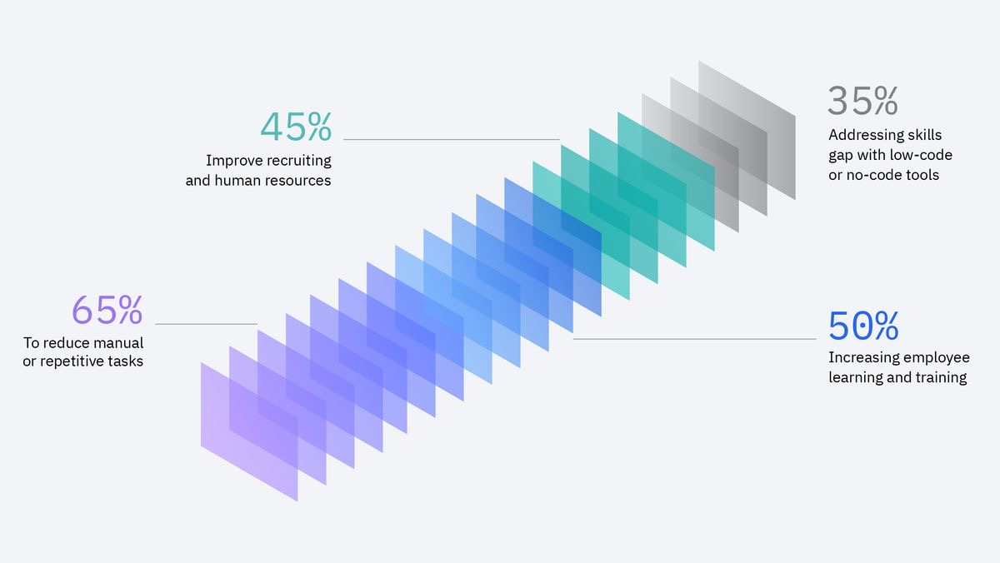

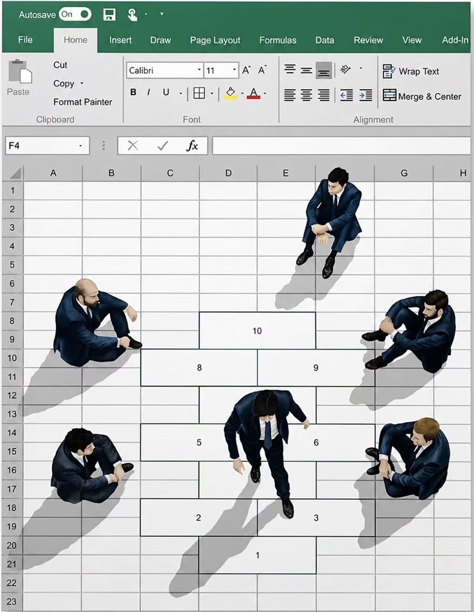


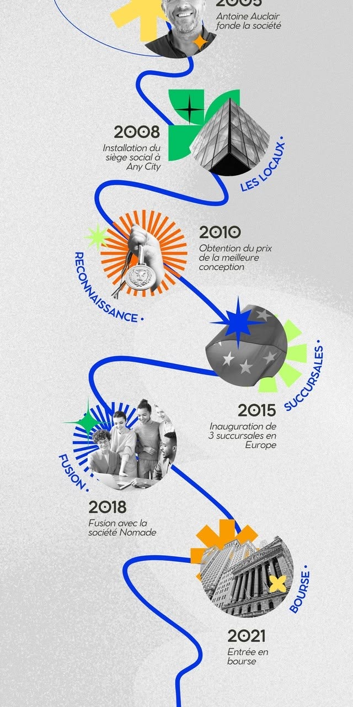


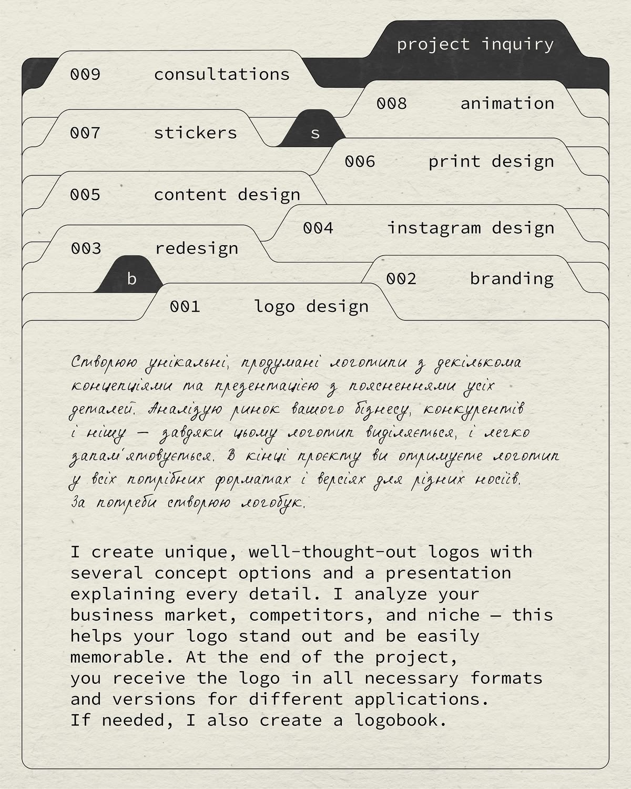

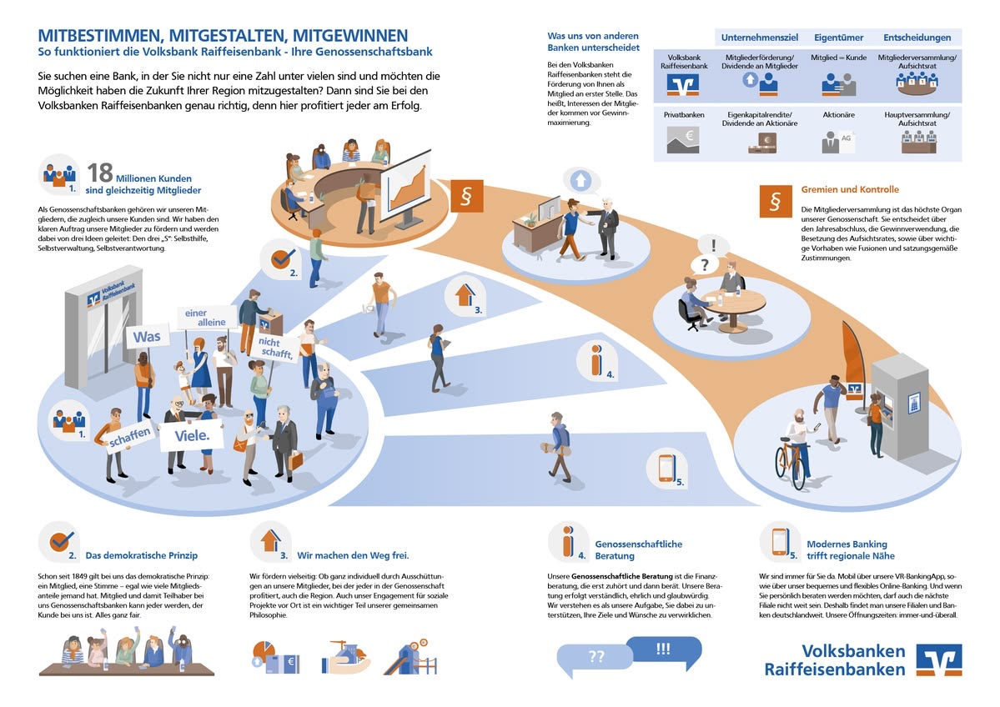

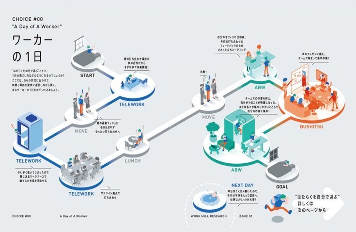

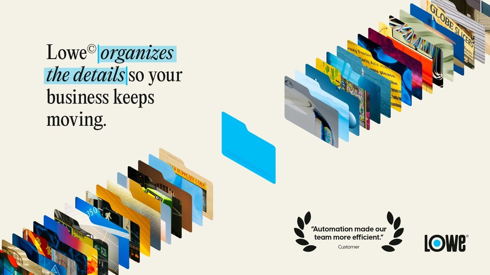

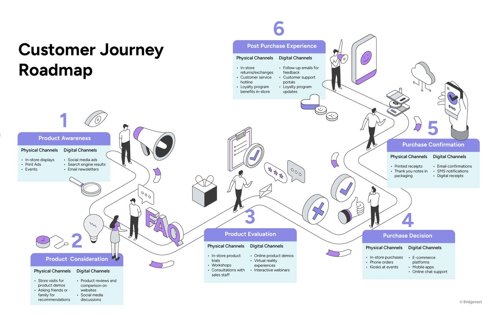

這些是部分看到覺得不錯的你先參考還有很多

### 🤖 GPT

喔——這批圖一放上來，我就比較確定你喜歡的其實**不是一般「漂亮的 UI」**。你喜歡的是「資訊本身就是視覺構圖」：路徑、資料夾、堆疊、人物、節點、空間感，把抽象資訊變成一幅可以探索的畫面。
而且這個方向跟「五年學習歷程」非常合。
我先不要急著定色票，因為你說後面還有很多。現在先把這 10 張裡值得偷師的「設計語言」拆出來。

## 我從這批圖看到了 5 個很明顯的共同點
**第一個是「路徑感」。** 你傳的藍線時間軸、日系 Worker 路線圖、Customer Journey 都不是傳統一格一格的表格，而是讓眼睛**沿著一條路走**。
這個我認為可以直接變成你們網站最重要的視覺語言：

> 專一 → 專二 → 專三 → 專四 → 專五 → 升學／實習／就業
而且不是一條死板直線。
可以像你第 4、8、10 張那樣有轉彎、分岔、節點、停靠站。

---
**第二個是「把抽象資料變成實體」。**
這點超適合資管。
你傳的圖不是寫：

> 文件很多。
而是直接給你看**一整片資料夾**。
不是寫：

> 層級很多。
而是把資料真的**一層一層疊起來**。
不是寫：

> 有不同工作階段。
而是讓人物真的「走過去」。
所以我們可以把：
「課程」→ 一本／一張資料頁 「作品」→ 文件卡 「證照」→ 徽章或票券 「學年」→ 一個區域 「目標校系」→ 終點站 「缺漏」→ 路徑上的空位 「五年累積」→ 越來越完整的資料庫／檔案櫃
這會比普通 icon + card 有意思很多。

---
**第三個是「超現實比例」。**
我特別注意到你傳的 Excel 人物、資料夾海、蜂巢人物。
人物非常小，資訊物件非常大。
這會產生一種：

> **「人正在資料裡面行走」**
的感覺。
這個概念我甚至覺得可以成為你們首頁第一屏。

### 「五年，我們會留下多少東西？」
一個小小的學生站在畫面中央。
周圍是巨大化的：

```
📁 課程
📁 作品
📁 證照
📁 活動
📁 競賽
📁 專題
📁 實習
```
遠處是一大堆散亂資料。
學生開始往前走。
Scroll ↓
這些東西慢慢被整理、分類、串起來。
最後形成：
**「我的五年學習歷程」**
這樣不用寫一大段「本系統旨在解決……」，訪客光看動畫就懂你們為什麼做這套系統。

---
**第四個是「編輯設計感」。**
你那張藍線時間軸跟資料夾 Tab 的圖很關鍵。
它們不像網站模板。
比較像：

> 雜誌 × 海報 × 資訊設計 × 網頁
所以我現在反而不建議學生端全部都是：

```
╭────────╮ ╭────────╮ ╭────────╮
│ CARD   │ │ CARD   │ │ CARD   │
╰────────╯ ╰────────╯ ╰────────╯
```
我們可以大量利用：
**超大年份、細線、Tab、編號、局部照片、裁切圖片、手繪路線、不同方向文字、留白。**
例如：

```
04
專四
────────────────────────────

                 ╭─────── PROJECT 07
     ╭──────╮    │ 資管科智慧學習歷程
     │證照  │────●
     ╰──────╯       \
                     \
          2026        ● 實習
                       \
                        ◎ YOU ARE HERE
```
這就開始有作品味了。

---
**第五個，也是我最喜歡的：資料夾 Tab。**
你傳的第 6 張其實可以直接影響學生端。
因為「學習歷程」本來就是在整理資料。
所以學生的五年甚至可以設計成：

```
╭──── 專五 ────────────────────────────╮
│ ╭──── 專四 ───────────────────────╮ │
│ │ ╭──── 專三 ──────────────────╮ │ │
│ │ │ ╭──── 專二 ─────────────╮ │ │ │
│ │ │ │ ╭──── 專一 ────────╮ │ │ │ │
│ │ │ │ │                  │ │ │ │ │
│ │ │ │ │    我的第一年     │ │ │ │ │
```
點「專四」。
整個專四資料夾抽出來。
裡面：
**COURSE / PROJECT / CERTIFICATE / ACTIVITY / REFLECTION**
再點 PROJECT。
作品像紙張一張張抽出來。
這種互動其實很符合「檔案／歷程」這個主題，而不是為藝術而藝術。

---

# 所以我現在反而想改掉之前那個「五年成長地圖」
不是不要五年成長，而是不要做成常見的：

> ●━━━━●━━━━●━━━━●
太普通了。
我現在比較想做成一個**會變形的五年資訊旅程**。
公開首頁可能是：

### 第一幕：混亂
學生站在巨大的「資料海」裡。

> **五年，會留下很多東西。**
散落的作品、證照、課程、活動。
↓

### 第二幕：整理
資料開始像你第一張圖一樣，一層一層堆疊、排列。

> **但留下，不等於整理。**
↓

### 第三幕：五年
畫面開始出現那條不規則的藍色路徑：
**01 專一 → 02 專二 → 03 專三 → 04 專四 → 05 專五**
每一站都有資管科該年的課程、活動、建議累積項目。
而且這部分就是你說的：

> **管理員可以修改。**
↓

### 第四幕：目的
五年路徑突然分成三條：

```
                    大學校門
                  ／ 二技升學
                 ／
五年資料 ━━━━━━◎━━━━ 公司
                 ＼   實習
                  ＼
                    工作
                    就業
```

> **累積不是終點，是為了知道下一站怎麼走。**
↓

### 第五幕：系統
所有東西最後收進一個巨大的資料夾。
**資管科智慧學習歷程系統**
`開始我的五年 →`
我覺得這個首頁如果真的做出來，跟同班「Bootstrap Navbar + Hero + 三張特色卡 + Footer」會完全不是同一個東西。

---

## 但有一件事我要幫你踩煞車 😂
你這些圖**不能全部混在一起**。
因為目前裡面其實有：
3D 商業風、Editorial、日系資訊圖、企業 Infographic、超現實攝影、插畫。
全部拿會變成大雜燴。
所以最後一定要挑出一套**主要美術語言**。
目前看這 10 張，我暫時最看好：

> **Editorial 資訊設計 × 路徑圖 × 資料實體化 × 少量超現實**
而不是 3D 科技風。
也就是你那張：
**藍色彎曲時間軸**
＋
**米白資料夾 Tab**
＋
**Lowe 那張層疊資料**
＋
**日系 Worker 路線圖**

## Turn 8: IMG\_2900\.jpeg IMG\_2899\.jpeg IMG\_2897\.jpeg IMG\_2896\.jpeg IMG\_2898\.jpeg IMG\_2895\.jpeg IMG\_2894\.jpeg IMG\_2893\.jpeg IMG\_2892\.jpeg IMG\_2891\.jpeg 這裡嗎還有

### 👤 田心于

*[This turn includes uploaded images]*

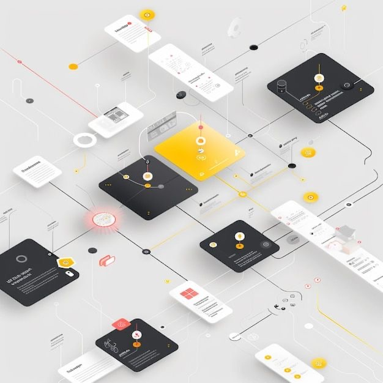

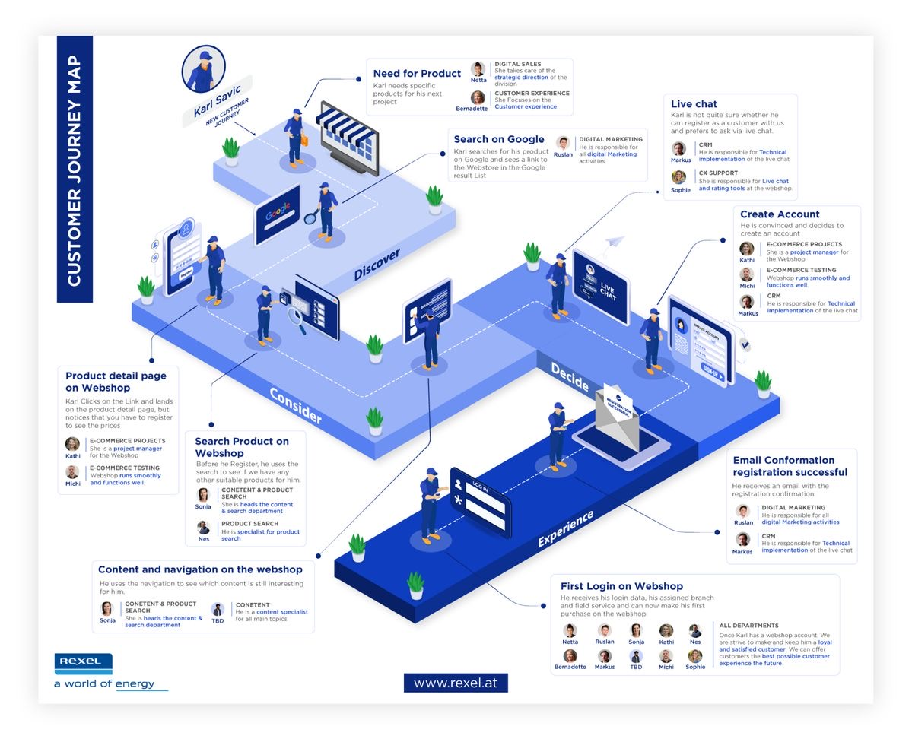

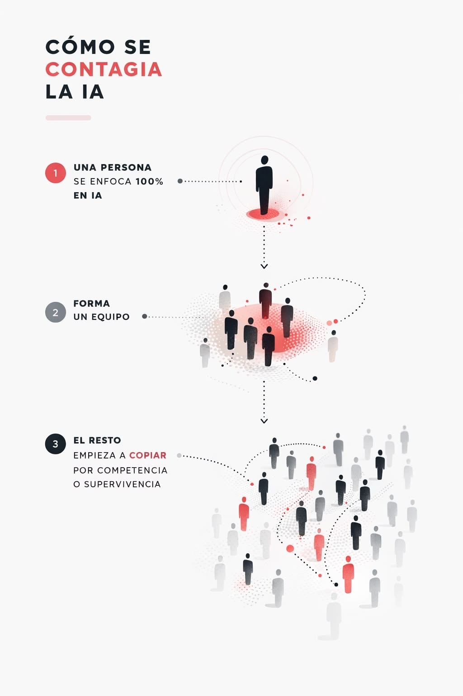

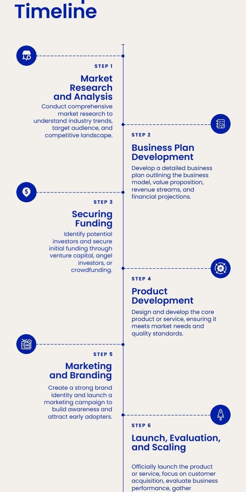


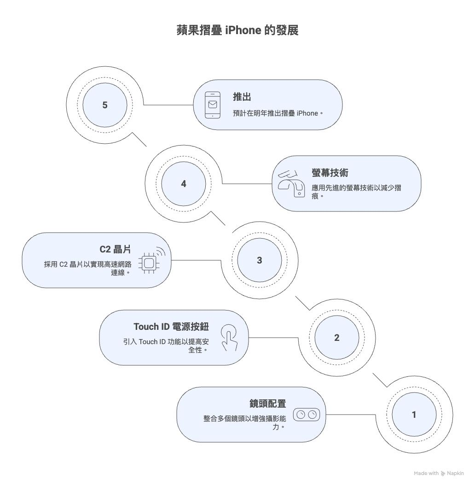

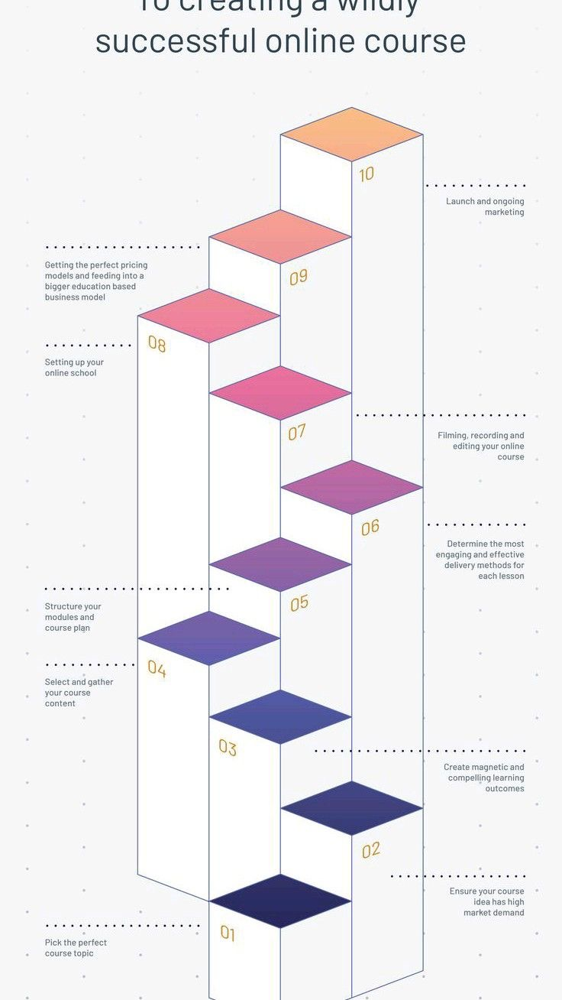

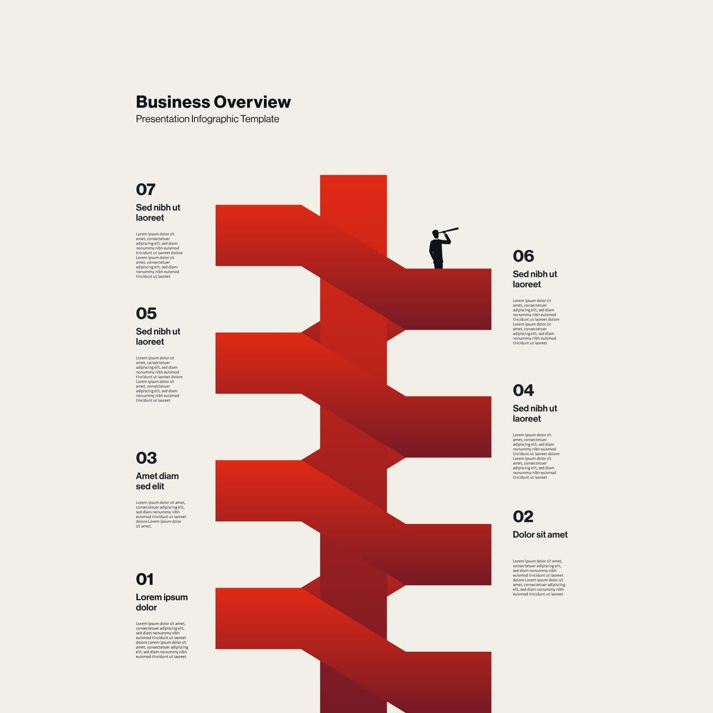

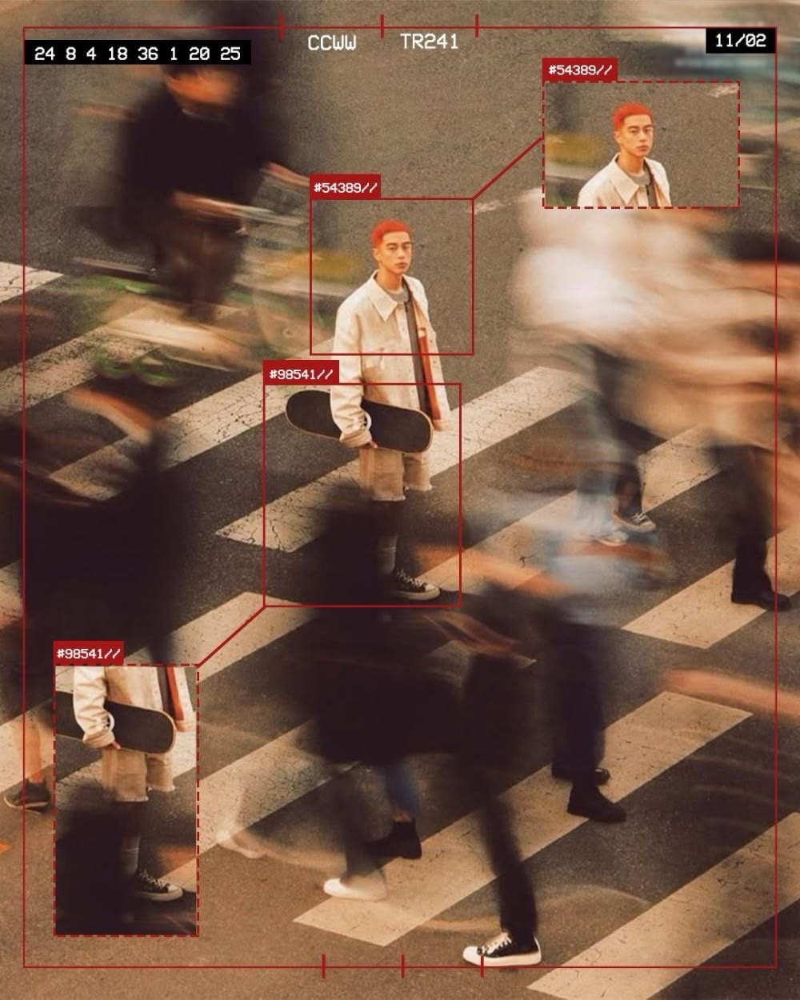

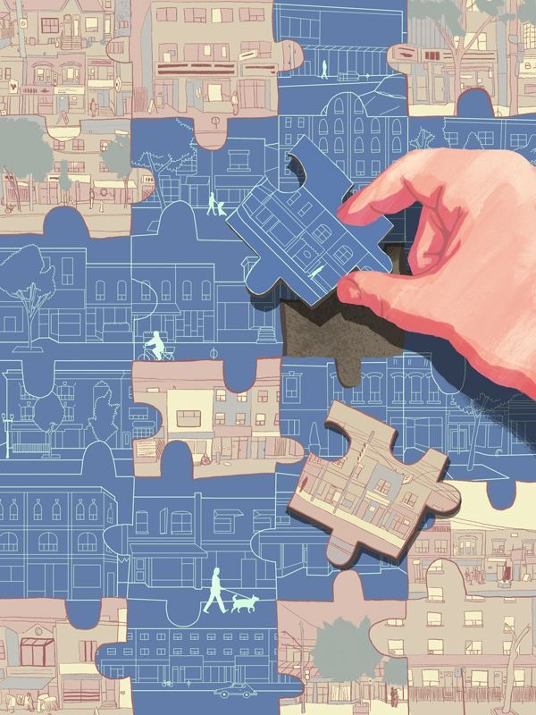

這裡嗎還有

### 🤖 GPT

有，而且這第二批讓我更確定一件事：**你不是在亂存「覺得漂亮的圖」而已，你的審美其實有固定規律。** 😂
前後 20 張放在一起後，我看到你一直在選的元素是：

> **路徑、連線、階段、堆疊、拼圖、人物在資訊空間裡移動、大片留白、少量強烈色彩，以及「一張圖就能說完一個故事」。**
所以我們現在先別急著選「藍色還是紫色」。真正該先定的是**這套系統的視覺概念**。

## 我現在最想採用：「把五年拼成自己的路」
你最後那張「拼圖」其實把前面很多概念串起來了。
學習歷程本身就是：
**課程 + 作品 + 證照 + 活動 + 競賽 + 專題 + 實習 + 成績 + 反思**
這些東西單獨看都只是一小塊。
但五年後，它們會拼成：

> **「我是怎樣的一個資管學生？」**
而你們系統真正做的，就是幫學生不要把這些拼圖弄丟。
所以我甚至想把整套網站的核心視覺語言變成：

### 「Piece × Path × Archive」
**拼圖 × 路徑 × 檔案**
三個元素各自負責不同事情。

| 視覺 | 代表什麼 | 用在哪 |
| --- | --- | --- |
| 拼圖 Piece | 一件學習成果 | 作品、證照、課程、活動 |
| 路徑 Path | 五年的成長 | 專一～專五、未來方向 |
| 檔案 Archive | 被整理保存的成果 | 個人歷程、作品集、備審 |

這樣網站就開始有「自己的世界觀」了。

---

# 而且第二批有一張，我現在非常想偷它的「概念」
就是第一張那個：
**很多 UI 浮在空間裡，彼此用細線連接。**
不是照抄它的黑黃配色，而是它的空間概念非常適合首頁。
我腦中現在的首頁第一屏會是：
左邊超大字：

# 五年，

# 不該散落在五十個地方。
下面：

> 課程、作品、證照、競賽、專題、實習。 把每一段經歷留下，慢慢拼成自己的方向。
右邊是一個很大的「資料宇宙」。
很多東西漂浮：

```
      [會計丙級]
            ╲
[GitHub] ─── ● ─── [網頁設計]
              ╲
          [專題成果]
              │
          [實習經歷]
              │
             YOU
```
滑鼠移過去，線會微微亮。
點「網頁設計」，那張資料卡稍微浮起。
**不是純裝飾，甚至可以真的點。**

---

# 接著 Scroll 下去，畫面開始「整理」
這就可以借第一批那個資料夾海、透明堆疊。
原本散落的東西：

```
證照     GitHub

       報告

 實習           課程

        專題
```
慢慢被吸進五個區域：
**專一 / 專二 / 專三 / 專四 / 專五**
然後一句：

> **所以我們做的，不只是另一個上傳檔案的地方。**
再下一幕：

# 我們想把五年，看得見。
這時候才正式進入五年旅程。

---

## 五年旅程，我現在不想用普通 Timeline 了
你第二批裡有「階梯」、「等角 3D Journey Map」、「斜向 iPhone 發展圖」。
我會把三個混合。
不是：

```
專一 ●──● 專二──● 專三
```
而是像一個**五層空間**：

```
                               ╭──────────╮
                               │ 05 專五  │ → 下一站
                         ╭─────╯          │
                         │ 04 專四        │
                   ╭─────╯                │
                   │ 03 專三              │
             ╭─────╯                      │
             │ 02 專二                    │
       ╭─────╯                            │
       │ 01 專一                          │
───────╯
```
但不要真的做得像 PowerPoint 階梯圖。
每一層都是一個小場景。

### 01 專一
小人物第一次走進資管科。
旁邊散著：
`程式基礎` `資訊概論` `第一份作品`

### 02 專二
開始出現更多文件與作品。

### 03 專三
GitHub、證照、競賽開始進來。

### 04 專四
專題、實習、專業課程。

### 05 專五
所有資料開始聚集。
然後——

---

# 這裡可以出現整個網站最漂亮的一幕
五年的階梯走完。
但是道路沒有結束。
畫面分岔。

```
                         ◯ 二技
                       ╱
              ╭───────
YOU ──────────●────────── ◯ 實習
              ╰───────
                       ╲
                         ◯ 就業
```
學生以前累積的拼圖開始飛過來。
例如選：

### 「二技升學」
畫面開始重新組合：
`成績` + `證照` + `專題` + `競賽` + `作品`
拼成：
**我的備審準備度**
然後系統告訴他：

> 你已經有這些。 還可以補上這些。
這就把你們三大特色完全串起來了：
**五年養成 → 目標導航 → AI 備審助手**
而不是三個互不相干的功能。

---

# 你第二批的「人物偵測」圖也很有意思
不是要拿紅框真的偵測學生 😂。
我要的是它的 **Focus（聚焦）概念**。
比如學生有：
**47 件資料。**
普通系統：

> 共 47 筆。
我們可以做：
很多作品縮圖在背景快速掠過、模糊。
系統把其中幾個框出來：

```
┌────────────┐
│ 畢業專題   │ ← 與目標高度相關
└────────────┘

          ┌────────────┐
          │ 網頁作品   │ ← 可加入備審
          └────────────┘
```
然後：

> **資料很多。真正重要的是，現在需要哪一些。**
這就很適合「目標校系導航」。

---

# 拼圖甚至可以真正成為「完成度」
這比圓餅圖有記憶點很多。
學生進來看到：

```
╭───╮╭───╮
│ ✓ ││ ✓ │╭───╮
╰─╮ ╰╯ ╭─╯│ ? │
  │    │  ╰─╮ ╰
╭─╯ ╭──╯    │
│ ✓ │   空白 │
╰───╯       ╯
```
完成一件重要歷程：
**啪。**
一片拼圖補上。
不是遊戲那種 +500 XP。
而是一句：

> **又留下了一塊。**
這個其實滿有情緒價值。
等專五：

> **五年前還是空白的。**
然後顯示完整拼圖。
我覺得這甚至可能成為畢業時很漂亮的畫面。

---

## 但現在我要把「藝術區」跟「工作區」正式分開
看完你兩批圖，我更確定不能整站這樣搞。
否則老師查 39 個學生會瘋掉 😂。
所以我會定一條非常明確的線：

### EXPERIENCE LAYER — 體驗層
**訪客首頁、學生首頁、五年歷程、個人作品集**
可以使用：
大面積留白、超大字、路徑、拼圖、等角視圖、人物、圖片裁切、Scroll 動畫、資料堆疊。
這裡負責：

> **讓人記住你們。**

### WORK LAYER — 工作層
**資料編輯、成績輸入、教師、行政、審查**
回到非常乾淨的介面：

```
搜尋學生 __________________ 🔍

班級：資五忠 ▾     狀態：待補 ▾

姓名       歷程       缺件       最近更新
田○○      87%        2          09/14
張○○      100%       0          09/12
林○○      61%        5          08/27
```
但是字體、線條、色彩、Tab、按鈕仍然沿用同一套品牌。
這裡負責：

> **讓人願意工作。**

---
而且現在我已經不太擔心你說「大家都是 AI 做的網站所以長一樣」了。
如果你真的把這套視覺邏輯建立起來，即使**程式碼有 AI 協助寫**，成品也不會像「AI 幫我生成一個學習歷程網站」。
因為 AI 最容易生成的是元件。
**最難生成的是一套有理由的視覺隱喻。**
你現在其實已經慢慢找到那個理由：

> **五年裡散落的每一塊資料，被整理、連接、累積，最後拼成學生自己的下一站。**
這句我會暫時把它當成整個 UI 的「母概念」。
你後面還有圖的話可以**繼續全部丟過來，不用挑得很精準**。我現在反而希望先看完整批，再幫你做最後一次篩選：哪些只能當靈感、哪些真的適合做成網站、哪些會太難實作、哪些值得變成你們專題的「招牌畫面」。等看完，我們再定稿，不會現在就急著鎖死風格。

## Turn 9: 目前先這些，先做可以抓住評審老師們眼睛一亮的設計理念，同事也是最先進老師們心目中的學習歷程檔案最美好的型態

### 🤖 GPT

對，我覺得現在可以正式收斂了。
看完你挑的兩批參考圖，我反而不想把目標定成「做一個很漂亮的學習歷程網站」，那還是不夠準確。我會把設計目標定成：

> **讓評審第一次看到時覺得「這不像學生常見的 AI 模板」；真正操作後，又覺得「如果學習歷程本來就長這樣，我會願意用」。**
也就是**第一眼靠藝術性抓住人，第二眼靠資訊設計讓人理解，真正使用時靠好操作留下人。**

## 核心設計理念：「把五年，拼成下一站。」
這句我認為可以直接成為你們整套 UI/UX 的母題。
學生五年間產生的成績、課程、作品、證照、競賽、活動、專題、實習，本來都是散落的「碎片」。
系統不是單純幫他：

> 上傳 → 儲存 → 下載。
而是經歷：

> **留下 → 整理 → 連接 → 看見成長 → 發現缺口 → 對照目標 → 前往下一站。**
因此，你挑的參考圖裡其實可以抽出四種視覺元素，而且每一種都有「功能意義」，不是裝飾。

| 視覺語言 | 系統裡代表 |
| --- | --- |
| **拼圖 Piece** | 每一件課程、作品、證照、活動 |
| **路徑 Path** | 專一到專五的五年成長 |
| **節點 Node** | 重要事件、里程碑、現在的位置 |
| **檔案 Archive** | 五年資料被整理、保存並重新使用 |

這樣就會有非常強的一致性。

---

# ① 評審第一眼：先不要介紹功能
首頁第一屏我甚至不想放：

> 資管科智慧學習歷程系統 本系統提供學生學習歷程管理……
太浪費第一印象了。
我想像的是整個螢幕有非常大量的留白，中央只有一個很小的學生人物。
四周漂浮著：
**成績單、GitHub、專題、證照、課堂作品、競賽、實習、Canva……**
彼此沒有連在一起。
左側非常大的文字：

# 五年，

# 會留下很多東西。
下面小字：

> 但真正重要的，不只是把它們留下。
`↓ 往下看看`
這時評審甚至還不知道你們所有功能。
**但他會想往下滑。**
這就成功一半了。

---

# ② 第一個動畫：「混亂 → 被整理」
往下 Scroll。
原本漂浮的東西開始移動。
細細的線開始把它們連起來。
一部分成為：
**專一**
一部分成為：
**專二**
然後專三、專四、專五。
畫面中央出現：

# 留下，只是第一步。

> 五年的學習，如果沒有整理、方向與持續累積，最後仍然只是一堆檔案。
然後所有資料逐漸形成一條路。
這裡就可以大量吸收你喜歡的：
**透明堆疊＋資料節點＋細線＋立體空間。**

---

# ③ 接下來才出現「資管五年」
這裡會是公開首頁最漂亮的一段。
不是普通 Timeline。
我比較希望像你傳的 **Customer Journey × 日本路線圖 × 階梯資訊圖**。
例如：

```
01
專一
探索
        ╲
         ╲______
                ●───── 02
                      專二
                      累積
                         ╲
                          ╲
                           ●──── 03
                                專三
                                找到方向
                                   ╲
                                    ●──── 04
                                         專四
                                         做成能力
                                            ╲
                                             ◎
                                             專五
                                             準備出發
```
但正式版會有小人物、課程、作品、電腦、證照、專題等插畫元素。
而且這不是寫死。
**管理員可以修改每一年：**
重要課程、推薦證照、活動、專題、該年建議完成事項。
所以訪客第一次來，甚至可以把這網站當：

> **「康寧資管五專五年到底在學什麼？」**
來看。
這非常棒，因為你原本說「希望訪客也能理解本校資管科五年的規劃」，現在它和藝術設計融合了。

---

# ④ 五年走完，畫面第一次「分岔」
這會是我很希望評審記住的第二個畫面。
專五不是終點。
路突然分成三條：

### 升學
二技校系

### 實習
企業與職場體驗

### 就業
能力與職缺
中間寫：

# 五年不是終點。

## 是你開始選擇下一站的地方。
這時候前面五年的資料，開始沿著不同路線重新排列。
這件事情其實就在視覺上解釋你們的「目標導航」。

---

# ⑤ 然後做一個很漂亮的「聚焦」
例如學生選：

> 國立臺北商業大學 ○○系
原本畫面裡有 40 件五年資料。
其他東西慢慢淡掉。
其中：
**成績、程式作品、證照、專題、競賽**
被框起來。
就像你之前傳的那張「人群中辨識人物」的構圖。
畫面寫：

> **你已經累積很多。 現在，看看哪些能帶你到下一站。**
這時 AI 才第一次登場。
不是：

# 🤖 AI 智慧分析系統
而只是：

> ✦ **幫我看看還少什麼**
按下去才顯示：

> 目前已經有專題成果與程式作品。 如果要準備這個目標，還有 2 項資料值得補充。
這樣 AI 反而顯得更高級。

---

# ⑥ 登入學生端：公開首頁的藝術「變成自己的」
這點我覺得會很驚艷。
訪客看到的是：

> **資管科五年路線**
學生登入以後看到的是：

> **我的五年路線**
同一套設計語言。
但是內容全部換成他自己。
例如：

# 田同學的第四年
畫面上的節點不是假的插圖，而是真的：
**2024 網頁作品** **2025 會計證照** **2025 競賽** **2026 專題** **2026 實習**
所以每個學生的畫面都不完全一樣。
這就是我覺得非常漂亮的地方：

> **UI 本身會隨著學生五年的累積一起長大。**
專一時可能很空。
專三開始豐富。
專五真的會是一張很漂亮、很完整的「人生小地圖」。

---

# ⑦ 「缺漏」也成為視覺的一部分
不要一直：
🔴 未完成 ⚠️ 缺件 ⚠️ 缺件 ⚠️ 缺件
可以做成：

# 你的第五年，還有兩塊空白。
拼圖裡真的有兩塊是空的。
滑鼠移上去：

> **專題反思** 還沒有留下
點它就直接編輯。
補完後：
那一塊拼進去。
微小動畫。

> **又留下了一塊。**
這就是我認為「用得開心」應該做到的程度。
不是遊戲化到：

> +200 EXP！🎉🔥
而是**有回饋、有成就，但仍然成熟。**

---

# ⑧ 老師看到學生時，也可以看到「這個人」
這是我現在想到更理想的一點。
老師不要只看到：

> 田○○ 87%
點學生以後，可以先看到一張縮小版的「五年地圖」。
老師一眼就知道：

> 喔，她專二幾乎沒東西；專三突然很多；專四有專題但是沒有證照。
再往下才是正式資料表。
這比單純「完成率 87%」資訊更多。
而老師真正要大量工作的：
批次提醒、學生名單、缺件、搜尋、篩選、成績、審核，
全部回到普通乾淨 UI。
所以不會藝術到難用。

---

# ⑨ 行政端也不是完全放棄藝術
行政首頁可以保留「節點網路」概念。
但是縮到很理性：

```
學生 ──── 作品
  │         │
  │       教師
  │         │
審查 ──── 委員
  │
升學資料
```
哪個節點有待處理，就出現小提示。
真正點進去，還是正常：
**表格 / 搜尋 / 篩選 / 編輯 / 新增 / 刪除。**
這樣品牌不會斷掉。

---

# ⑩ 還有一個很重要：五年後的「最後一頁」
如果真的做到完整版本，我會很想加。
學生專五準備離開時：

# 你的五年，整理好了。
然後系統慢慢顯示：
**37 件作品** **6 張證照** **3 次競賽／活動** **1 個畢業專題** **1 段實習經歷**
最後整張五年路線完整呈現。
可以進入：
**我的作品集**
或：
**準備下一站**
這會讓「五年不間斷使用」真正有頭有尾。

---

## 所以我現在會正式把視覺方向定成這樣
不是「科技藍 Dashboard」。
也不是「遊戲化學習平台」。
更不是「AI 紫色漸層網站」。
而是：

> ### **Interactive Editorial Learning Journey**
> **互動式資訊設計 × 五年成長旅程 × 個人數位檔案**
視覺氣質我會抓：
**70% 安靜、乾淨、成熟 20% 藝術與資訊視覺化 10% 驚喜互動**
這個比例很重要。
如果反過來變成 70% 藝術，五年真的會看膩。

---
而且你前面有一句話，我現在會稍微改一下。
不是：

> 「做得漂亮老師會少扣幾分。」
而應該讓評審產生：

> **「他們不是把功能做好之後再美化，而是真的思考過學習歷程『應該怎麼被看見』。」**
這兩個層次差很多。
你們的招牌也不必是「我們用了 AI」。
AI 大家都有。
真正的招牌可以變成：

# **把五年，拼成下一站。**
而 AI 只是藏在背後，幫學生把這條路走得更清楚。
我認為這已經很接近你說的——**老師心目中「如果學習歷程系統可以重新設計，我希望它本來就是這樣」的方向了。**

## Turn 10: 請把你跟我討論的這些網頁設計風格整合更新到雲端上最終版本和一個月版本

### 🤖 GPT

可以，已經直接更新到雲端的兩份文件，而且我確認這次修改的是**現在真正的「最終版」**，不是之前那份「最終版－舊版備份」。資管科智慧學習歷程系統－系統規格設計書（最終版）
我把剛才討論的 UI/UX 整合成正式的設計章節，核心統一為 **「把五年，拼成下一站。」**，並納入「拼圖 × 路徑 × 節點 × 檔案」、公開首頁故事式捲動、五年成長路線、升學／實習／就業分岔、學生個人五年歷程、缺漏拼圖、低存在感 AI 小助手，以及教師／行政工作區與藝術展示區分開等設計。
**最終版**寫的是完整理想型態，包括「你的五年，整理好了」畢業總結、個人化五年軌跡、完整公開首頁、長期使用原則等：
資管科智慧學習歷程系統－系統規格設計書（最終版）
**一個月版**則刻意縮小，保留最能讓評審眼睛一亮、但一個月比較有機會完成的四個視覺重點：**公開首頁五年路線＋學生五年路線＋目標分岔＋AI 缺漏建議**。複雜 3D、人物資料空間、大型拼圖動畫、畢業總結等都放到後續，不讓 UI 拖垮功能開發。原本一個月版就是以少量目標、6 個關卡及最小可運作流程為範圍，我沒有把它硬膨脹成完整版。資管科智慧學習歷程系統－系統規格設計書（一個月）
資管科智慧學習歷程系統－系統規格設計書（一個月）
而且這次我特別寫進一條很重要的原則：**藝術設計不能只是一張漂亮首頁海報，而要一路接到學生真正的目標、成果、關卡與 AI 建議。** 這樣之後我們開始寫網頁時，就可以直接拿這章當 UI 開發規格，而不是重新想一次。

---

*Exported from [Voyager](https://github.com/Nagi-ovo/voyager)*  
*Generated on September 21, 2026 at 02:39 PM*